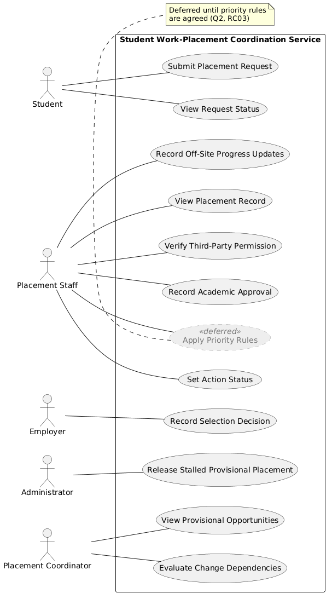
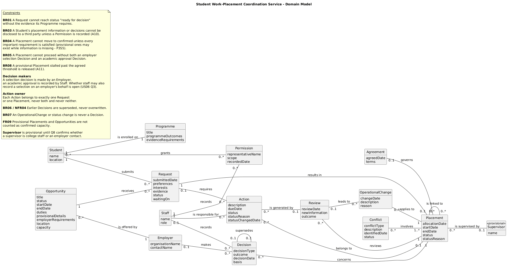

# 03 – Revised Analysis Baseline

## Purpose

This document is the agreed CA2 analysis baseline for Scenario 28 – Student Work-Placement Coordination Service. It was produced by applying the decisions in the [Reconciliation and Expansion Record](02-reconciliation-and-expansion-record.md) to the original Scenario 28 CA1 analysis. It covers the agreed scope, stakeholders, requirements, business rules, use cases, user stories, Gherkin and domain model, using the same identifiers as the CA1 so that every item stays traceable.

Items carried over unchanged keep their CA1 wording. Items that were changed, added or deferred are marked with the reconciliation, practice or expansion ID that caused the change e.g. *(changed: RC13)*, and every change is listed in the Change Log. This baseline is the reference point for the behavioural design, class model and CA3 slices that follow. Later changes are recorded as new decisions rather than overwriting it.

 

## 1. Scope

The initial release covers service coordination and records for the Kerry College Placement Office (CS1). The in-scope capabilities below are carried over from the CA1. Two now depend on decisions made during reconciliation, and one is partly deferred.

### In Scope for the Initial Release

| ID | Capability | Problem | Change |
| --- | --- | --- | --- |
| **IS1** | Placement Record Management | [PR1](../CA1/report/02-Purpose-Scope-Boundary.md#in-scope-and-out-of-scope-functions) | - |
| **IS2** | Request Tracking | [PR2](../CA1/report/02-Purpose-Scope-Boundary.md#in-scope-and-out-of-scope-functions) | - |
| **IS3** | Priority Management | [PR3](../CA1/report/02-Purpose-Scope-Boundary.md#in-scope-and-out-of-scope-functions) | Priority and exception rules deferred until the policy is agreed (deferred: [RC03](./02-reconciliation-and-expansion-record.md#scope-and-requirements), [EX03](./02-reconciliation-and-expansion-record.md#group-expansions)) |
| **IS4** | Authorisation Management | [PR4](../CA1/report/02-Purpose-Scope-Boundary.md#in-scope-and-out-of-scope-functions) |Uses the working assumption for third-party authority (changed: [RC04](./02-reconciliation-and-expansion-record.md#scope-and-requirements), [EX01](./02-reconciliation-and-expansion-record.md#group-expansions))  |
| **IS5** | Approval Decision Tracking | [PR10](../CA1/report/02-Purpose-Scope-Boundary.md#in-scope-and-out-of-scope-functions) | - |
| **IS6** | Capacity and Provisional Allocation Management | [PR5](../CA1/report/02-Purpose-Scope-Boundary.md#in-scope-and-out-of-scope-functions), [PR6](../CA1/report/02-Purpose-Scope-Boundary.md#in-scope-and-out-of-scope-functions) | Supervisor allocation recorded through a provisional Supervisor concept (added: [RC14](./02-reconciliation-and-expansion-record.md#scope-and-requirements)). Stalled threshold uses a working assumption (changed: [RC07](./02-reconciliation-and-expansion-record.md#scope-and-requirements), [EX02](./02-reconciliation-and-expansion-record.md#group-expansions)) |
| **IS7** | Linked Arrangements Tracking | [PR8](../CA1/report/02-Purpose-Scope-Boundary.md#in-scope-and-out-of-scope-functions) | - |
| **IS8** | Status and Ownership Tracking | [PR7](../CA1/report/02-Purpose-Scope-Boundary.md#in-scope-and-out-of-scope-functions) | - |
| **IS9** | Off-Site Progress Recording | [PR9](../CA1/report/02-Purpose-Scope-Boundary.md#in-scope-and-out-of-scope-functions) | - |

 

### Out of Scope for the Initial Release

| ID | Item | Reason | Ref |
| --- | --- | --- | --- |
| **OS1** | Specialist Professional Systems | Excluded by the scenario | [P5S6](../CA1/decisions/Scenario-Annotation/Annotated-Scenario.md) |
| **OS2** | Financial Accounting | Excluded by the scenario | [P5S6](../CA1/decisions/Scenario-Annotation/Annotated-Scenario.md) | 
| **OS3** | Public Website Functions | Excluded by the scenario | [P5S6](../CA1/decisions/Scenario-Annotation/Annotated-Scenario.md) |
| **OS4** | Negotiating Employer Legal Contracts | Contracts are negotiated outside the system; only the resulting placement agreements are recorded | [A1](../CA1/report/05-Rules-Uncertainty-Register.md#assumptions) |
| **OS5** | External Recruitment System Integration | The initial release can operate without it | [A2](../CA1/requirements/04-Requirements-Catalogue.md#functional-requirements) | 
| **OS6** | Student Academic Record Maintenance | Academic records stay in existing academic systems | [A3](../CA1/report/05-Rules-Uncertainty-Register.md#assumptions) |

 

### Dependencies

| Dependency (outside the service) | Needed for | Ref |
| --- | --- | --- |
| Academic record systems supply programme and enrolment information, including each programme's evidence requirements. | [FR01](../CA1/requirements/04-Requirements-Catalogue.md#functional-requirements), [BR01](../CA1/report/05-Rules-Uncertainty-Register.md#business-rules) | [A3](../CA1/requirements/04-Requirements-Catalogue.md#functional-requirements), [A5](../CA1/requirements/04-Requirements-Catalogue.md#functional-requirements), [OS6](../CA1/report/02-Purpose-Scope-Boundary.md#in-scope-and-out-of-scope-functions) |
| The data protection role sets clear guidelines on third party verification standards and information sharing rules. | [FR05](../CA1/requirements/04-Requirements-Catalogue.md#functional-requirements), [BR03](../CA1/report/05-Rules-Uncertainty-Register.md#business-rules), [NFR02](../CA1/requirements/04-Requirements-Catalogue.md#non-functional-requirements) | [A8](../CA1/requirements/04-Requirements-Catalogue.md#functional-requirements), [SH11](../CA1/decisions/Worked-Business-Problem/01_Stakeholders_And_Requirements.md#step-6-worked-stakeholder-analysis), [Q3](../CA1/report/05-Rules-Uncertainty-Register.md#clarification-questions), [Q7](../CA1/report/05-Rules-Uncertainty-Register.md#clarification-questions) |
| Employers review student applications and record selection decisions. | [FR06](../CA1/requirements/04-Requirements-Catalogue.md#functional-requirements), [BR05](../CA1/report/05-Rules-Uncertainty-Register.md#business-rules) | [SH4](../CA1/decisions/Worked-Business-Problem/01_Stakeholders_And_Requirements.md#step-6-worked-stakeholder-analysis), [P3S2](../CA1/decisions/Scenario-Annotation/Annotated-Scenario.md) |

 

### Constraints

Constraints now record their type and impact as well as their source (changed: PA04).

| ID | Constraint | Type | Source | Impact |
| --- | --- | --- | --- | --- |
| **CS1** | The initial release is limited to service coordination and records. | Scope | [P5S5](../CA1/decisions/Scenario-Annotation/Annotated-Scenario.md) | Bounds the in-scope list ([IS1–IS9](../CA1/report/02-Purpose-Scope-Boundary.md#in-scope-and-out-of-scope-functions)) and excludes [OS1–OS3](../CA1/report/02-Purpose-Scope-Boundary.md#in-scope-and-out-of-scope-functions) |
| **CS2** | The service must accommodate off-site staff operations where connectivity may be unrelaible | Environmental | [P5S4](../CA1/decisions/Scenario-Annotation/Annotated-Scenario.md) | Off-site progress must be recorded without a connection and reach the shared record later ([IS9](../CA1/report/02-Purpose-Scope-Boundary.md#in-scope-and-out-of-scope-functions), [FR12](../CA1/requirements/04-Requirements-Catalogue.md#functional-requirements), [NFR03](../CA1/requirements/04-Requirements-Catalogue.md#non-functional-requirements)) |
| **CS3** | External partners and funders must access only placement information relevant to their role, excluding unnecessary personal or commercially sensitive details. | Legal / data | [P5S2](../CA1/decisions/Scenario-Annotation/Annotated-Scenario.md), [P5S3](../CA1/decisions/Scenario-Annotation/Annotated-Scenario.md) | Restricts what is shared and reported ([NFR01](../CA1/requirements/04-Requirements-Catalogue.md#non-functional-requirements), [NFR02](../CA1/requirements/04-Requirements-Catalogue.md#non-functional-requirements), [BR03](../CA1/report/05-Rules-Uncertainty-Register.md#business-rules), [Q7](../CA1/report/05-Rules-Uncertainty-Register.md#clarification-questions)) |
| **CS4** | The service starts from records currently held in separate files. | Transition | [P1S2](../CA1/decisions/Scenario-Annotation/Annotated-Scenario.md), [P4S1](../CA1/decisions/Scenario-Annotation/Annotated-Scenario.md) | Existing records must be brought into the single shared placement record ([IS1](../CA1/report/02-Purpose-Scope-Boundary.md#in-scope-and-out-of-scope-functions)) |

 

## 2. Stakeholders and Actors

Stakeholders are everyone with an interest in the service. Actors are the roles that interact with it directly across the system boundary. The stakeholder and actor decisions from the CA1 are carried over. Three reconciliation decisions affect how some stakeholders are represented in the domain model, but no actor has been added or removed.

### Stakeholder Catalogue

| ID | Ref | Stakeholder | Goals | Concerns | Influence | Classification |
| :--- | :--- | :--- | :--- | :--- | :--- | :--- |
| **SH1** | [P2S1](../CA1/decisions/Scenario-Annotation/Annotated-Scenario.md), [P2S3](../CA1/decisions/Scenario-Annotation/Annotated-Scenario.md), [P2S5](../CA1/decisions/Scenario-Annotation/Annotated-Scenario.md), [P6S2](../CA1/decisions/Scenario-Annotation/Annotated-Scenario.md) | **Student** | Know what their request is waiting on and track application progress. | Delayed or lost applications and inconsistent decision-making across similar cases. | Medium | Direct |
| **SH2** | [P2S4](../CA1/decisions/Scenario-Annotation/Annotated-Scenario.md), [P2S7](../CA1/decisions/Scenario-Annotation/Annotated-Scenario.md), [P3S7](../CA1/decisions/Scenario-Annotation/Annotated-Scenario.md), [P4S1](../CA1/decisions/Scenario-Annotation/Annotated-Scenario.md)  | **Placement Staff** | Process requests smoothly, verify student evidence without searching separate files, and maintain evidence of current and earlier decisions and versions. | Spending time searching across separate records, uncertainty over third-party authority, and loss of earlier decisions or versions. | High | Direct |
| **SH3** | [P2S6](../CA1/decisions/Scenario-Annotation/Annotated-Scenario.md), [P2S7](../CA1/decisions/Scenario-Annotation/Annotated-Scenario.md) | **Third-Party Representative** | Help students with applications and get updates on their progress. | Being refused information or delayed due to unclear permissions. | Medium | External |
| **SH4** | [P2S2](../CA1/decisions/Scenario-Annotation/Annotated-Scenario.md), [P3S2](../CA1/decisions/Scenario-Annotation/Annotated-Scenario.md), [P3S6](../CA1/decisions/Scenario-Annotation/Annotated-Scenario.md) | **Employer** | Select suitable students for placement openings and confirm placement duties. | Changing opportunity details or unmanaged changes to linked arrangements. | High | External |
| **SH5** | [P3S5](../CA1/decisions/Scenario-Annotation/Annotated-Scenario.md), [P3S6](../CA1/decisions/Scenario-Annotation/Annotated-Scenario.md), [P5S1](../CA1/decisions/Scenario-Annotation/Annotated-Scenario.md) | **Placement Coordinator** | Keep track of unallocated requests, provisional arrangements, capacity conflicts, overdue actions, and incomplete records. | Held provisional capacity and unmanaged knock-on effects from changes. | High | Direct |
| **SH6** | [P5S2](../CA1/decisions/Scenario-Annotation/Annotated-Scenario.md), [P6S4](../CA1/decisions/Scenario-Annotation/Annotated-Scenario.md) | **External Partners** | Receive information needed for their role without receiving unnecessary details. | Seeing inappropriate or extra information outside their role. | Medium | External |
| **SH7** | [P4S1](../CA1/decisions/Scenario-Annotation/Annotated-Scenario.md), [P5S3](../CA1/decisions/Scenario-Annotation/Annotated-Scenario.md) | **Management** | Access summary information about overall placement activity. | Fragmented progress records making summary views difficult to gather. | High | Indirect |
| **SH8** | [P5S3](../CA1/decisions/Scenario-Annotation/Annotated-Scenario.md) | **Funders** | Receive high-level summary reports about placement activity without sensitive data. | Receiving unnecessary personal or commercially sensitive information **([A4](../CA1/report/05-Rules-Uncertainty-Register.md#assumptions))**. | Medium | External |
| **SH9** | [P3S5](../CA1/decisions/Scenario-Annotation/Annotated-Scenario.md), [P6S3](../CA1/decisions/Scenario-Annotation/Annotated-Scenario.md) | **Administrator** | Identify and release stalled provisional arrangements to free up capacity. | Stalled provisional allocations blocking capacity needed by other students. | Medium | Direct |
| **SH10** | [P4S5](../CA1/decisions/Scenario-Annotation/Annotated-Scenario.md), [P6S5](../CA1/decisions/Scenario-Annotation/Annotated-Scenario.md) | **Reviewer** | Add new information and decisions without erasing the basis of earlier decisions. | Losing the original record or reasons behind earlier decisions when new information is added. | Medium | Indirect |
| **SH11** | [P2S7](../CA1/decisions/Scenario-Annotation/Annotated-Scenario.md), [P5S2](../CA1/decisions/Scenario-Annotation/Annotated-Scenario.md), [P5S3](../CA1/decisions/Scenario-Annotation/Annotated-Scenario.md), [A8](../CA1/report/05-Rules-Uncertainty-Register.md#assumptions) | **Data-Protection Officer** | Ensure placement information is shared only with authorised parties and only as much as each role requires. | Detailed student information or decisions being disclosed without the required authority, or summary reporting exposing unnecessary personal or commercially sensitive information. | High | Indirect |
| **SH12** | [P1S2](../CA1/decisions/Scenario-Annotation/Annotated-Scenario.md), [P3S3](../CA1/decisions/Scenario-Annotation/Annotated-Scenario.md), [P3S6](../CA1/decisions/Scenario-Annotation/Annotated-Scenario.md), [A9](../CA1/report/05-Rules-Uncertainty-Register.md#assumptions) | **Supervisor** | Know which placements they are allocated to and be informed when an allocation changes. | Being allocated to clashing placements, or changes to linked arrangements altering their allocation without notice. | Medium | Indirect |

 

### Actor Catalogue

| Actor or Stakeholder | Type | Goal or Interest | Change |
| --- | --- | --- | --- |
| Student | Primary actor | Submit placement preferences and programme evidence, and view the current status of their placement request. | — |
| Placement Staff | Primary actor | View the shared placement record, apply priority rules, verify third-party permissions, record academic approval decisions, set action status and record progress updates off-site. | "Activity" renamed to "action" (changed: [RC11](./02-reconciliation-and-expansion-record.md#use-cases)). Priority rules deferred (deferred: [RC03](./02-reconciliation-and-expansion-record.md#scope-and-requirements)) |
| Employer | Primary actor | Record selection decisions for student applications. | — |
| Placement Coordinator | Primary actor | View provisional placement opportunities and the dependencies between connected arrangements. | — |
| Administrator | Primary actor | Release stalled provisional placements to free capacity for other students. | "Allocation" renamed to "provisional placement" (changed: [RC11](./02-reconciliation-and-expansion-record.md#use-cases)) |
| Third-Party Representative | Offstage stakeholder | Legitimate helpers are not refused or delayed when acting for a student. | Permission now modelled in the domain (added: [RC15](./02-reconciliation-and-expansion-record.md#domain-model)) |
| External Partners | Offstage stakeholder | Partners receive only the information required for their role. | — |
| Management | Offstage stakeholder | Reliable summary information on placement activity is available. | — |
| Funders | Offstage stakeholder | Summary reporting does not expose unnecessary personal or commercially sensitive information. | — |
| Reviewer | Offstage stakeholder | The basis of earlier decisions is preserved when new information is added. | — |
| Data-Protection Officer ([A8](../CA1/report/05-Rules-Uncertainty-Register.md#assumptions)) | Offstage stakeholder | Placement information is shared only with authorised parties, and only as much as their role requires. | — |
| Supervisor ([A9](../CA1/report/05-Rules-Uncertainty-Register.md#assumptions)) | Offstage stakeholder | Supervisor allocations are recorded accurately, and changes affecting them are visible. | Provisional Supervisor concept added to the domain model, pending [Q8](../CA1/report/05-Rules-Uncertainty-Register.md#clarification-questions) (added: [RC14](./02-reconciliation-and-expansion-record.md#domain-model)) |

 

### Actor Decisions

The reasoning for each actor decision is unchanged from the CA1 ([CA1 Stakeholder and Actor Catalogue](../CA1/decisions/Worked-Business-Problem/01_Stakeholders_And_Requirements.md#step-6-worked-stakeholder-analysis)). In summary:

- **Student** covers the scenario's "service user" ([A6](../CA1/report/05-Rules-Uncertainty-Register.md#assumptions)).
- **Placement Staff, Placement Coordinator and Administrator** stay separate actors because each has different goals and use cases. In the domain model they are represented by one Staff class with a role, because the domain needs to remember who owns an action and who recorded a decision (accepted: [RC16](./02-reconciliation-and-expansion-record.md#domain-model)).
- **Third-Party Representative** stays offstage, because they contact staff rather than the service ([US05](../CA1/requirements/user-stories.md#selected-story-us05), [FR05](../CA1/requirements/04-Requirements-Catalogue.md#functional-requirements)). The permission staff check is now a domain concept (added: [RC15](./02-reconciliation-and-expansion-record.md#domain-model)).
- **Management and Funders** stay offstage, because reporting was not prioritised for the initial release. Their interest is protected through [NFR01](../CA1/requirements/04-Requirements-Catalogue.md#non-functional-requirements), [CS3](../CA1/report/02-Purpose-Scope-Boundary.md#constraints) and [FR10](../CA1/requirements/04-Requirements-Catalogue.md#functional-requirements).
- **External Partners, Reviewer and Data-Protection Officer** stay offstage, with their interests protected through [NFR01](../CA1/requirements/04-Requirements-Catalogue.md#non-functional-requirements), [NFR02](../CA1/requirements/04-Requirements-Catalogue.md#non-functional-requirements), [NFR04](../CA1/requirements/04-Requirements-Catalogue.md#non-functional-requirements), [BR03](../CA1/report/05-Rules-Uncertainty-Register.md#business-rules), [BR06](../CA1/report/05-Rules-Uncertainty-Register.md#business-rules) and [CS3](../CA1/report/05-Rules-Uncertainty-Register.md#constraints).
- **Supervisor** stays offstage, as no user story has them using the service. A provisional Supervisor concept is added to the domain model, so supervisor allocation ([IS6](../CA1/report/02-Purpose-Scope-Boundary.md#in-scope-and-out-of-scope-functions)) has somewhere to be recorded. [Q8](../CA1/report/05-Rules-Uncertainty-Register.md#clarification-questions) decides whether a supervisor is college staff or an employer contact (added: [RC14](./02-reconciliation-and-expansion-record.md#domain-model)).

 

## 3. Requirements

The functional and non-functional requirements are carried over from the CA1 with their original IDs. Four functional requirements are affected by reconciliation: one is deferred, two now rely on working assumptions, and two are reworded to match the domain model.

### Functional Requirements

| ID | Functional Requirement | MoSCoW | Source / Rationale | Problem | Verification | Change |
| :--- | :--- | :--- | :--- | :--- | :--- | :--- |
| **FR01** | The system shall allow a student to submit placement preferences and programme evidence. | Must | Student ([SH1](../CA1/decisions/Worked-Business-Problem/01_Stakeholders_And_Requirements.md#step-6-worked-stakeholder-analysis)), [IS2](../CA1/report/02-Purpose-Scope-Boundary.md#in-scope-and-out-of-scope-functions) | [PR2](../CA1/report/01-Scenario-Interpretation.md#problems--consequences) | Gherkin scenarios [SC01–SC05](../CA1/features/submit-placement-request.feature) | - |
| **FR02** | The system shall allow a student to view the current status of their placement request. | Must | Student ([SH1](../CA1/decisions/Worked-Business-Problem/01_Stakeholders_And_Requirements.md#step-6-worked-stakeholder-analysis)), [IS2](../CA1/report/02-Purpose-Scope-Boundary.md#in-scope-and-out-of-scope-functions) | [PR2](../CA1/report/01-Scenario-Interpretation.md#problems--consequences), [PR7](../CA1/report/01-Scenario-Interpretation.md#problems--consequences) | Acceptance testing of [US02 AC1–AC6](../CA1/requirements/user-stories.md#selected-story-us02) | - |
| **FR03** | The system shall maintain a single shared record for each placement. | Must | Placement Staff ([SH2](../CA1/decisions/Worked-Business-Problem/01_Stakeholders_And_Requirements.md#step-6-worked-stakeholder-analysis)), [IS1](../CA1/report/02-Purpose-Scope-Boundary.md#in-scope-and-out-of-scope-functions) | [PR1](../CA1/report/01-Scenario-Interpretation.md#problems--consequences) | Demonstration of single placement record across all status transitions | - |
| FR04 | *Moved to Deferred Requirements.* | — | — | [PR3](../CA1/report/01-Scenario-Interpretation.md#problems--consequences) | — | Deferred: [RC03](./02-reconciliation-and-expansion-record.md), [EX03](./02-reconciliation-and-expansion-record.md#group-expansions) |
| **FR05** | The system shall allow placement staff to verify third-party authorisation permissions before disclosing placement information. | Must | Placement Staff ([SH2](../CA1/decisions/Worked-Business-Problem/01_Stakeholders_And_Requirements.md#step-6-worked-stakeholder-analysis)), Third-Party Representative ([SH3](../CA1/decisions/Worked-Business-Problem/01_Stakeholders_And_Requirements.md#step-6-worked-stakeholder-analysis)), [IS4](../CA1/report/02-Purpose-Scope-Boundary.md#in-scope-and-out-of-scope-functions) | [PR4](../CA1/report/01-Scenario-Interpretation.md#problems--consequences) | Inspection of permissions records before disclosure | Uses the [Q3](../CA1/report/05-Rules-Uncertainty-Register.md#clarification-questions) working assumption (changed: [RC04](./02-reconciliation-and-expansion-record.md#scope-and-requirements), [EX01](./02-reconciliation-and-expansion-record.md#group-expansions)) |
| **FR06** | The system shall allow employers to record selection decisions for student applicants. | Must | Employer ([SH4](../CA1/decisions/Worked-Business-Problem/01_Stakeholders_And_Requirements.md#step-6-worked-stakeholder-analysis)), [IS5](../CA1/report/02-Purpose-Scope-Boundary.md#in-scope-and-out-of-scope-functions) | [PR10](../CA1/report/01-Scenario-Interpretation.md#problems--consequences) | Acceptance testing of employer selection decision recording | - |
| **FR07** | The system shall allow placement staff to record college academic approval decisions for placements. | Must | Placement Staff ([SH2](../CA1/decisions/Worked-Business-Problem/01_Stakeholders_And_Requirements.md#step-6-worked-stakeholder-analysis)), [IS5](../CA1/report/02-Purpose-Scope-Boundary.md#in-scope-and-out-of-scope-functions) | [PR10](../CA1/report/01-Scenario-Interpretation.md#problems--consequences) | Acceptance testing of college approval decision recording | - |
| **FR08** | The system shall allow the administrator to release stalled provisional allocations. | Must | Administrator ([SH9](../CA1/decisions/Worked-Business-Problem/01_Stakeholders_And_Requirements.md#step-6-worked-stakeholder-analysis)), [IS6](../CA1/report/02-Purpose-Scope-Boundary.md#in-scope-and-out-of-scope-functions) | [PR5](../CA1/report/01-Scenario-Interpretation.md#problems--consequences) | Acceptance testing of capacity release upon reaching threshold ([Q4](../CA1/report/05-Rules-Uncertainty-Register.md#clarification-questions)) | "Allocations" renamed to "provisional placements" (changed: [RC11](./02-reconciliation-and-expansion-record.md#use-cases)). Threshold from the [Q4](../CA1/report/05-Rules-Uncertainty-Register.md#clarification-questions) working assumption (changed: [RC07](./02-reconciliation-and-expansion-record.md#business-rules), [EX02](./02-reconciliation-and-expansion-record.md#group-expansions)) |
| **FR09** | The system shall allow the placement coordinator to view provisional placement opportunities. | Could | Placement Coordinator ([SH5](../CA1/decisions/Worked-Business-Problem/01_Stakeholders_And_Requirements.md#step-6-worked-stakeholder-analysis)), [IS6](../CA1/report/02-Purpose-Scope-Boundary.md#in-scope-and-out-of-scope-functions) | [PR6](../CA1/report/01-Scenario-Interpretation.md#problems--consequences) | Demonstration that provisional opportunities are identified separately from confirmed ones | - |
| **FR10** | The system shall allow placement staff to set an activity status from the agreed set of standardised values. | Must | Placement Staff ([SH2](../CA1/decisions/Worked-Business-Problem/01_Stakeholders_And_Requirements.md#step-6-worked-stakeholder-analysis)), [IS8](../CA1/report/02-Purpose-Scope-Boundary.md#in-scope-and-out-of-scope-functions) | [PR7](../CA1/report/01-Scenario-Interpretation.md#problems--consequences) | Inspection of status selection against the agreed status vocabulary | "Activity" renamed to "action" (changed: [RC11](./02-reconciliation-and-expansion-record.md#use-cases)) |
| **FR11** | The system shall display dependencies between connected placement arrangements. | Should | Employer ([SH4](../CA1/decisions/Worked-Business-Problem/01_Stakeholders_And_Requirements.md#step-6-worked-stakeholder-analysis)), Placement Coordinator ([SH5](../CA1/decisions/Worked-Business-Problem/01_Stakeholders_And_Requirements.md#step-6-worked-stakeholder-analysis)), [IS7](../CA1/report/02-Purpose-Scope-Boundary.md#in-scope-and-out-of-scope-functions) | [PR8](../CA1/report/01-Scenario-Interpretation.md#problems--consequences) | Demonstration that linked arrangements are shown before a change is made | - |
| **FR12** | The system shall allow off-site staff to record progress updates when connectivity is unreliable. | Must | Placement Staff ([SH2](../CA1/decisions/Worked-Business-Problem/01_Stakeholders_And_Requirements.md#step-6-worked-stakeholder-analysis)), [IS9](../CA1/report/02-Purpose-Scope-Boundary.md#in-scope-and-out-of-scope-functions) | [PR9](../CA1/report/01-Scenario-Interpretation.md#problems--consequences) | Acceptance test: updates recorded off-site appear in the shared record once connectivity returns | - |

 

### Non-Functional Requirements

| ID | Ref | Quality Category | MoSCoW | Measurable Requirement | Source / Rationale | Verification
| :--- | :--- | :--- | :--- | :--- | :--- | :--- |
| **NFR01** | [P5S2](../CA1/decisions/Scenario-Annotation/Annotated-Scenario.md), [P5S3](../CA1/decisions/Scenario-Annotation/Annotated-Scenario.md) | Privacy | Must | The system shall ensure that external partners and funders can access only placement data permitted by their role, with no restricted details visible. | Protects sensitive information. | Access test per role: 0 restricted fields visible to partner and funder roles |
| **NFR02** | [P2S7](../CA1/decisions/Scenario-Annotation/Annotated-Scenario.md) | Security | Must | The system shall prevent student data from being disclosed to a third party unless the required authorisation permissions are recorded, with every access attempt without the required permissions refused. | Prevents wrongful disclosure. | Test that every disclosure attempt without recorded permission is refused |
| **NFR03** | [P5S4](../CA1/decisions/Scenario-Annotation/Annotated-Scenario.md) | Reliability | Must | The system shall ensure that 100% of updates recorded by off-site staff without a reliable connection reach the shared record once the connection returns, with no lost updates. | Prevents lost or re-entered updates. | Test that all off-site updates reach the shared record after reconnection, with none lost |
| **NFR04** | [P6S5](../CA1/decisions/Scenario-Annotation/Annotated-Scenario.md) | Integrity | Must | The system shall preserve the history and basis of earlier decisions so that none can be overwritten when new information is added. | Preserves the record of earlier decisions. | Inspection that each revised decision retains the earlier decision and its basis. |

 

### Deferred Requirements

| ID | Deferred Requirement | Original MoSCoW | Depends on | Also deferred | Change |
| --- | --- | --- | --- | --- | --- |
| **FR04** | The system shall allow placement staff to apply agreed priority rules for student placement applications. | Should | [Q2](../CA1/report/05-Rules-Uncertainty-Register.md#clarification-questions) (eligibility, priority and exceptions) | [BR02](../CA1/report/05-Rules-Uncertainty-Register.md#business-rules), [US04](../CA1/requirements/user-stories.md#selected-story-us04), [UC04](../CA1/report/06-Use-Case-Model.md#use-case-catalogue) | Deferred: [RC03](./02-reconciliation-and-expansion-record.md#scope-and-requirements), [EX03](./02-reconciliation-and-expansion-record.md#group-expansions) |

 

## 4. Business Rules, Assumptions, Risks and Questions

The rules, assumptions, risks and questions are carried over from the CA1 register with their original IDs. Reconciliation adds two working assumptions (for Q3 and Q4), defers one rule (BR02), and updates the status of every open question. 

### Business Rules

| ID | Ref | Statement | Status | Change |
| --- | --- | --- | --- | --- |
| **BR01** | [P2S1](../CA1/decisions/Scenario-Annotation/Annotated-Scenario.md), [P2S4](../CA1/decisions/Scenario-Annotation/Annotated-Scenario.md) | A request must include the evidence required by the student's programme before it is ready for a decision. | Confirmed, evidence set per programme ([A5](../CA1/report/05-Rules-Uncertainty-Register.md#assumptions)) | - |
| **BR02** | [P2S5](../CA1/decisions/Scenario-Annotation/Annotated-Scenario.md) | Priority and exception handling for applications must follow agreed, documented guidelines rather than inconsistent practice. | Deferred ([Q2](../CA1/report/05-Rules-Uncertainty-Register.md#clarification-questions)) | Deferred with [FR04](../CA1/requirements/04-Requirements-Catalogue.md#functional-requirements) (deferred: [RC03](./02-reconciliation-and-expansion-record.md#scope-and-requirements)) |
| **BR03** | [P2S7](../CA1/decisions/Scenario-Annotation/Annotated-Scenario.md) | Staff must verify and record third-party permissions prior to the disclosure of any detailed student placement information or decisions. | Confirmed, authority from [A10](../CA1/report/05-Rules-Uncertainty-Register.md#assumptions) | Uses the [Q3](../CA1/report/05-Rules-Uncertainty-Register.md#clarification-questions) working assumption (changed: [RC04](./02-reconciliation-and-expansion-record.md#scope-and-requirements), [EX01](./02-reconciliation-and-expansion-record.md#group-expansions)) |
| **BR04** | [P3S1](../CA1/decisions/Scenario-Annotation/Annotated-Scenario.md), [P3S4](../CA1/decisions/Scenario-Annotation/Annotated-Scenario.md), [P6S1](../CA1/decisions/Scenario-Annotation/Annotated-Scenario.md) | A vacancy must not be treated as a match unless programme outcomes, student interests, employer requirements, location, capacity, and potential conflicts have all been satisfied. | Confirmed | Match stays deferred (accepted: [RC08](./02-reconciliation-and-expansion-record.md#business-rules)) |
| **BR05** | [P3S2](../CA1/decisions/Scenario-Annotation/Annotated-Scenario.md) | A placement cannot proceed unless both employer selection and academic approval are recorded. | Confirmed | - |
| **BR06** | [P3S7](../CA1/decisions/Scenario-Annotation/Annotated-Scenario.md), [P4S6](../CA1/decisions/Scenario-Annotation/Annotated-Scenario.md), [P6S5](../CA1/decisions/Scenario-Annotation/Annotated-Scenario.md) | Staff must preserve the current confirmed position, while retaining evidence of earlier decision making. | Confirmed | - |
| **BR07** | [P4S4](../CA1/decisions/Scenario-Annotation/Annotated-Scenario.md) | A formal decision must be distinguished from an operational change, with silence not taken as approval. | Confirmed | - |
| **BR08** | [P3S5](../CA1/decisions/Scenario-Annotation/Annotated-Scenario.md), [P6S3](../CA1/decisions/Scenario-Annotation/Annotated-Scenario.md), [FR08](../CA1/requirements/04-Requirements-Catalogue.md#functional-requirements) | Provisional allocations that remain stalled past the agreed threshold must be reviewed and released. | Confirmed, threshold from [A11](../CA1/report/02-Purpose-Scope-Boundary.md#assumptions) | "Allocations" renamed to "provisional placements" (changed: [RC11](./02-reconciliation-and-expansion-record.md#use-cases)). Threshold from the [Q4](../CA1/report/05-Rules-Uncertainty-Register.md#clarification-questions) working assumption (changed: [RC07](./02-reconciliation-and-expansion-record.md#business-rules), [EX02](./02-reconciliation-and-expansion-record.md#group-expansions)) |

 

### Assumptions

| ID | Ref | Statement | Change |
| :--- | :--- |  :--- | :--- |
| **A1** | [OS4](../CA1/report/02-Purpose-Scope-Boundary.md#in-scope-and-out-of-scope-functions) | Employer legal contracts are negotiated outside of the system. Only the resulting placement agreements are recorded. | - |
| **A2** | [OS5](../CA1/report/02-Purpose-Scope-Boundary.md#in-scope-and-out-of-scope-functions) | The initial release can operate without integration with external recruitment systems. | - |
| **A3** | [OS6](../CA1/report/02-Purpose-Scope-Boundary.md#in-scope-and-out-of-scope-functions) | Student academic records continue to be maintained in existing academic systems, with the service only holding placement-related information. | - |
| **A4** | [SH8](../CA1/decisions/Worked-Business-Problem/01_Stakeholders_And_Requirements.md#step-6-worked-stakeholder-analysis) | Placement funders do not need to receive unnecessary personal or commercially sensitive information. | - |
| **A5** | [P2S1](../CA1/decisions/Scenario-Annotation/Annotated-Scenario.md) | Each programme sets its own evidence requirements, so what counts as a complete request may differ between students. | Serves as the working assumption for [Q1](../CA1/report/05-Rules-Uncertainty-Register.md#clarification-questions) (accepted: [RC05](./02-reconciliation-and-expansion-record.md#business-rules)) |
| **A6** | [P6S2](../CA1/decisions/Scenario-Annotation/Annotated-Scenario.md) | The service user is a student. | - |
| **A7** | [P6S4](../CA1/decisions/Scenario-Annotation/Annotated-Scenario.md) | The partner representative is an external partner. | - |
| **A8** | [P2S7](../CA1/decisions/Scenario-Annotation/Annotated-Scenario.md), [P5S2](../CA1/decisions/Scenario-Annotation/Annotated-Scenario.md), [P5S3](../CA1/decisions/Scenario-Annotation/Annotated-Scenario.md) | The college has a data-protection role responsible for decisions on what placement information may be shared, and with whom. | - |
| **A9** | [P1S2](../CA1/decisions/Scenario-Annotation/Annotated-Scenario.md) | Each placement has an allocated supervisor whose allocation is recorded and managed by placement staff. | Supervisor now a provisional domain concept (added: [RC14](./02-reconciliation-and-expansion-record.md#domain-model)) |
| **A10** | [Q3](../CA1/report/05-Rules-Uncertainty-Register.md#clarification-questions) | *Working assumption on the authority required when another person acts for a student – to be agreed in DR-004.* | Added: [EX01](./02-reconciliation-and-expansion-record.md#group-expansions) |
| **A11** | [Q4](../CA1/report/05-Rules-Uncertainty-Register.md#clarification-questions) | *Working assumption on when a provisional placement counts as stalled – to be agreed in DR-005.* | Added: [EX02](./02-reconciliation-and-expansion-record.md#group-expansions) |

 

### Risks

| ID | Ref | Statement | Change |
| :--- | :--- |  :--- | :--- |
| **RS1** | [P1S2](../CA1/decisions/Scenario-Annotation/Annotated-Scenario.md), [P4S1](../CA1/decisions/Scenario-Annotation/Annotated-Scenario.md) | Historical placement records may conflict or be incomplete when moved into the new single shared record. | - |
| **RS2** | [P2S5](../CA1/decisions/Scenario-Annotation/Annotated-Scenario.md), [P2S7](../CA1/decisions/Scenario-Annotation/Annotated-Scenario.md) | Staff may continue handling cases inconsistently without agreed priority criteria and third-party authorisation rules. | Partly reduced: authorisation now has a working assumption ([A10]()). Priority remains deferred ([Q2]()) |
| **RS3** | [P4S2](../CA1/decisions/Scenario-Annotation/Annotated-Scenario.md) | Task ownership may remain unclear without adopting standardised status definitions. | - |
| **RS4** | [P5S4](../CA1/decisions/Scenario-Annotation/Annotated-Scenario.md) | If connectivity fails during off-site work, progress updates recorded may not reach the shared record. | - |

 

### Clarification Questions

The status of each question after reconciliation. Full detail is in the [Reconciliation and Expansion Record](./02-reconciliation-and-expansion-record.md#open-questions-carried-forward).

| ID | Question | Status |
| --- | --- | --- |
| **Q1** | What information is required before a request is ready for decision? | Working assumption ([A5](../CA1/report/05-Rules-Uncertainty-Register.md#assumptions)) | 
| **Q2** | How should eligibility, priority and exceptions should be applied? | Deferred ([FR04](../CA1/requirements/04-Requirements-Catalogue.md#functional-requirements), [BR02](../CA1/report/05-Rules-Uncertainty-Register.md#business-rules)) |
| **Q3** | What authority is required when another person acts for the requester? | Working assumption ([A10](../CA1/report/05-Rules-Uncertainty-Register.md#assumptions)), [DR-004](./decisions/decision-log.md#decision-log) |
| **Q4** | When should provisional allocations should expire or become confirmed? | Working assumption ([A11](../CA1/report/05-Rules-Uncertainty-Register.md#assumptions), [DR-005](./decisions/decision-log.md#decision-log)) |
| **Q5** | Who may approve changes, substitutions or withdrawal? | Open |
| **Q6** | How should versions, reviews and outstanding actions should be related? | Provisional (domain model) |
| **Q7** | Which information may be shared with staff, partners and funders? | Open |
| **Q8** | Is a placement supervisor a college staff member, an employer contact, or can it be either? | Provisional (Supervisor concept) |
| **Q9** | Does "approval" of an advertised opportunity mean the same as academic approval of a placement, or is it a separate approval? | Open |
| **Q10** | Should a match be recorded as its own outcome, or is it the point at which a request satisfies all the important requirements? | Deferred |

 

## 5. Use Cases

The twelve use cases are carried over from the CA1 with their original IDs, still mapped one to one to FR01–FR12 (accepted: RC02). Two are renamed to match the domain model, one is deferred with its requirement, and the read-only use cases are kept but marked as unsuitable for CA3 slices.

### System Boundary

The system boundary is the **Student Work-Placement Coordination Service**. Students, placement staff, employers, the placement coordinator and the administrator interact with it directly. Academic record systems, employers own processes and the data-protection role sit outside it.

 

### Use Case Catalogue

| Use Case | Primary Actor | Meaningful Outcome | Source | Use case type | Change |
| --- | --- | --- | --- | --- | --- |
| **UC01** - **Submit Placement Request** | Student | A placement request with preferences and programme evidence is recorded. | FR01 | Changes state | - |
| **UC02** - **View Request Status** | Student | The student sees the current status of their request, including whether it is waiting on information, a decision, or an outside organisation. | FR02 | Read-only | Not used as a CA3 slice (accepted: RC09) |
| **UC03** - **View Placement Record** | Placement Staff | A single placement record is displayed showing all associated details without searching across separate records. | FR03 | Read-only | Not used as a CA3 slice (accepted: RC09) |
| **UC04** - **Apply Priority Rules** | Placement Staff | Student applications are prioritised consistently, using agreed guidelines, and with the applied rule recorded. | FR04 | Deferred | Deferred with FR04 and BR02 (deferred: RC03) |
| **UC05** - **Verify Third-Party Permission** | Placement Staff | Placement information is disclosed to a third-party only where the required permission is recorded. | FR05 | Changes state | Uses the Q3 working assumption (changed: RC04) |
| **UC06** - **Record Selection Decision** | Employer | The employer selection decision for a student application is recorded. | FR06 | Changes state | Shares the BR05 proceed rule with UC07 through one interface (changed: RC10) |
| **UC07** - **Record Academic Approval** | Placement Staff | The college academic approval decision is recorded for a placement. | FR07 | Changes state | Shares the BR05 proceed rule with UC06 through one interface (changed: RC10) |
| **UC08** - **Release Stalled Allocation** | Administrator | A stalled provisional allocation is cleared, freeing up capacity for other students. | FR08 | Changes state | Renamed from "Release Stalled Allocation" (changed: RC11). Threshold from the Q4 working assumption (changed: RC07) |
| **UC09** - **View Provisional Opportunities** | Placement Coordinator | Provisional opportunities are identified and not counted as confirmed capacity. | FR09 | Read-only | Not used as a CA3 slice (accepted: RC09) |
| **UC10** - **Set Activity Status** | Placement Staff | The status of a placement activity is updated using an agreed, standardised term. | FR10 | Changes state | Renamed from "Set Activity Status" (changed: RC11) |
| **UC11** - **Evaluate Change Dependencies** | Placement Coordinator | Connected arrangements are viewed to assess knock-on impacts before making changes. | FR11 | Read-only | Not used as a CA3 slice (accepted: RC09) |
| **UC12** - **Record Off-Site Progress Updates** | Placement Staff | Progress updates recorded without a reliable connection reach the shared record once the connection returns. | FR12 | Changes state | - |

 

The use cases marked **Changes state** are the candidates for CA3 slices. The final four are chosen in the [Prioritised Implementation Catalogue](./04-prioritised-implementation-catalogue.md).

 

### Use Case Diagram

Source: [`diagrams/use-case-diagram.puml`](./diagrams/use-case-diagram.puml)

The diagram is updated from the CA1 version to show the renamed use cases (UC08, UC10) and to mark UC04 as deferred.

 

### Detailed Use Cases

Each detailed use case separates extensions (the goal is still reached) from exceptions (the goal fails), and lists the open questions behind each step (added: PA07).

| Use case | Status | Link |
| :--- | :--- | :--- |
| UC01 Submit Placement Request | Carried over from the CA1 (main success scenario, alternative 4a, exceptions 4b and 5a) | [UC01](../CA1/report/06-Use-Case-Model.md#detailed-use-case-preconditions-trigger-success-flow-alternatives-exceptions-postconditions) |
| Other selected use cases | To be written in Iteration 2 for each use case chosen in the implementation catalogue (added: RC12) | — |

 

## 6. User Stories and Acceptance Criteria

The twelve user stories are carried over from the CA1 with their original IDs, each still mapped to one requirement and one use case (accepted: RC02). Three stories change: two are reworded to match the domain model, and one is deferred with its requirement.

### User Stories

| ID | Title | User Story | Stakeholder | Requirement | Rule | Use Case | MoSCoW | Change |
| :--- | :--- | :--- | :--- | :--- | :--- | :--- | :--- | :--- |
| **US01** | Submit Placement Request | As a student, I want to submit my placement preferences and programme evidence so that my request can be assessed for a placement decision. | SH1 | FR01 | BR01 | UC01 | Must | — |
| **US02** | View Request Status | As a student, I want to view the current status of my placement request so that I know whether my request is waiting on information, a decision, or an outside organisation. | SH1 | FR02 | BR01, BR07 | UC02 | Must | — |
| **US03** | View Shared Placement Record | As a placement staff member, I want to view a single shared record for each placement so that I do not have to search across separate records. | SH2 | FR03 | BR06 | UC03 | Must | — |
| **US04** | Apply Priority Rules | As a placement staff member, I want to apply priority rules for student placement applications so that I treat each student application consistently. | SH2 | FR04 | BR02 | UC04 | Should | Deferred with FR04 and BR02 (deferred: RC03) |
| **US05** | Verify Authorisation | As a placement staff member, I want to verify third-party authorisation permissions so that I do not accidentally disclose any sensitive placement information. | SH2, SH3, SH11 | FR05 | BR03 | UC05 | Must | Acceptance criteria use the Q3 working assumption (changed: RC04, A10) |
| **US06** | Record Employer Decision | As an employer, I want to record selection decisions for student applications so that the placement application can proceed once academic approval is also recorded. | SH4 | FR06 | BR05, BR07 | UC06 | Must | — |
| **US07** | Record Academic Approval | As a placement staff member, I want to record academic approval decisions for a placement so that a placement application can proceed once the employer's selection is also recorded. | SH2 | FR07 | BR05, BR06, BR07 | UC07 | Must | — |
| **US08** | Release Stalled Provisional Placements | As an administrator, I want to release stalled provisional placements so that a placement is free for other students. | SH9 | FR08 | BR08 | UC08 | Must | Renamed from "Release Stalled Allocations" (changed: RC11). Threshold from the Q4 working assumption (changed: RC07, A11) |
| **US09** | View Provisional Places | As a placement coordinator, I want to view provisional placement opportunities so that I don't count provisional places as confirmed capacity, overstating what is available. | SH5 | FR09 | — | UC09 | Could | — |
| **US10** | Set Action Status | As a placement staff member, I want to set an agreed action status so that everyone can see what's awaiting action and who is responsible. | SH2 | FR10 | BR07 | UC10 | Must | Renamed from "Set Activity Status" (changed: RC11) |
| **US11** | View Dependencies | As a placement coordinator, I want to view the dependencies between connected placement arrangements so that I can see the knock-on effects prior to making changes. | SH4, SH5 | FR11 | — | UC11 | Should | — |
| **US12** | Record Updates Off-site | As a placement staff member, I want to record progress updates off-site so that updates aren't lost or re-entered at a later stage. | SH2 | FR12 | CS2 | UC12 | Must | — |

 

### Acceptance Criteria

All twelve stories have observable acceptance criteria, and US01–US06 also have Given-When-Then examples. These are carried over unchanged from the [CA1 user stories](../CA1/requirements/user-stories.md#task-2-acceptance-criteria), except:

| Story | Change to acceptance criteria |
| :--- | :--- |
| US04 | Deferred. Its criteria will be revisited once the priority rules are agreed (Q2) |
| US05 | Criteria that depend on the required authority now refer to the working assumption A10 (DR-004) |
| US08 | "Allocation" reworded to "provisional placement". The threshold in the criteria refers to the working assumption A11 (DR-005) |
| US10 | "Activity" reworded to "action" |

Acceptance criteria for the stories chosen as CA3 slices will be refined into Gherkin feature files during Iteration 2 (added: RC12).

 

## 7. Gherkin

Behaviour is specified in Gherkin feature files stored in [features/](./features/). Each feature file covers one use case, and each scenario traces back to the requirement, user story, use case path and business rule it tests.

### Conventions

All CA2 feature files follow the conventions already used in the CA1 feature file, plus one practice adopted from another CA1:

| Convention | How it is used | Example |
| :--- | :--- | :--- |
| Feature-level tags | Link the feature to its use case, requirement and user story | `@UC01 @FR01 @US01` |
| Scenario-level tags | Link each scenario to its ID, rule and use case path | `@SC03 @BR01 @UC01-4b` |
| `Rule:` blocks | Group scenarios under the business rule they test, or the use case guarantee they protect | `Rule: BR01 - A request must include the evidence required…` |
| `Background:` | Shared starting state for every scenario in the feature | Student S1 enrolled on programme P1 |
| `Scenario Outline` with `Examples` | Boundary values tested in one table | Evidence complete vs one item missing (SC04) |
| Day-before boundary | Dates tested just before, at and after a threshold (adopted: PA06) | A provisional placement that becomes stalled the day before review |

 

### Feature Files

| Feature file | Use case | Scenarios | Rules covered | Status |
| :--- | :--- | :--- | :--- | :--- |
| [`submit-placement-request.feature`](features/submit-placement-request.feature) | UC01 | SC1 main success, SC2 missing evidence supplied (4a), SC3 held as awaiting evidence (4b), SC4 evidence boundary outline, SC05 cancelled before confirming (5a) | BR01 | Carried over from the CA1 |
| One feature file per use case selected for CA3 | Chosen in the [implementation catalogue](./04-prioritised-implementation-catalogue.md) | Success, alternative, failure and boundary scenarios | The rules each use case enforces | To be written in Iteration 2 (added: RC12) |

 

Each new feature file must include at least one success scenario, one failure scenario and one boundary scenario, and every business rule a use case enforces must have its own `Rule:` block.

 

## 8. Domain Model

The domain model is carried over from the CA1, with the reconciliation changes applied. ID attributes are removed, two concepts are added, one attribute becomes an association, and one attribute is deferred. It contains 15 classes: 13 from the CA1 plus Supervisor (provisional) and Permission. Match stays deferred (Q10).

### Glossary

The glossary is carried over from the [CA1 candidate-concept analysis](../CA1/report/08-Candidate-Concept-Analysis.md), with two new entries:

| Term | Definition | Related concepts | Evidence |
| --- | --- | --- | --- |
| Supervisor *(provisional)* | A person allocated to oversee a student during a placement. Whether this is college staff or an employer contact is unresolved (Q8). | Placement | P1S2, A9, IS6, RC14 |
| Permission | A recorded authority allowing another person or organisation to receive a student's placement information or decisions. | Student, Staff | P2S7, BR03, NFR02, RC15 |

 

### Classes and Attributes

| Class | Attributes | Change |
| :--- | :--- | :--- |
| Student | name, location | `studentNumber` removed (changed: RC13) |
| Programme | title, programmeOutcomes, evidenceRequirements | `programmeCode` removed (changed: RC13) |
| Opportunity | title, status, startDate, endDate, duties, provisionalDetails, employerRequirements, location, capacity | — |
| Employer | organisationName, contactName | — |
| Agreement | agreedDate, terms | — |
| Request | submittedDate, preferences, interests, evidence, status, waitingOn | `priorityRuleApplied` deferred with BR02 (deferred: RC03) |
| Staff | name, role | `staffNumber` removed (changed: RC13) |
| Decision | decisionType, outcome, decisionDate, basis | — |
| Conflict | conflictType, description, identifiedDate, status | — |
| OperationalChange | changeDate, description, reason | — |
| Placement | allocationDate, startDate, endDate, status, statusReason | `supervisor` attribute replaced by an association to Supervisor (changed: RC14) |
| Action | description, dueDate, status, statusReason, statusChangedDate | — |
| Review | reviewDate, newInformation, outcome | — |
| Supervisor *(provisional)* | name | Added: RC14, EX04 |
| Permission | representativeName, scope, recordedDate | Added: RC15, EX05 |

 

### Associations

The 19 associations from the [CA1 domain model](../CA1/report/09-Domain-Model.md#named-associations) are carried over. Their reasons have been checked from both ends (changed: RC17). Three associations are added:

| Class A | Association | Class B | Multiplicity | Reason | Change |
| :--- | :--- | :--- | :--- | :--- | :--- |
| Placement | is supervised by | Supervisor | 0..* to 0..1 | A placement has at most one supervisor, and none until one is allocated. A supervisor may oversee many placements (A9, IS6) | Added: RC14 |
| Student | grants | Permission | 1 to 0..* | A permission is for exactly one student. A student may grant none, or several to different people (BR03) | Added: RC15 |
| Staff | records | Permission | 1 to 0..* | Each permission is verified and recorded by one staff member. A staff member may record many (BR03, NFR02) | Added: RC15 |

 

### Transactions

Transaction and history concepts record something that happened, and link the concepts involved (added: PA09).

| Transaction | What it links | Requirement |
| :--- | :--- | :--- |
| Request | Student, Opportunity | FR01, FR02 |
| Decision | Employer or Staff, Placement; earlier Decisions through *supersedes* | FR06, FR07, BR05, BR06 |
| Placement | Request, Agreement | FR03, FR08 |
| OperationalChange | Placement, Review | FR11, BR07 |
| Action | Staff, Request or Placement, Review | FR10 |
| Review | Placement | BR06 |

 

### Domain Model Diagram

Source: [`diagrams/domain-model.puml`](./diagrams/domain-model.puml)

 

## 9. Traceability Matrix

    Problem → requirement → user story → use case → Gherkin → domain concept

Each requirement traces from its scenario evidence and problem, through stakeholders and rules, to the user story, use case, Gherkin and domain concepts that realise it. The matrix is carried over from the CA1, with the reconciliation changes applied. Gherkin for the use cases chosen as CA3 slices is added during Iteration 2.

| Requirement | MoSCoW | Evidence | Problem | Stakeholder | Rule / Constraint / Assumption | User Story | Use Case | Gherkin | Domain Concepts | Change |
| :--- | :--- | :--- | :--- | :--- | :--- | :--- | :--- | :--- | :--- | :--- |
| **FR01** | Must | P2S1, P2S3 | PR2 | SH1 | BR01, A5 | US01 | UC01 | SC01–SC05 | Student, Request, Programme, Opportunity | — |
| **FR02** | Must | P2S3, P6S2 | PR2, PR7 | SH1 | BR01, BR07 | US02 | UC02 | — | Student, Request (`status`, `waitingOn`) | — |
| **FR03** | Must | P1S2, P4S1 | PR1 | SH2 | BR06 | US03 | UC03 | — | Placement, Request, Decision, Agreement, Review, Supervisor | Supervisor added (RC14) |
| **FR04** | *Deferred* | P2S5 | PR3 | SH2 | BR02 *(deferred)* | US04 | UC04 | — | Staff | Deferred. `priorityRuleApplied` removed (RC03) |
| **FR05** | Must | P2S6, P2S7 | PR4 | SH2, SH3, SH11 | BR03, A10 | US05 | UC05 | — | Student, Staff (`role`), Permission | Permission added (RC15). Q3 working assumption (RC04) |
| **FR06** | Must | P3S2 | PR10 | SH4 | BR05, BR07 | US06 | UC06 | — | Employer, Decision, Placement | — |
| **FR07** | Must | P3S2 | PR10 | SH2 | BR05, BR06, BR07 | US07 | UC07 | — | Staff, Decision, Placement | — |
| **FR08** | Must | P3S5, P6S3 | PR5 | SH9 | BR08, A11 | US08 | UC08 | — | Placement (`allocationDate`, `status`, `statusReason`) | Renamed to provisional placement (RC11). Q4 working assumption (RC07) |
| **FR09** | Could | P2S2, P3S4 | PR6 | SH5 | — | US09 | UC09 | — | Opportunity (`status`, `provisionalDetails`, `capacity`) | — |
| **FR10** | Must | P4S2, P4S3 | PR7 | SH2 | BR07 | US10 | UC10 | — | Action, Placement (`status`, `statusReason`), Staff | "Activity" renamed to "action" (RC11) |
| **FR11** | Should | P3S6 | PR8 | SH4, SH5 | — | US11 | UC11 | — | Placement (*is linked to*), OperationalChange | — |
| **FR12** | Must | P5S4 | PR9 | SH2 | CS2 | US12 | UC12 | — | Review, Action, Placement | — |
| **NFR01** | Must | P5S2, P5S3 | — | SH6, SH8, SH11 | CS3 | — | — | — | — *(access concern, not a domain class)* | — |
| **NFR02** | Must | P2S7 | PR4 | SH3, SH11 | BR03, A10 | — | UC05 | — | Student, Staff, Permission | Permission added (RC15) |
| **NFR03** | Must | P5S4 | PR9 | SH2 | CS2 | — | UC12 | — | Placement, Action, Review | — |
| **NFR04** | Must | P6S5 | PR1 | SH10 | BR06 | — | UC06, UC07 | — | Decision (`basis`, *supersedes*) | — |

 

## 10. Change Log

Every change from the CA1, with its RC, PA or EX ID

Every change from the Scenario 28 CA1 is listed below, with the decision that caused it. Items not listed are carried over unchanged.

| # | Section | Change | Caused by | Items affected |
| :--- | :--- | :--- | :--- | :--- |
| **CL01** | Scope | IS3 marked as partly deferred (priority and exception rules) | RC03, EX03 | IS3 |
| **CL02** | Scope | IS4 now relies on the Q3 working assumption | RC04, EX01 | IS4 |
| **CL03** | Scope | IS6 now covers supervisor allocation through the Supervisor concept, and the stalled threshold through the Q4 working assumption | RC07, RC14, EX02 | IS6 |
| **CL04** | Scope | Constraints given type and impact columns | PA04 | CS1–CS4 |
| **CL05** | Scope | Typo fixed ("unrelaible" → "unreliable") | Housekeeping | CS2 |
| **CL06** | Stakeholders and Actors | "Set activity status" and "release stalled allocations" reworded in actor goals | RC11 | Placement Staff, Administrator |
| **CL07** | Requirements | FR04 moved to Deferred Requirements, keeping its ID | RC03, EX03, PA01 | FR04 |
| **CL08** | Requirements | FR05 linked to the Q3 working assumption | RC04, EX01 | FR05 |
| **CL09** | Requirements | FR08 reworded ("allocations" → "provisional placements") and linked to the Q4 working assumption | RC07, RC11, EX02 | FR08 |
| **CL10** | Requirements | FR10 reworded ("activity status" → "action status") | RC11 | FR10 |
| **CL11** | Rules and Assumptions | BR02 deferred with FR04 | RC03 | BR02 |
| **CL12** | Rules and Assumptions | BR03 linked to the new assumption A10 | RC04 | BR03 |
| **CL13** | Rules and Assumptions | BR08 reworded and linked to the new assumption A11 | RC07, RC11 | BR08 |
| **CL14** | Rules and Assumptions | A5 recorded as the working assumption for Q1 | RC05 | A5, Q1 |
| **CL15** | Rules and Assumptions | A10 (Q3 authority) and A11 (Q4 stalled threshold) added | EX01, EX02 | A10, A11 |
| **CL16** | Rules and Assumptions | Status recorded for each of Q1–Q10. Doubled "should" removed from Q2, Q4 and Q6. Questions turned from a code block into a table | RC03–RC08, Housekeeping | Q1–Q10 |
| **CL17** | Use Cases | UC08 renamed to Release Stalled Provisional Placement, and UC10 to Set Action Status | RC11 | UC08, UC10, use case diagram |
| **CL18** | Use Cases | UC04 marked as deferred | RC03 | UC04, use case diagram |
| **CL19** | Use Cases | Read-only use cases marked as unsuitable for CA3 slices | RC09 | UC02, UC03, UC09, UC11 |
| **CL20** | Use Cases | UC06 and UC07 share the BR05 proceed rule through one interface | RC10 | UC06, UC07 |
| **CL21** | Use Cases | Detailed use case layout separates extensions from exceptions, with open issues per step | PA07 | Detailed use cases |
| **CL22** | User Stories | US08 and US10 renamed, US04 deferred, and acceptance criteria for US05, US08 and US10 updated | RC03, RC04, RC07, RC11 | US04, US05, US08, US10 |
| **CL23** | Gherkin | Invalid `"""` block before `Feature:` replaced with comments, so the file runs | Housekeeping | submit-placement-request.feature |
| **CL24** | Gherkin | Scenario tags made consistent (`@SC1`–`@SC4`, `@SC05` → `@SC01`–`@SC05`) | Housekeeping | submit-placement-request.feature, traceability matrix |
| **CL25** | Gherkin | Day-before boundary pattern adopted for date thresholds | PA06 | Future feature files (BR08) |
| **CL26** | Domain Model | ID attributes removed (studentNumber, programmeCode, staffNumber) | RC13 | Student, Programme, Staff |
| **CL27** | Domain Model | `priorityRuleApplied` removed with BR02 | RC03 | Request |
| **CL28** | Domain Model | Supervisor added as a provisional class. Placement's `supervisor` attribute replaced by the *is supervised by* association | RC14, EX04 | Supervisor, Placement |
| **CL29** | Domain Model | Permission added, with *grants* and *records* associations | RC15, EX05 | Permission, Student, Staff |
| **CL30** | Domain Model | Association reasons checked and rewritten where only one end was explained | RC17 | Associations |
| **CL31** | Domain Model | Transactions table added | PA09 | Domain model |
| **CL32** | Domain Model | External academic records reached through an interface with a fake adapter | PA08 | Programme, architecture contract |
| **CL33** | Traceability | Matrix updated for every change above, with a Change column | All | Traceability matrix |