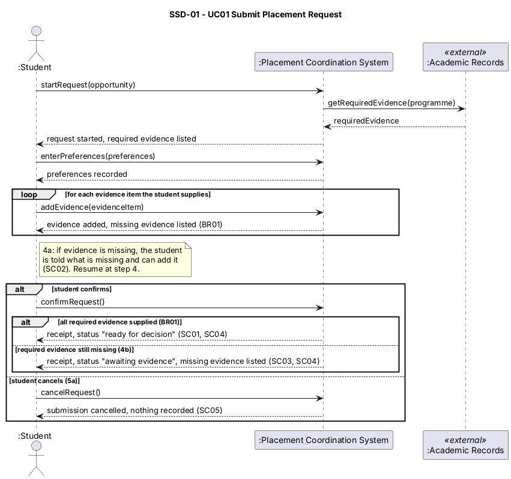

# 05 - System Sequence Diagrams

| Field | Value |
| --- | --- |
| Artefact ID | CA2-05 |
| Owner | Isabelle Lynch |
| Reviewer | Eoin Mannix |
| Builds on | [UC01 detailed use case](use-cases/UC01-submit-placement-request.md), [feature file](features/submit-placement-request.feature) (SC01 - SC05), [03 Revised analysis baseline](03-revised-analysis-baseline.md) |
| Feeds into | [06 Operation contracts](06-operation-contracts.md), [09 Object-interaction sequence diagrams](09-object-interaction-sequence-diagrams.md), [10 Architecture and integration contract](10-architecture-and-integration-contract.md) |

## Purpose

This file shows the black-box behaviour of UC01 Submit Placement Request. It covers the events the student sends to the system, what the system returns and the alternative and failure paths. The system is treated as a single lifeline and its internal objects are shown later in the object-interaction sequence diagrams (09). Each system event found here becomes one operation contract (06), following Larman (2005), where the SSD is used to find the system operations before any responsibilities are assigned.

The SSD is drawn from the [UC01 detailed use case](use-cases/UC01-submit-placement-request.md) and checked against the Gherkin scenarios in the [feature file](features/submit-placement-request.feature). The Background of the feature file (student S1 on programme P1, P1 requires evidence items E1 and E2, opportunity OP7 is open) is used in the walkthroughs below so the SSD can be checked against concrete data.

Only UC01 is designed in CA2 ([DR-003](decisions/decision-log.md)), so there is one SSD. It covers the main success scenario and every extension and exception in the detailed use case, so separate SSDs per path are not needed.

## SSD Index

| SSD ID | Use Case | Paths Covered | Gherkin Scenarios | Actors | System Events | Diagram |
| --- | --- | --- | --- | --- | --- | --- |
| SSD-01 | UC01 Submit Placement Request | Main success scenario, 4a, 4b, 5a | SC01 - SC05 | Student (primary), Academic Records (supporting, external) | startRequest, enterPreferences, addEvidence, confirmRequest, cancelRequest | UC01-SSD |

## SSD-01 UC01 Submit Placement Request

**Use Case:** UC01
**Scenarios:** SC01 - SC05
**Requirements:** FR01 (submit preferences and evidence), FR02 (the student is shown what the request is waiting on), FR03 (single shared placement record)
**Rule:** BR01
**Story:** US01
**Owner:** Isabelle Lynch

### Diagram

Source: [`diagrams/UC01-SSD.puml`](./diagrams/UC01-SSD.puml)

### System Boundary and Actors

| Lifeline | Type | Role in UC01 |
| --- | --- | --- |
| Student | Primary actor | Starts the request, supplies preferences and evidence, then confirms or cancels. |
| Placement Coordination System | System under design (black box) | Receives every system event and returns the outcome. |
| Academic Records | Supporting actor, external system | Supplies the evidence each programme requires (assumption A3). It is outside the system boundary and is reached through an interface with a fake for testing (PA05). In the design this is `ProgrammeEvidencePort` (IF-01 in 10). |

### System Events

| # | System event (operation) | Parameters | Returned outcome | UC01 step | Contract | Object design |
| --- | --- | --- | --- | --- | --- | --- |
| 1 | startRequest(opportunity) | opportunity: the open placement opportunity the student is requesting | Request started: the evidence required by the student's programme is listed | 1 | [CO1](06-operation-contracts.md#co1-startrequest) | OSD-01 |
| 2 | enterPreferences(preferences) | preferences: the student's placement preferences | Preferences recorded | 2 | [CO2](06-operation-contracts.md#co2-enterpreferences) | OSD-02 |
| 3 | addEvidence(evidenceItem) | evidenceItem: one item of programme evidence | Evidence added: any evidence still missing is listed (BR01) | 3, 4, 4a | [CO3](06-operation-contracts.md#co3-addevidence) | OSD-03 |
| 4 | confirmRequest() | - | Receipt and request status: *ready for decision* if all required evidence is supplied, otherwise *awaiting evidence* with the missing items listed | 5 - 7, 4b | [CO4](06-operation-contracts.md#co4-confirmrequest) | OSD-04 |
| 5 | cancelRequest() | - | Submission cancelled, nothing recorded | 5a | [CO5](06-operation-contracts.md#co5-cancelrequest) | OSD-05 |

The system's call to Academic Records (`getRequiredEvidence(programme)`) is not a system event because the student does not trigger it directly. It is shown so the external dependency is visible at the boundary. It becomes the `ProgrammeEvidencePort` interface in the architecture contract (10, IF-01).

### Agreed Parameter and Return Types

The SSD keeps the messages abstract. The types below were agreed in the design class diagram (08) and the architecture contract ([10, section 5.1](10-architecture-and-integration-contract.md#51-inputs-and-outputs-per-system-operation)), and the names in the SSD match them.

| System event | Parameter type | Return type | What the return holds |
| --- | --- | --- | --- |
| `startRequest(opportunity)` | `String` (opportunity reference, e.g. `OP7`) | `EvidenceRequirements` | The evidence items the student's programme requires, e.g. `{E1, E2}` |
| `enterPreferences(preferences)` | `String` | `void` | Nothing. The acknowledgement is that no error was signalled |
| `addEvidence(evidenceItem)` | `String` (`EvidenceItem` identifier, e.g. `E1`) | `List<String>` | The required items still missing. Empty when the evidence is complete |
| `confirmRequest()` | - | `Receipt` | Opportunity title, submitted date, status and any missing items |
| `cancelRequest()` | - | `void` | Nothing. The acknowledgement is that no error was signalled |

### Alternatives and Failures Shown

| Fragment | Condition | Outcome | UC01 flow | Gherkin |
| --- | --- | --- | --- | --- |
| `loop` | Repeated for each evidence item the student supplies. It can run zero times | After each item the system lists any evidence still missing so the student can add it | 4a (goal still reached) | SC02 |
| `inner alt` (first branch) | All evidence required by the programme has been supplied (BR01) | Request recorded with status *ready for decision*, receipt shown | Main success scenario | SC01, SC02, SC04 |
| `inner alt` (second branch) | Required evidence is still missing when the student confirms | Request recorded with status *awaiting evidence*, receipt shown with the missing evidence listed | 4b (goal fails) | SC03, SC04 |
| `outer alt` (second branch) | Student cancels instead of confirming | Nothing is recorded (minimal guarantee) | 5a (goal fails) | SC05 |

### Scenario Walkthroughs

Each Gherkin scenario is played through the SSD below using the Background data. This shows that every scenario follows a path in the diagram and gives the expected output after every event, so the SSD can be checked without reading the internal design.

| Scenario | System events in order, with the returned outcome | Path through SSD-01 | Final outcome |
| --- | --- | --- | --- |
| SC01 Student submits a request with all required evidence | `startRequest(OP7)` → E1, E2 required  `enterPreferences(...)` → recorded  `addEvidence(E1)` → E2 missing  `addEvidence(E2)` → nothing missing  `confirmRequest()` → receipt | `loop` twice, `outer alt` confirm, `inner alt` first branch | *ready for decision* |
| SC02 Student supplies missing evidence before confirming | `startRequest(OP7)` → E1, E2 required  `enterPreferences(...)` → recorded  `addEvidence(E1)` → **E2 missing** (student is told, 4a)  `addEvidence(E2)` → nothing missing  `confirmRequest()` → receipt | `loop` twice with the 4a note, `outer alt` confirm, `inner alt` first branch | *ready for decision* |
| SC03 Request without all required evidence is held | `startRequest(OP7)` → E1, E2 required  `enterPreferences(...)` → recorded  `addEvidence(E1)` → E2 missing  `confirmRequest()` → receipt, E2 listed | `loop` once, `outer alt` confirm, `inner alt` second branch | *awaiting evidence*, waiting on E2 |
| SC04 row 1: E1, E2 and E3 | `addEvidence` for E1, E2 and E3. After E3 nothing is missing because E3 is not required and is ignored | `loop` three times, `inner alt` first branch | *ready for decision* |
| SC04 row 2: E1 and E2 | `addEvidence` for E1 and E2 | `loop` twice, `inner alt` first branch | *ready for decision* |
| SC04 row 3: E1 only | `addEvidence(E1)` → E2 missing | `loop` once, `inner alt` second branch | *awaiting evidence*, waiting on E2 |
| SC04 row 4: no evidence items | `addEvidence` is never sent | `loop` zero times, `inner alt` second branch | *awaiting evidence*, waiting on E1 and E2 |
| SC05 Student cancels before confirming | `startRequest(OP7)`, `enterPreferences(...)`, `addEvidence(E1)`, `addEvidence(E2)` as in SC01, then `cancelRequest()` → cancelled | `outer alt` second branch | Nothing recorded |

SC01 and SC02 send the same system events. The difference is only in what the student does with the "E2 missing" reply: in SC02 they act on it, which is extension 4a. Because the system responds in the same way in both, 4a needs the `loop` and the missing-evidence reply but no separate branch. This is why 4a is an extension (goal still reached) and 4b is an exception.

### Failures Outside the Use Case Flow

The SSD only draws the paths in the detailed use case. The architecture contract ([10, section 6](10-architecture-and-integration-contract.md#6-error-conventions)) adds named errors for when a precondition is broken or an outside system fails. Under DR-010 these stop the operation with no state change, so they are not drawn as `alt` branches. They are listed here so every system event's possible results are visible in one place.

| System event | Named errors it can signal (10, section 6) | Why it is not drawn in SSD-01 |
| --- | --- | --- |
| startRequest | `STUDENT_NOT_FOUND`, `OPPORTUNITY_NOT_FOUND`, `ACADEMIC_RECORDS_UNAVAILABLE` | The first two break UC01 preconditions (student identified, opportunity exists). The third is a failure of the supporting actor, which UC01 does not cover (A3, 10 section 8) |
| enterPreferences | `NO_REQUEST_IN_PROGRESS` | Breaks the CO2 precondition. The SSD order makes it impossible on the paths shown |
| addEvidence | `NO_REQUEST_IN_PROGRESS` | Breaks the CO3 precondition |
| confirmRequest | `NO_REQUEST_IN_PROGRESS`, `CANNOT_SAVE` | `CANNOT_SAVE` means the shared record could not be written. No receipt is issued and the request stays in progress so the student can confirm again (09 Note 6) |
| cancelRequest | `NO_REQUEST_IN_PROGRESS` | Breaks the CO5 precondition |

`OPPORTUNITY_NOT_OPEN` is reserved in 10 but is not raised in UC01 while OI1 is open (see Note 3).

### How the SSD Matches the Use Case and Gherkin

| Check | Result |
| --- | --- |
| Every step of the main success scenario appears as a system event or a returned outcome | Yes: steps 1, 2, 3 and 5 are system events. Steps 4, 6 and 7 are the system's returned outcomes |
| Every extension and exception appears as a fragment | Yes: 4a (`loop`), 4b (`inner alt`), 5a (`outer alt`) |
| Every Gherkin scenario can be traced to a path in the diagram (DoD-19) | Yes: SC01, SC03, SC04 and SC05 are labelled on the returned outcomes and SC02 on the 4a note after the `loop`. See Scenario Walkthroughs |
| Every system event has one operation contract and one object-interaction sequence diagram (DoD-15) | Yes: see the Contract and Object design columns in System Events |
| BR01 is visible where it changes the outcome | Yes: the guard on the `inner alt` and the missing evidence list returned by `addEvidence` |
| The minimal guarantee holds on every path | Yes: no path returns *ready for decision* without the required evidence and cancelling records nothing |
| Message names match the design class diagram and architecture contract (DoD-05) | Yes: the five system events are the five public methods on `SubmitPlacementRequestHandler` (08) and `getRequiredEvidence(programme)` is IF-01 (10) |

### Notes and Assumptions

1. Separate `addEvidence` event. Evidence is supplied one item at a time so the system can tell the student what is still missing after each item (step 4 and extension 4a). Taking all evidence in a single event would hide extension 4a inside one call.
2. Validation happens at confirmation as well as after each item. `addEvidence` reports what is missing so the student can act, but the status is decided only by `confirmRequest()`. This keeps BR01 in one place: the decision about *ready for decision* versus *awaiting evidence*.
3. The opportunity being open is a precondition. It is not checked in the SSD. What makes an opportunity open is open issue OI1 in the detailed use case. If the group adds a "not open" exception, `startRequest` gains a failure branch here and raises `OPPORTUNITY_NOT_OPEN` (10, section 6).
4. A request without all required evidence is held, not rejected. This follows the working assumption for Q1 (RC05) and the CA1 assumption behind exception 4b.
5. Third parties acting for a student are out of scope for this SSD (Q3, outside UC01 under DR-003). The student is the only primary actor.
6. Parameter and return types are agreed. They were left abstract while the SSD was drawn and are now fixed in 08 and 10 (section 5.1), shown in Agreed Parameter and Return Types above. The SSD messages use the same names.
7. Between `startRequest` and `confirmRequest` the request is in progress. It exists in the system but is not part of the shared placement record until it is confirmed (DR-008). `cancelRequest` discards it, which is how the minimal guarantee holds.
8. Cancelling is allowed at any point while the request is in progress (after `startRequest`, after `enterPreferences` or during the evidence `loop`), as the CO5 precondition allows. The diagram shows it once, as the alternative to `confirmRequest`, to keep it readable. Every cancel point has the same outcome: nothing is recorded.
9. The student is already identified. Logging in is not part of UC01 (UC01 precondition, 09 Note 3), so the SSD starts at `startRequest`.
10. One request at a time. The SSD assumes the student has one request in progress at a time. What happens if `startRequest` is sent while a request is already in progress is not defined in UC01 and is listed as open in 08 (Note 5) and 09 (Note 4).
11. Preferences are entered once. The SSD sends `enterPreferences` once. If the student sends it again before confirming, the new preferences replace the old ones (CO2), so no extra branch is needed.
