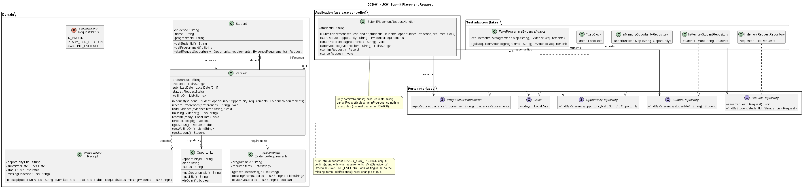

# 08 - Design Class Diagram
 
| Field | Value |
| --------------- | -------------------------------------------------- |
| Artefact ID | CA2-08 |
| Owner | Eoin Mannix |
| Reviewer | Isabelle Lynch |
| Feeds into | 09 Object-interaction sequence diagrams, 10 Architecture and integration contract, 11 CA3 slice specifications |
 
## Purpose
 
This is where the CRC cards from 07 became an actual design class diagram (DCD) for UC01 Submit Placement Request.
 
The domain model (03) is about the problem: students, opportunities, requests and so on. The DCD is about the code we're going to write. It shows each class's fields, methods and types, how the classes link up, and which layer each one sits in.
 
Every class here has a CRC card in 07. Every public method is either a system operation from SSD-01 (05) or a message from the sequence diagrams (09). We drew this and 09 together, so if one changes, the other does too.
 
We're only doing UC01 in CA2 (DR-003), so only the classes UC01 needs are here. Things like Employer, Placement, Decision and Match come in later with the use cases that need them.
 
## From Domain Model to Design Classes
 
The DCD isn't just the domain model redrawn. Some concepts turn into classes, some become plain fields and we add a few classes the software needs that don't exist in the real world.
 
### What happened to the concepts UC01 uses
 
| Concept | What it is in the DCD | Why |
| --- | --- | --- |
| Student | `Student` class | We need to know who's asking. It also creates the `Request` |
| Opportunity | `Opportunity` class | The placement the student wants. Its title goes on the receipt |
| Request | `Request` class | Everything CO1 - CO5 change lives here and it's the class that applies BR01 |
| Programme | Not a class, just `Student.programmeId` plus `EvidenceRequirements` | Programme data lives in Academic Records (A3). We only need its evidence list and we get that through a port |
| Preferences | `Request.preferences : String` | CO2 puts them on the request, not the student |
| Evidence | `Request.evidence : List<String>` | Evidence items are just codes like `E1`, so no class needed yet |
| Awaiting Evidence / Ready for Decision | Values in the `RequestStatus` enum | BR01 decides which one a request gets |
| Initial Expression of Interest | Closest thing is `IN_PROGRESS`, which never gets saved | In UC01 a request only gets saved when it's confirmed (DR-008), so staff never see this stage |
| Waiting | `Request.waitingOn : List<String>` | Shows the students what they're still missing (FR02) |
 
### Classes we added
 
| Class | Why we need it |
| --- | --- |
| `SubmitPlacementRequestHandler` | Takes the five system operations so the domain classes don't have to deal with the UI (Controller) |
| `EvidenceRequirements` | Holds the programme's required items so `Request` can check BR01 itself |
| `RequestStatus` | Gives the statuses fixed names |
| `Receipt` | What the student gets back after confirming. It isn't stored |
| Repositories, `ProgrammeEvidencePort`, `Clock` | Ports that keep storage, Academic Records and the date out of the domain |
| Fakes (`InMemory…`, `FakeProgrammeEvidenceAdapter`, `FixedClock`) | Let us test everything without a real database or Academic Records |
 
## DCD-01 UC01 Submit Placement Request
 
**Use Case:** UC01
**Contracts:** CO1 - CO5
**Requirement:** FR01
**Rule:** BR01
**Story:** US01
 
### Diagram
 

 
Source: [`diagrams/UC01-DCD.puml`](./diagrams/UC01-DCD.puml)
 
### How to read it
 
| Symbol | Meaning |
| --- | --- |
| `-` / `+` | Private field / public method |
| `[0..1]` | Can be empty, like `submittedDate` before confirming |
| `"1"`, `"0..1"` on a line | How many objects are on that end |
| Solid line with an arrow | The class at the tail holds a reference to the class at the head. The label is the field name |
| Dashed line `<<create>>` | The class at the tail creates the one at the head |
| Dashed line with a hollow triangle | The class implements that interface |
| `<<value object>>` | Can't be changed once it's made |
 
The types are written Java-style (`String`, `List<String>`, `LocalDate`) to keep things clear. They get confirmed in 10 and 12, and if we use a different language they just get swapped for that language's versions.
 
Links between classes are only shown as lines, not repeated as fields inside boxes, so nothing shows up twice.
 
## Layers
 
The classes are split into four packages. The main rule is that the domain doesn't depend on anything outside itself: no database, no clock, no Academic Records.
 
| Package | Classes | Depends on |
| --- | --- | --- |
| Application | `SubmitPlacementRequestHandler` | Domain, Ports |
| Domain | `Student`, `Opportunity`, `Request`, `EvidenceRequirements`, `RequestStatus`, `Receipt` | Nothing outside the domain |
| Ports | `ProgrammeEvidencePort`, `RequestRepository`, `StudentRepository`, `OpportunityRepository`, `Clock` | Domain |
| Test adapters | `FakeProgrammeEvidenceAdapter`, `InMemoryRequestRepository`, `InMemoryStudentRepository`, `InMemoryOpportunityRepository`, `FixedClock` | Ports, Domain |
 
In practice:
 
- The handler talks to the domain objects and the ports.
- Domain objects only talk to each other. If they need something from outside, like today's date, it gets passed in. That's why it's `confirm(today)` and not `Request` calling the clock itself.
- The fakes plug into the ports, so the handler never knows whether it's using a fake or the real thing.
This makes testing easy. You can check BR01 just by calling `Request.confirm()` and `FixedClock` means the dates come out the same every run. If Academic Records ever changes, only its adapter has to change.
 
The real adapters (database, system clock, Academic Records) use the same ports. They aren't drawn because UC01 is built and tested with the fakes. We pick the real ones in 10 and 12.
 
## Class Specifications
 
The source column says where each member came from: a CRC card (07), a contract (06), a sequence diagram (09) or the domain model (03).
 
### SubmitPlacementRequestHandler
 
**Package:** Application **GRASP:** Controller, Pure Fabrication
 
The handler is the first thing each system operation hits after the UI. Its job is to coordinate, not to decide. It finds the objects, passes the messages on, saves the result and sends back the answer. It never looks at the evidence or sets the status itself, which keeps it a thin controller.
 
| Member | Type | What it's for | Source |
| --- | --- | --- | --- |
| `studentId` | `String` | The student this handler is working for | 07 Handler card |
| `inProgress` | `Request [0..1]` | The request being built between start and confirm/cancel | 07, DR-008 |
| `students`, `opportunities`, `evidence`, `requests`, `clock` | Ports, passed in through the constructor | So tests can swap in fakes | 07 Low Coupling |
| `startRequest(opportunity : String) : EvidenceRequirements` | System operation | Starts a request and sends back the evidence the programme needs | CO1, OSD-01 |
| `enterPreferences(preferences : String) : void` | System operation | Saves the preferences on the request | CO2, OSD-02 |
| `addEvidence(evidenceItem : String) : List<String>` | System operation | Adds one item and sends back what's still missing | CO3, OSD-03 |
| `confirmRequest() : Receipt` | System operation | Confirms, saves and sends back the receipt | CO4, OSD-04 |
| `cancelRequest() : void` | System operation | Throws the request away. Nothing is saved | CO5, OSD-05 |
 
**What each operation does:**
 
| Operation | What happens | `inProgress` afterwards |
| --- | --- | --- |
| `startRequest` | Finds the student and opportunity, gets the evidence requirements, asks the student to create the request | Holds the new request |
| `enterPreferences` | Passes the preferences to the request | Same request |
| `addEvidence` | Adds the item and asks the request what's missing | Same request |
| `confirmRequest` | Gets today's date, calls `confirm(today)`, saves the request, gets the receipt | Empty |
| `cancelRequest` | Just lets go of the request | Empty |
 
The key point is that **only `confirmRequest()` ever saves anything**.
That's how we make sure a cancelled request leaves no trace (SC05).
 
### Student
 
**Package:** Domain **GRASP:** Creator, Information Expert
 
`Student` knows which programme it's on and creates its own `Request`.
It's the Creator because, in the domain model, a student submits a request and the request records who it belongs to.
 
| Member | Type | What it's for | Source |
| --- | --- | --- | --- |
| `studentId` | `String` | Identifies the student, like `S1` | Domain: Student |
| `name` | `String` | The student's name | Domain: Student.name |
| `programmeId` | `String` | Which programme they're on, like `P1`. The programme itself stays in Academic Records | Domain, A3 |
| `getStudentId() : String` | Knowing | Lets the repository find a student's requests | `RequestRepository` |
| `getProgrammeId() : String` | Knowing | The handler uses it to look up the evidence requirements | OSD-01 |
| `startRequest(opportunity, requirements) : Request` | Creator | Makes a new `Request` linked to this student | CO1, OSD-01 |
 
`Student` doesn't keep a list of its requests. If you need them, you ask `RequestRepository.findByStudent`.
 
### Opportunity
 
**Package:** Domain **GRASP:** Information Expert
 
`Opportunity` is the placement the student wants, like `OP7`. In UC01 it's only read, mainly for its title on the receipt.
 
| Member | Type | What it's for | Source |
| --- | --- | --- | --- |
| `opportunityId` | `String` | Identifies the opportunity, like `OP7` | Domain: Opportunity |
| `title` | `String` | Shown on the receipt | Domain, CO4 |
| `status` | `String` | Whether it's open. Used by `isOpen()` | Domain |
| `getOpportunityId() : String` | Knowing | Identifies it to the repository | `OpportunityRepository` |
| `getTitle() : String` | Knowing | Read when the receipt is made | OSD-04 |
| `isOpen() : boolean` | Information Expert | True if it's taking requests | 07 Opportunity card |
 
`isOpen()` is on the diagram but UC01 never calls it. That's because the opportunity being open is already a precondition of CO1. We kept the method because the CRC card gives `Opportunity` that job and it's where the check would go if it's ever needed.
 
### Request
 
**Package:** Domain **GRASP:** Information Expert, Creator (of `Receipt`)
 
`Request` is the centre of UC01. Everything the contracts change lives here. It knows what evidence has been supplied and what's required, so it's the one that decides BR01 and nothing else does.
 
| Member | Type | What it's for | Source |
| --- | --- | --- | --- |
| `student` | `Student` | Who made the request | Domain, CO1 |
| `opportunity` | `Opportunity` | What they're asking for | Domain, CO1 |
| `requirements` | `EvidenceRequirements` | What evidence is needed | 07 |
| `preferences` | `String` | The student's preferences | Domain, CO2 |
| `evidence` | `List<String>` | Evidence supplied so far, like `[E1, E2]` | Domain, CO3 |
| `submittedDate` | `LocalDate [0..1]` | When it was confirmed. Empty until then | Domain, CO4 |
| `status` | `RequestStatus` | `IN_PROGRESS` until confirmed | Domain, CO1, CO4 |
| `waitingOn` | `List<String>` | What's still missing | Domain, CO4 |
| `Request(student, opportunity, requirements)` | Constructor | Sets up the links and starts it as `IN_PROGRESS` | CO1 |
| `recordPreferences(preferences : String) : void` | Doing | Saves the preferences | CO2 |
| `addEvidence(evidenceItem : String) : void` | Doing | Adds an item. Doesn't touch the status | CO3 |
| `missingEvidence() : List<String>` | Knowing | Asks the requirements what's missing | CO3, 4a |
| `confirm(today : LocalDate) : void` | Doing | Sets the date and applies BR01 | CO4 |
| `createReceipt() : Receipt` | Creator | Builds the receipt | CO4 |
| `getStatus()`, `getWaitingOn()`, `getStudent()` | Knowing | Read by tests and the repository | SC01 - SC05 |
 
**How `confirm(today)` works:**
 
```text
confirm(today):
    submittedDate = today
    if requirements.isMetBy(evidence):
        status    = READY_FOR_DECISION
        waitingOn = empty
    else:
        status    = AWAITING_EVIDENCE
        waitingOn = requirements.missingFrom(evidence)
```
 
**How a request changes as you go** (P1 needs E1 and E2 and a dash means no change):
 
| Field | After start | After preferences | After adding E1 | Confirm with both | Confirm with E2 missing |
| --- | --- | --- | --- | --- | --- |
| `preferences` | Empty | Set | - | - | - |
| `evidence` | `[]` | - | `[E1]` | `[E1, E2]` | `[E1]` |
| `submittedDate` | Empty | - | - | `today` | `today` |
| `status` | `IN_PROGRESS` | - | - | `READY_FOR_DECISION` | `AWAITING_EVIDENCE` |
| `waitingOn` | `[]` | - | - | `[]` | `[E2]` |
 
If the student cancels at any point, the request is just thrown away.
 
### EvidenceRequirements
 
**Package:** Domain **GRASP:** Information Expert
 
`EvidenceRequirements` is the list of evidence a programme needs, like `{E1, E2}` for P1. It comes from Academic Records through `ProgrammeEvidencePort` and gets attached to the request when it starts. Because it knows what's required, it's the one that works out what's missing.
 
It's a value object, so it never changes once it's made. Two of them with the same items count as equal.
 
| Member | Type | What it's for | Source |
| --- | --- | --- | --- |
| `programmeId` | `String` | Which programme these requirements are for | A5 |
| `requiredItems` | `Set<String>` | The items needed, like `{E1, E2}` | Domain: Programme |
| `getRequiredItems() : List<String>` | Knowing | Lets the UI list the required items from the `EvidenceRequirements` that `startRequest` returns | CO1 |
| `missingFrom(supplied : List<String>) : List<String>` | Knowing | Required items that aren't in `supplied`. Extra items are ignored | CO3, CO4 |
| `isMetBy(supplied : List<String>) : boolean` | Knowing | True when nothing is missing (BR01) | CO4 |
 
A few quick examples with P1:
 
| Supplied | `missingFrom` | `isMetBy` |
| --- | --- | --- |
| `[]` | `[E1, E2]` | false |
| `[E1]` | `[E2]` | false |
| `[E1, E2]` | `[]` | true |
| `[E1, E2, E3]` | `[]` | true (E3 is just ignored) |
 
### RequestStatus
 
**Package:** Domain **GRASP:** Information Expert
 
`RequestStatus` is the fixed list of statuses a request can have in UC01.
 
| Value | Meaning | Who sees it |
| --- | --- | --- |
| `IN_PROGRESS` | Started but not confirmed yet | Nobody. It's never saved |
| `READY_FOR_DECISION` | Confirmed with all the required evidence (BR01) | Student and staff |
| `AWAITING_EVIDENCE` | Confirmed but something's missing (4b) | Student and staff |
 
Only `Request.confirm()` ever sets the last two.
 
### Receipt
 
**Package:** Domain **GRASP:** Pure Fabrication
 
`Receipt` is what the student gets back after confirming. It's just a snapshot of the request at that moment, so it keeps what the student sees separate from the `Request` itself. It isn't stored anywhere.
 
| Member | Type | What it's for | Source |
| --- | --- | --- | --- |
| `opportunityTitle` | `String` | The placement they asked for | CO4 |
| `submittedDate` | `LocalDate` | When they confirmed | CO4 |
| `status` | `RequestStatus` | Ready or awaiting evidence | CO4 |
| `missingEvidence` | `List<String>` | What's still missing (empty if ready) | CO4 |
| `Receipt(opportunityTitle, submittedDate, status, missingEvidence)` | Constructor | Only ever called by `Request.createReceipt()` | OSD-04 |
 
### Ports
 
**Package:** Ports **GRASP:** Pure Fabrication, Indirection, Protected Variations
 
Ports are interfaces. The handler only ever sees these, never what's behind them, so we can use fakes now and swap in the real versions later without touching the domain.
 
| Port | Method | Used in | What it does |
| --- | --- | --- | --- |
| `StudentRepository` | `findByReference(studentRef : String) : Student` | OSD-01 | Finds the student |
| `OpportunityRepository` | `findByReference(opportunityRef : String) : Opportunity` | OSD-01 | Finds the opportunity |
| `ProgrammeEvidencePort` | `getRequiredEvidence(programme : String) : EvidenceRequirements` | OSD-01 | Gets a programme's evidence list from Academic Records |
| `RequestRepository` | `save(request : Request) : void`, `findByStudent(studentId : String) : List<Request>` | OSD-04, tests | Saves a confirmed request and finds a student's requests |
| `Clock` | `today() : LocalDate` | OSD-04 | Gives today's date |
 
### Fakes
 
**Package:** Test adapters **GRASP:** Pure Fabrication
 
These are simple in-memory versions of the ports that only exist so we can test UC01. They're set up to match the Gherkin Background in [submit-placement-request.feature](features/submit-placement-request.feature).
 
| Fake | Implements | Set up with |
| --- | --- | --- |
| `InMemoryStudentRepository` | `StudentRepository` | S1, on programme P1 |
| `InMemoryOpportunityRepository` | `OpportunityRepository` | OP7, open |
| `FakeProgrammeEvidenceAdapter` | `ProgrammeEvidencePort` | P1 needs E1 and E2 |
| `InMemoryRequestRepository` | `RequestRepository` | Starts empty. Tests check what ends up in it |
| `FixedClock` | `Clock` | One fixed date, so results are the same every run |
 
The real versions (a database, the system clock and an Academic Records adapter) use the same ports. They get picked in 10 and 12.
 
## Associations and Navigability
 
The arrows only go one way where possible. Two-way links mean two objects you have to keep in sync, so we avoid them unless they're really needed.
 
| From | To | How many | Which way | Why |
| --- | --- | --- | --- | --- |
| `Request` | `Student` | 1 | Request to Student | A request needs to know whose it is. A student's requests come from the repository, so `Student` doesn't need a list |
| `Request` | `Opportunity` | 1 | Request to Opportunity | Same idea. UC02 can get an opportunity's requests from the repository |
| `Request` | `EvidenceRequirements` | 1 | Request to EvidenceRequirements | So `confirm()` can check BR01 without calling a port |
| `SubmitPlacementRequestHandler` | `Request` | 0..1 | Handler to Request | The request in progress. Empty before start and after confirm or cancel |
| `SubmitPlacementRequestHandler` | Each port | 1 | Handler to port | Passed in through the constructor |
| `Student` | `Request` | - | `<<create>>` | Student creates the request (Creator) |
| `Request` | `Receipt` | - | `<<create>>` | Request creates the receipt (Creator) |
| Each fake | Its port | - | Implements | The fake is one version of the port |
 
## How the DCD Lines Up with Everything Else
 
| Check | Does it hold? |
| --- | --- |
| Every class with a CRC card in 07 is on the DCD | Yes. All 13, plus the in-memory fakes and `FixedClock` |
| Every CRC responsibility turns into a field, link or method | Yes. See the source columns |
| All five system operations from SSD-01 are on the handler | Yes |
| Every message in 09 is a method on the class that receives it | Yes. Checked against OSD-01 to OSD-05 |
| Every field a contract in 06 changes is on `Request` | Yes: `preferences`, `evidence`, `submittedDate`, `status` and `waitingOn` |
| BR01 is only applied in one place | Yes. Only `Request.confirm()` sets the final status |
| The domain doesn't depend on ports or fakes | Yes. No arrows from Domain to Ports or the fakes and `confirm()` gets the date passed in |
| Nothing is shown twice | Yes. Links are only drawn as lines, not repeated as fields |
 
## Notes and Assumptions
 
1. **Evidence is just text for now.** Items are codes like `E1`. If we later need upload dates or verification, we'd add an `EvidenceItem` class and only `Request` and `EvidenceRequirements` would change.
2. **Programme isn't a class.** It lives in Academic Records (A3). We only keep `programmeId` and the requirements we read through the port.
3. **Preferences are one string.** We don't know their structure yet, so they can become their own class later without affecting anything else.
4. **No request ID yet.** UC01 doesn't need one, but UC02 will need to find a single request, so expect a `requestId` then.
5. **One request at a time.** What happens if `startRequest` is called while one is already in progress isn't defined. The simplest option is to reject it. That gets agreed in 10.
6. **In-progress handling depends on DR-008**, which is still proposed. If it's not accepted, `inProgress` moves out of the handler and `RequestRepository` needs a delete method.
7. **Names and types aren't final.** They get confirmed in 10 and this file has to stay in step with it.
 