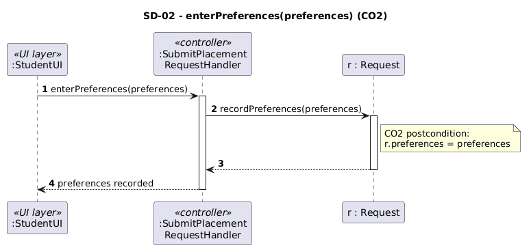
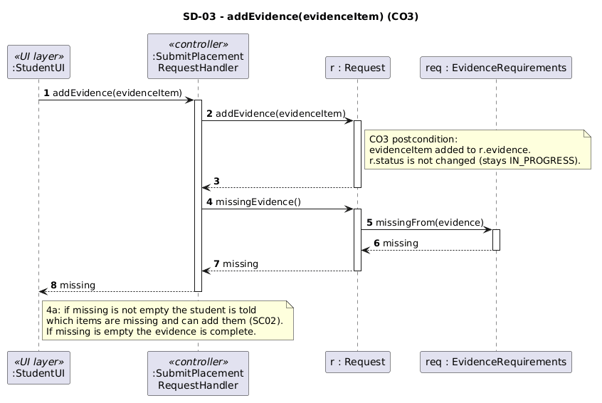

# 09 - Object-Interaction Sequence Diagrams

| Field | Value |
| --------------- | ------------------------------------------------ |
| Artefact ID | CA2-09 |
| Owner | Eoin Mannix | 
| Reviewer | Isabelle Lynch |
| Feeds into | 10 Architecture and integration contract, 11 CA3 slice specifications | 

## Purpose 

SSD-01 (05) treats the system as a black box. The student sends in an operation and gets an answer back, but you can't see what happens inside. This file opens the box up. 

For each system operation, it shows which objects get messages, in what order, and which object makes each postcondition in the contracts (06) true. Who does what comes from the CRC cards (07) and every message is a method on the design class diagram (08).

There's one sequence diagram per system operation, so each one lines up with one contract and one row of the responsiblity table in 07. Between them they cover the main success scenario, extention 4a and exceptions 4b and 5a of UC01.

## Diagram Index

| SD ID | System operation | Contract | UC01 flow | Gherkin | Diagram | CA3 slice (DR-007) |
| --- | --- | --- | --- | --- | --- | --- |
| SD-01 | `startRequest(opportunityId)` | CO1 | Step 1 | SC01 - SC05 | 
[UC01-SD-01-startRequest](./diagrams/UC01-SD-01-startRequest.puml) | A Start request |
| SD-02 | `enterPreferences(preferences)` | CO2 | Step 2 | SC01 - SC05 |
[UC01-SD-02-enterPreferences](./diagrams/UC01-SD-02-enterPreferences.puml) | B - Capture preferences adn evidence |
| SD-03 | `addEvudence(evidenceItem)` | CO3 | Steps 3, 4, 4a | SC02 |
[UC01-SD-03-addEvidence](./diagrams/UC01-SD-03-addEvidence.puml) | B - Capture preferences and evidence |
| SD-04 | `confirmRequest()` | CO4 | Steps 5 - 7, 4b | SC01 - SC04 |
[UC01-SD-04-confirmRequest](./diagrams/UC01-SD-04-confirmRequest.puml) | C - Confirm request, and D (save) | 
| SD-05 | `cancelRequest()` | CO5 | 5a | SC05 |
[UC01-SD-05-cancelRequest](./diagrams/UC01-SD-05-cancelRequest.puml) | D - Cancel and record |

## How to read the diagrams

| Symbol | Meaning |
| --- | --- |
| `:StudentUI` | The UI. It sends the system operation to the handler. How it's built isn't part of CA2 |
| `<<controller>>`, `<<port>>` | Same labels as in 08. Ports are interfaces, and in tests the fakes from 08 sit behind them | 
| `s : Student`, `r : Request` | Named objects. The same names are used in the contracts (06) | 
| `<<create>>` | The message creates the object (Creator, 07) | 
| `X` at the bottom of a lifeline | The object is gone because nothing points to it anymore |
| `x = value` arrow back to itself | A field gets set. These match postconditions in 06 |
| Yellow notes | Which contract postconditions are true at that point | 
| Dashed arrows | Return messages, showing that comes back | 

Messages are numbered automatically and the step numbers in the tables below match those numbers.

## SD-01 startRequest (CO1)

Source: ['diagrams/UC01-SD-01-StartRequest.puml'](./diagrams/UC01-SD-01-startRequest.puml)

| Step | What happens | GRASP (07) | Contract |
| --- | --- | --- | --- |
| 1 | The UI sends `enterPreferences(preferences)` | Controller | - |
| 2 - 5 | The handler finds the student and the opportunity through the repositories | Pure Fabrication | CO1 preconditions |
| 6 - 9 | The handler gets the student's `programmeId` and asks `ProgrammeEvidencePort` for the requirements
| Information Expert (Student), Indirection, Protected Variations | CO1 output (A3, PA05) |
| 10 - 13 | `s.startRequest(op, req)` creates `r`. The constructor links `r` to `s`, `op` and `req` and sets `status = IN_PROGRESS` | Creator Instance created, links formed, status set |
| 14 | The handler holds on to `r` as `inProgress` | Controller | DR-008 |
| 15 - 17 | The handler gets the required items and sends them back to the UI | - | CO1 output |

`op.isOpen` isn't called, because the opportunity being open is already a precondition of C01 (07 Note 5)

## SD-02 enterPreferences (CO2)

Source: [`diagrams/UC01-SD-02-enterPreferences.puml`](./diagrams/UC01-SD-02-enterPreferences.puml)

| Step | What happens | GRASP (07) | Contract |
| --- | --- | --- | --- |
| 1 | The UI sends `enterPreferences(preferences)` | Controller | - |
| 2 | The handler passes it straight on to `r.recordPreferences(preferences)` | Information Expert | `r.preferences` set |
| 3 - 4 | A confirmation comes back to the UI | - | CO2 output |

This is the simplest one. The handler doesn't do anything with the preferences itself, it just hands them to the request.

## SD-03 addEvidence (CO3)

Source: [`diagrams/UC01-SD-03-addEvidence.puml`](./diagrams/UC01-SD-03-addEvidence.puml)

| Step | What happens | GRASP (07) | Contract | 
| --- | --- | --- | --- |
| 1 | The UI sends `addEvidence(evidenceItem)` | Controller | - | 
| 2 - 3 | `r.addEvidence(evidenceItem)` adds the item. The status isn't touched | Information Expert | Item added to `r.evidence` | 
| 4 - 7 | `r.missingEvidence()` asks `req.missingFrom(evidence)` and gets back the missing items | Information Expert (Request, EvidenceRequirements) | CO3 output (BR01, 4a) |
| 8 | The missing items go back to the UI | - | CO3 output |

This diagram shows one call. In SSD-01 the student calls `addEvidence` in a loop, once per item, so SD-03 runs once for each go round the loop. Extention 4a (SC02) is just the student seeing that the `missing` list isn't empty and calling `addEvidence` again.

