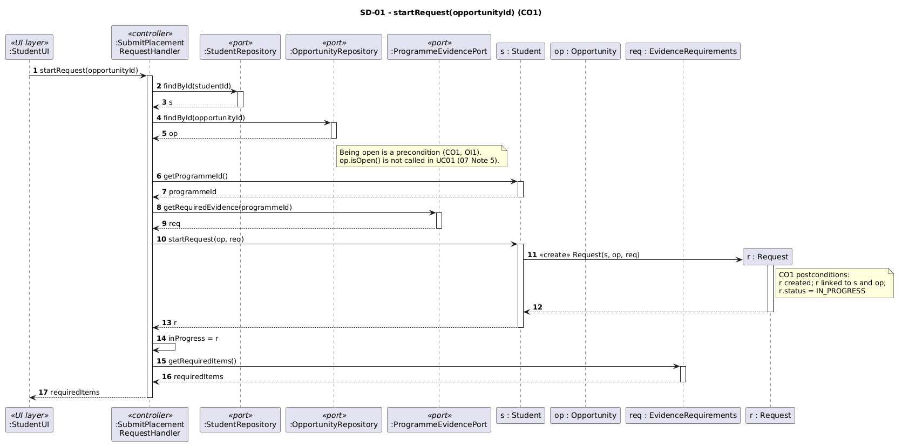
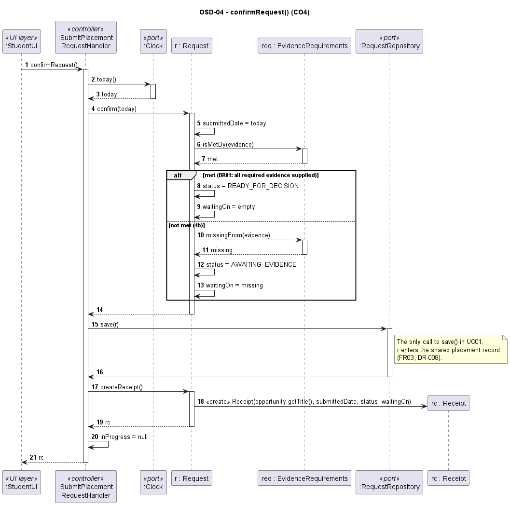
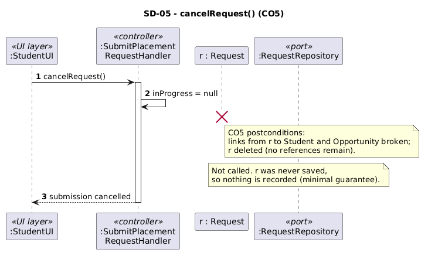

# 09 - Object-Interaction Sequence Diagrams

| Field | Value |
| --------------- | ------------------------------------------------ |
| Artefact ID | CA2-09 |
| Owner | Eoin Mannix | 
| Reviewer | Isabelle Lynch |
| Feeds into | 10 Architecture and integration contract, 11 CA3 slice specifications | 

## Purpose 

SSD-01 (05) treats the system as a black box. The student sends in an operation and gets an answer back, but you can't see what happens inside. This file opens the box up. 

For each system operation, it shows which objects get messages, in what order, and which object makes each postcondition in the contracts (06) true. Who does what comes from the CRC cards (07) and every message is a method on the design class diagram (08).

There's one sequence diagram per system operation, so each one lines up with one contract and one row of the responsiblity table in 07. Between them they cover the main success scenario, Extension 4a and exceptions 4b and 5a of UC01.

## Diagram Index

| SD ID | System operation | Contract | UC01 flow | Gherkin | Diagram | CA3 slice (DR-007) |
| --- | --- | --- | --- | --- | --- | --- |
| SD-01 | `startRequest(opportunityId)` | CO1 | Step 1 | SC01 - SC05 | [UC01-SD-01-startRequest](./diagrams/UC01-SD-01-startRequest.puml) | A Start request |
| SD-02 | `startRequest(opportunityId)` | CO2 | Step 2 | SC01 - SC05 |[UC01-SD-02-enterPreferences](./diagrams/UC01-SD-02-enterPreferences.puml) | B - Capture preferences and evidence |
| SD-03 | `addEvudence(evidenceItem)` | CO3 | Steps 3, 4, 4a | SC02 | [UC01-SD-03-addEvidence](./diagrams/UC01-SD-03-addEvidence.puml) | B - Capture preferences and evidence |
| SD-04 | `confirmRequest()` | CO4 | Steps 5 - 7, 4b | SC01 - SC04 |[UC01-SD-04-confirmRequest](./diagrams/UC01-SD-04-confirmRequest.puml) | C - Confirm request, and D (save) | 
| SD-05 | `cancelRequest()` | CO5 | 5a | SC05 |[UC01-SD-05-cancelRequest](./diagrams/UC01-SD-05-cancelRequest.puml) | D - Cancel and record |

## How to read the diagrams

| Symbol | Meaning |
| --- | --- |
| `:StudentUI` | The UI. It sends the system operation to the handler. How it's built isn't part of CA2 |
| `<<controller>>`, `<<port>>` | Same labels as in 08. Ports are interfaces, and in tests the fakes from 08 sit behind them | 
| `s : Student`, `r : Request` | Named objects. The same names are used in the contracts (06) | 
| `<<create>>` | The message creates the object (Creator, 07) | 
| `X` at the bottom of a lifeline | The object is gone because nothing points to it anymore |
| `x = value` arrow back to itself | A field gets set. These match postconditions in 06 |
| Yellow notes | Which contract postconditions are true at that point | 
| Dashed arrows | Return messages, showing what comes back | 

Messages are numbered automatically and the step numbers in the tables below match those numbers.

## SD-01 startRequest (CO1)

Source: [`diagrams/UC01-SD-01-startRequest.puml`](./diagrams/UC01-SD-01-startRequest.puml)

| Step | What happens | GRASP (07) | Contract |
| --- | --- | --- | --- |
| 1 | The UI sends `startRequest(opportunityId)` | Controller | - |
| 2 - 5 | The handler finds the student and the opportunity through the repositories | Pure Fabrication | CO1 preconditions |
| 6 - 9 | The handler gets the student's `programmeId` and asks `ProgrammeEvidencePort` for the requirements |
| Information Expert (Student), Indirection, Protected Variations | CO1 output (A3, PA05) |
| 10 - 13 | `s.startRequest(op, req)` creates `r`. The constructor links `r` to `s`, `op` and `req` and sets `status = IN_PROGRESS` | Creator | Instance created, links formed, status set |
| 14 | The handler holds on to `r` as `inProgress` | Controller | DR-008 |
| 15 - 17 | The handler gets the required items and sends them back to the UI | - | CO1 output |

`op.isOpen()` isn't called, because the opportunity being open is already a precondition of CO1 (07 Note 5)

## SD-02 enterPreferences (CO2)

Source: [`diagrams/UC01-SD-02-enterPreferences.puml`](./diagrams/UC01-SD-02-enterPreferences.puml)

| Step | What happens | GRASP (07) | Contract |
| --- | --- | --- | --- |
| 1 | The UI sends `enterPreferences(preferences)` | Controller | - |
| 2 | The handler passes it straight on to `r.recordPreferences(preferences)` | Information Expert | `r.preferences` set |
| 3 - 4 | A confirmation comes back to the UI | - | CO2 output |

This is the simplest one. The handler doesn't do anything with the preferences itself, it just hands them to the request.

## SD-03 addEvidence (CO3)

Source: [`diagrams/UC01-SD-03-addEvidence.puml`](./diagrams/UC01-SD-03-addEvidence.puml)

| Step | What happens | GRASP (07) | Contract | 
| --- | --- | --- | --- |
| 1 | The UI sends `addEvidence(evidenceItem)` | Controller | - | 
| 2 - 3 | `r.addEvidence(evidenceItem)` adds the item. The status isn't touched | Information Expert | Item added to `r.evidence` | 
| 4 - 7 | `r.missingEvidence()` asks `req.missingFrom(evidence)` and gets back the missing items | Information Expert (Request, EvidenceRequirements) | CO3 output (BR01, 4a) |
| 8 | The missing items go back to the UI | - | CO3 output |

This diagram shows one call. In SSD-01 the student calls `addEvidence` in a loop, once per item, so SD-03 runs once for each go round the loop. Extension 4a (SC02) is just the student seeing that the `missing` list isn't empty and calling `addEvidence` again.

## SD-04 confirmRequest (CO4)

Source: [`diagrams/UC01-SD-04-confirmRequest.puml`](./diagrams/UC01-SD-04-confirmRequest.puml)

| Step | What happens | GRASP (07) | Contract |
| --- | --- | --- | --- |
| 1 | The UI sends `confirmRequest()` | Controller | - | 
| 2 - 3 | The handler gets `today` from `Clock` | Protected Variations | - | 
| 4 - 5 | `r.confirm(today)` sets `submittedDate` | Information Expert | `r.submittedDate` set | 
| 6 - 7 | `r` asks `req.isMetBy(evidence)` | Information Expert (EvidenceRequirements) | BR01 check |
| 8 - 9 (`alt` met) | `status = READY_FOR_DECISION`, `waitingOn` left empty | Information Expert | Main success scenario (SC01, SC02, SC04 rows 1 - 2) |
| 10 - 13 (`alt` not met) | `r` asks `req.missingFrom(evidence)`, then sets `status = AWAITING_EVIDENCE` and `waitingOn = missing` | Information Expert | 4b (SC03, SC04 rows 3 - 4) | 
| 14 | `confirm()` finishes and control goes back to the handler | - | - |
| 15 - 16 | The handler saves `r` to `RequestRepository` | Pure Fabrication | `r` goes into the shared record (06 Note 1, FR03, DR-008) |
| 17 - 19 | `r.createReceipt()` builds the `Receipt` from its own data | Creator | CO4 output |
| 20 | The handler sets `inProgress = null` | Controller | The request is no longer in progress |
| 21 | The receipt goes back to the UI | - | CO4 output |

This is the most important diagram. BR01 is only decided inside `r.confirm()`. The handler never looks at the evidence or sets the status, so it stays a thin controller (07 decision table).

## SD-05 cancelRequest (CO5)

Source: [`diagrams/UC01-SD-05-cancelRequest.puml`](./diagrams/UC01-SD-05-cancelRequest.puml)

| Step | What happens | GRASP (07) | Contract |
| --- | --- | --- | --- |
| 1 | The UI sends `cancelRequest()` | Controller | - |
| 2 | The handler sets `inProgress = null`. Nothing else points at `r`, so it's gone, along with its links to `s` and `op` | Controller | Links broken, `r` deleted |
| - | `RequestRepository` isn't called | Pure Fabrication | Minimal guarantee: nothing recorded (SC05) |
| 3 | A confirmation goes back to the UI | - | CO5 output |

The student can cancel at any point while the request is in progress (05 Note 8), and SD-05 looks the same wherever it happens. Because `r` was never saved, there's nothing to undo. 

## Message Index 

Every message sent to an object is a method on its class in the design class diagram (08).

| Message | Receiver (08 class) | Used in |
| --- | --- | --- |
| `startRequest`, `enterPreferences`, `addEvidence`, `confirmRequest`, `cancelRequest` | `SubmitPlacementRequestHandler` | SD-01 - SD-05 |
| `findById(studentId)` | `StudentRepository` | SD-01 |
| `findById(opportunityId)` | `OpportunityRepository` | SD-01 |
| `getRequiredEvidence(programmeId)` | `ProgrammeEvidencePort` | SD-01 |
| `getProgrammeId()`, `startRequest(op, req)` | `Student` | SD-01 |
| `Request(s, op, req)` | `Request` (constructor) | SD-01 |
| `getRequiredItems()` | `EvidenceRequirements` | SD-01 |
| `recordPreferences(preferences)` | `Request` | SD-02 |
| `addEvidence(evidenceItem)`, `missingEvidence()` | `Request` | SD-03 |
| `missingFrom(evidence)` | `EvidenceRequirements` | SD-03, SD-04 |
| `today()` | `Clock` | SD-04 |
| `confirm(today)`, `createReceipt()` | `Request` | SD-04 |
| `isMetBy(evidence)` | `EvidenceRequirements` | SD-04 |
| `save(r)` | `RequestRepository` | SD-04 |
| `Receipt(...)` | `Receipt` (constructor) | SD-04 |
| `getTitle()` | `Opportunity` | SD-04 (read while building the `Receipt`, not drawn as its own message) |

## How the Sequence Diagrams Line Up with Everything Else
 
| Check | Does it hold? |
| --- | --- |
| Every system event in SSD-01 has a sequence diagram | Yes. SD-01 to SD-05 |
| Every postcondition in CO1 - CO5 is made true by a message in the matching diagram | Yes. See the Contract column in each table |
| Each diagram follows the responsibility table in 07 | Yes. Same receivers, same order |
| Every message is a method in 08 | Yes. See the Message Index |
| BR01 is only applied in one place | Yes. Only `r.confirm()` in SD-04 sets `READY_FOR_DECISION` or `AWAITING_EVIDENCE`. SD-03 never changes the status |
| The minimal guarantee holds | Yes. `RequestRepository.save()` only appears in SD-04. SD-05 throws `r` away without touching the repository |
| Domain objects never call ports | Yes. Only the handler calls the repositories, the port and `Clock`. `Request` gets `today` passed in |
| Every Gherkin scenario can be traced to a path | Yes. SC01: SD-01, 02, 03, 04 (met). SC02: SD-03 more than once, then SD-04 (met). SC03: SD-04 (not met). SC04: both branches of the SD-04 `alt`. SC05: SD-05 |

## Notes and Assumptions
 
1. **One diagram per contract.** Each one starts with the handler getting one system operation, like in Larman (2005). That keeps them small, and each CA3 slice can point at the diagrams it builds.
2. **The UI is a placeholder.** `:StudentUI` stands for whatever sends the operations: a web page, an API endpoint or a test. It gets decided in 10.
3. **The student is already identified.** The handler is created for one student (`studentId`), which is the CO1 precondition. Logging in isn't part of UC01.
4. **One request at a time.** What happens if `startRequest` is called while one is already in progress isn't defined in UC01. The simplest option is to reject it. That gets agreed in 10.
5. **Calling things out of order.** Calling something like `addEvidence` before `startRequest` breaks the contract preconditions. How the handler reports that is part of the error handling in 10.
6. **Repository failures aren't shown.** If `save(r)` fails, the handler keeps hold of `r` so the student can try again. Error handling is agreed in 10.
7. **In-progress handling depends on DR-008**, which is still proposed. If it's not accepted, SD-01 gets a `save(r)` call and SD-05 gets a delete call.
8. **Names and types aren't final.** They have to stay in step with 08 and the architecture contract (10).
 