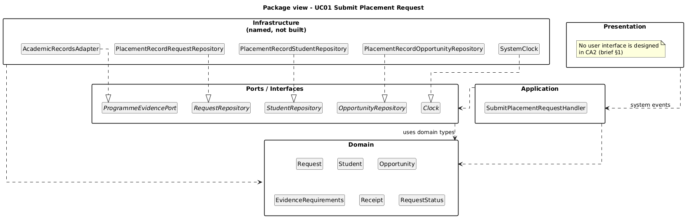

# 10 – Design Structure and Shared Interfaces
| Field        | Value                   |
| ------------ | ----------------------- |
| Owner        | Bartlomiej Jedrzejowski |
| Reviewer     | Daniel Courtney         |
| Last updated | 2026-11-24              |

## 1. Purpose

This file shows the layered structure of the UC01 `Submit Placement Request` design and the shared interfaces, types and conventions that connect its parts. It is needed because [SSD-01](./05-system-sequence-diagrams.md) shows an external call to Academic Records (`getRequiredEvidence(programme)`) and leaves the parameter types open ([05](./05-system-sequence-diagrams.md#notes-and-assumptions) note 6, [06](./06-operation-contracts.md#notes-and-assumptions) note 8). This file turns external dependencies into interfaces, so the design does not rely on how the academic records system works. The operation contracts (06), design class diagram (08) and object-interaction sequence diagrams (09) use the names and conventions defined here.

## 2. Package / layer view

Source: [`diagrams/package-view-uc01.puml`](diagrams/package-view-uc01.puml)

| Layer / package    | Responsibility                                                         | Contains                                                                                                                                    | May depend on                   | Must not depend on                        |
| ------------------ | ---------------------------------------------------------------------- | ------------------------------------------------------------------------------------------------------------------------------------------- | ------------------------------- | ----------------------------------------- |
| Presentation       | Show screens and take student's input                                  | Nothing designed, no UI in CA2 scope                                                                                                        | Application                     | Domain, Ports, Infrastructure             |
| Application        | Coordinates work and receives the five system operations from the SSD. | `SubmitPlacementRequestHandler` (see [07](./07-crc-responsibility-model.md))                                                                | Domain, Ports                   | Presentation, Infrastructure              |
| Domain             | Holds business data and enforces BR01.                                 | `Request`, `Student`, `Opportunity`, `EvidenceRequirements`, `Receipt`, `RequestStatus`                                                     | None                            | All other layers                          |
| Ports / Interfaces | Describes what the design needs from outside, without saying how.      | `ProgrammeEvidencePort` (IF-01), `RequestRepository` (IF-02), `StudentRepository` (IF-03), `OpportunityRepository` (IF-04), `Clock` (IF-05) | Domain                          | Application, Presentation, Infrastructure |
| Infrastructure     | Connects to real outside systems (named, not built).                   | `AcademicRecordsAdapter`, repository implementations, system clock                                                                          | Ports (implements them), Domain | Application, Presentation                 |

### 2.1 Dependency rules

- **Dependencies point inwards.** The Domain layer depends on no other layer, so BR01 is enforced in the same way regardless of where evidence requirements come from or how requests are stored (Low Coupling, Layers pattern).
- **Presentation only speaks to the Application layer.** The five system operations from the SSD arrive at one controller, so the screens contain no business rules (GRASP Controller, Model–View Separation).
- **The Application layer uses ports, never infrastructure.** The controller asks `ProgrammeEvidencePort` for requirements without knowing it is Academic Records. If the college changes systems, only the adapter changes (Protected Variations).
- **Infrastructure implements ports, and nothing depends on infrastructure.** The Academic Records adapter and the store implementation can be swapped without touching the domain or the controller (Indirection).

 

## 3. Shared types

| Type            | Kind       | Values or fields                                                                                     | Rule it supports | Used in                                                                                                                    |
| --------------- | ---------- | ---------------------------------------------------------------------------------------------------- | ---------------- | -------------------------------------------------------------------------------------------------------------------------- |
| `RequestStatus` | enum       | `in progress` (internal, never shown – 06 CO1, 07 note 3), `awaiting evidence`, `ready for decision` | BR01             | CO1, CO3, CO4, OSD-04, SC01–SC04                                                                                           |
| `EvidenceItem`  | identifier | `E1`, `E2`, `E3` (feature file Background), compared by identifier                                   | BR01             | `Request.evidence`, `EvidenceRequirements`, `addEvidence(evidenceItem)`, `getRequiredEvidence` result, CO3, CO4, SC02–SC04 |
| `waitingOn`     | pending    | pending – see issue #<n>                                                                             | FR02, BR01       | CO4                                                                                                                        |

 

## 4. Interface catalogue

### IF-01 – `ProgrammeEvidencePort`

| Field            | Content                                                                                                                          |
| ---------------- | -------------------------------------------------------------------------------------------------------------------------------- |
| Purpose          | Supplies the evidence items a programme requires                                                                                 |
| Used by          | `SubmitPlacementRequestHandler`                                                                                                  |
| Realised by      | `AcademicRecordsAdapter`                                                                                                         |
| Why an interface | Protected Variations: academic records are an external system (A3) that the college may change, so only the adapter would change |
| Appears in       | SSD-01, OSD-01, CO1 (output)                                                                                                     |

| Operation                        | Input                         | Output                 | Errors |
| -------------------------------- | ----------------------------- | ---------------------- | ------ |
| `getRequiredEvidence(programme)` | Student's programme reference | `EvidenceRequirements` | `TBC`  |

### IF-02 – `RequestRepository`

| Field            | Content                                                                                                                                                                                                                                                    |
| ---------------- | ---------------------------------------------------------------------------------------------------------------------------------------------------------------------------------------------------------------------------------------------------------- |
| Purpose          | Stores confirmed requests in the single shared placement record.                                                                                                                                                                                           |
| Used by          | `SubmitPlacementRequestHandler`                                                                                                                                                                                                                            |
| Realised by      | `PlacementRecordRequestRepository`                                                                                                                                                                                                                         |
| Why an interface | Pure Fabrication: no domain class is a natural home for storage, so a separate class holds it. `Request` stays focused on its own responsibilities (evidence, status, BR01) (High Cohesion) and does not depend on how requests are stored (Low Coupling). |
| Appears in       | OSD-04, CO4                                                                                                                                                                                                                                                |

| Operation       | Input                   | Output | Errors |
| --------------- | ----------------------- | ------ | ------ |
| `save(request)` | The confirmed `Request` | none   | `TBC`  |

### IF-03 – `StudentRepository`

| Field            | Content                                                                                 |
| ---------------- | --------------------------------------------------------------------------------------- |
| Purpose          | Finds the identified student by reference.                                              |
| Used by          | `SubmitPlacementRequestHandler`                                                         |
| Realised by      | `PlacementRecordRequestRepository`                                                      |
| Why an interface | Pure Fabrication: no domain class should know how students are looked up (Low Coupling) |
| Appears in       | OSD-01, CO1 (precondition)                                                              |

| Operation                     | Input             | Output | Errors |
| ----------------------------- | ----------------- | ------ | ------ |
| `findByReference(studentRef)` | Student reference |        | `TBC`  |

### IF-04 – `OpportunityRepository`

| Field                    | Content                                                                                      |
| ------------------------ | -------------------------------------------------------------------------------------------- |
| Purpose                  | Finds the requested opportunity by reference.                                                |
| Used by                  | `SubmitPlacementRequestHandler`                                                              |
| Realised by              | `PlacementRecordRequestRepository`                                                           |
| Why an interface (GRASP) | Pure Fabrication: no domain class should know how opportunities are looked up (Low Coupling) |
| Appears in               | OSD-01, CO1 (step 1)                                                                         |

| Operation | Input | Output | Errors |
| --------- | ----- | ------ | ------ |
|           |       |        |        |

### IF-05 – `Clock`

| Field                    | Content       |
| ------------------------ | ------------- |
| Purpose                  |               |
| Used by (class from 08)  |               |
| Realised by              |               |
| Why an interface (GRASP) |               |
| Appears in               | OSD-04, CO-xx |

| Operation | Input | Output | Errors |
| --------- | ----- | ------ | ------ |
|           |       |        |        |

 

## 5. Input, output and result types

### 5.1 Inputs and outputs per system operation

| System operation (from 05)      | Input | Output / result   | Contract |
| ------------------------------- | ----- | ----------------- | -------- |
| `startRequest(opportunity)`     |       |                   | CO1      |
| `enterPreferences(preferences)` |       |                   | CO2      |
| `addEvidence(evidenceItem)`     |       |                   | CO3      |
| `confirmRequest()`              |       | Returns `Receipt` | CO4      |
| `cancelRequest()`               |       |                   | CO5      |

### 5.2 Result convention

<!-- How an operation reports success vs a controlled failure, e.g. a result object with outcome + reason vs throwing exceptions. State the choice and why (DR-010). -->  

## 6. Error conventions

| Error                  | Meaning | Raised by (operation) | Rule / extension  | Gherkin |
| ---------------------- | ------- | --------------------- | ----------------- | ------- |
| `OPPORTUNITY_NOT_OPEN` |         |                       | UC01 precondition |         |

 

## 7. Decisions and rejected alternatives

|DR|Decision|Rejected alternative|Reason|
|---|---|---|---|
|DR-010||||

 

## 8. Assumptions and limitations

<!-- Feeds the design evaluation. e.g. evidence requirements come from outside the system (A3, A5); store is abstract because persistence is out of scope for CA2. -->