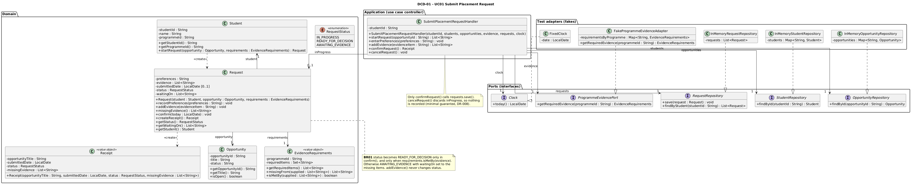
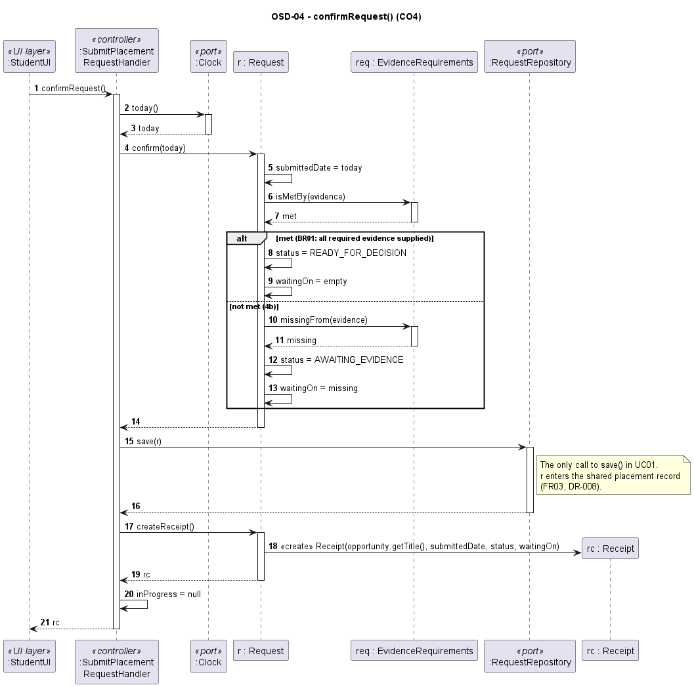
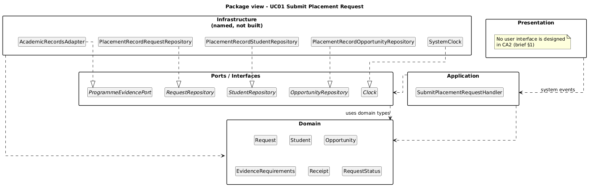

# OOAD CA2 Design Dossier

## Scenario 28: Student Work-Placement Coordination Service

| Field | Value |
| --- | --- |
| Module | Object Oriented Analysis and Design |
| Group | Daniel Courtney, Eoin Mannix, Isabelle Lynch, Bartlomiej Jedrzejowski |
| Use case designed | UC01 Submit Placement Request |
| Repository tag | `ca2-submission` |

<br>

## Contents

1. [Introduction](#1-introduction)
2. [Scenario Selection and Analysis Baseline](#2-scenario-selection-and-analysis-baseline)
3. [Backlog, Scope and Traceability](#3-backlog-scope-and-traceability)
4. [Behavioural Model](#4-behavioural-model)
5. [Responsibilities and Design Class Diagram](#5-responsibilities-and-design-class-diagram)
6. [Interactions, Architecture and Consistency](#6-interactions-architecture-and-consistency)
7. [Design Evaluation and Rationale](#7-design-evaluation-and-rationale)
8. [Process, Review and AI Use](#8-process-review-and-ai-use)
9. [Limitations and Next Steps](#9-limitations-and-next-steps)
10. [References](#10-references)

<br>

## 1. Introduction

This dossier explains and justifies the group's object-oriented design for Scenario 28, the Student Work-Placement Coordination Service. It does not repeat the design artefacts. Instead, it walks through them in the order they were produced, says why each decision was made, and points to the file where the detail can be checked.

The design follows the path taught in the module, from analysis to design (Larman, 2005):

<br>

**Scenario and CA1 analysis**
- reconciled baseline (01-03)
- prioritised backlog and selected use case (04)
- fully dressed use case and Gherkin
- system sequence diagram (05)
- operation contracts (06)
- CRC cards and GRASP (07)
- design class diagram (08)
- object-interaction sequence diagrams (09)
- architecture and integration contract (10)
- traceability (11) and evaluation (12)

The group made the decision to design one use case (*UC01 Submit Placement Request*) in depth rather than several use cases in less detail ([DR-003](decisions/decision-log.md)). Every member contributed to the same use case, with work divided by artefact (Section 8).

<br>

## 2. Scenario Selection and Analysis Baseline

### 2.1 Choosing the scenario

Each member brought the scenario they analysed in CA1: Scenario 02 (Eoin), 03 (Bart), 05 (Isabelle) and 28 (Dan). Before scoring, the group agreed six criteria in the [suitability matrix (01)](01-scenario-suitability-matrix.md): scope, behavioural richness, OO potential, sliceability, testability and comparability. Each criterion has a written descriptor for a score of 1, 2 or 3, so a score means the same thing whichever member gives it.

Each member scored the three scenarios they did not write. This avoided authors marking their own work. No two raters differed by more than one point on any criterion, so the averages were used without adjustment. The averaged totals were 14.3 (Scenario 02), 13.0 (Scenario 03), 16.0 (Scenario 05) and 15.7 (Scenario 28), out of 18.

Scenarios 05 and 28 were effectively tied. The group chose Scenario 28 because it scored higher on testability and comparability ([DR-001](decisions/decision-log.md)). Its central rule, that a request needs the programme's evidence before it can be decided (BR01), has a clear pass or fail outcome, and its use cases were closer in size. The lecturer approved Scenario 28 with no expansion items ([DR-002](decisions/decision-log.md)).

### 2.2 Reconciling the CA1

The Scenario 28 CA1 was not adopted unchanged. The [reconciliation and expansion record (02)](02-reconciliation-and-expansion-record.md) reviews it item by item (RC01 to RC17), using the issues the other three members raised while scoring. Items that were checked and kept are recorded too, so the record shows the whole analysis was reviewed, not just the parts that changed.

<br>

The decisions that matter most for UC01 are:

| ID | Decision | Effect on UC01 |
| --- | --- | --- |
| RC05 | BR01 accepted. A5 (each programme sets its own evidence requirements) becomes the working assumption for open question Q1 | BR01 is testable now, so UC01 is not blocked |
| RC12 | UC01's detailed use case revised to separate extensions (goal still reached) from exceptions (goal fails) | Gives the clear paths 4a, 4b and 5a used through the rest of the design |
| RC03 | Priority rules (Q2) deferred | Keeps an unagreed policy out of the first release |

The group also adopted six practices from the other CA1s (PA01 to PA06). Two shaped the design directly. PA04, from Scenario 03, is the extensions and exceptions layout for detailed use cases. PA05, from Scenario 02, models an external system as a supporting actor reached through an interface. PA05 is why Academic Records appears as a supporting actor in the SSD and as `ProgrammeEvidencePort` in the design.

The group added five expansion items (EX01 to EX05): working assumptions for Q3 and Q4, a deferred requirement for priority rules, and two new domain concepts. None of these is needed for UC01, but they are recorded so a later use case can pick them up.

<br>

### 2.3 The revised baseline

The [revised analysis baseline (03)](03-revised-analysis-baseline.md) applies these decisions to the CA1. It is the single agreed source for scope, stakeholders, requirements, rules, assumptions, use cases, user stories and the domain model. Every change is marked with the reconciliation, practice or expansion ID that caused it and listed in a change log (CL01 to CL33), so any line can be traced back to why it changed. The group adopted 02 and 03 as the CA2 baseline in [DR-006](decisions/decision-log.md).

<br>

## 3. Backlog, Scope and Traceability

### 3.1 Product Goal and backlog

The Product Goal, stated in the README, is:

> Give the Kerry College Placement Office one reliable, shared view of every placement request and placement, so students know what their request is waiting on, staff apply the same rules every time, and earlier decisions are never lost.

The [prioritised implementation catalogue (04)](04-prioritised-implementation-catalogue.md) ranks all twelve use cases against five criteria (CR-1 to CR-5). These ask whether a use case:

- receives an input, applies a rule, changes state and gives an observable outcome
- has enough behaviour for every member to do meaningful design work
- can be built and tested with its dependencies replaced by fakes
- is not blocked by an open question
- delivers value against a recorded problem

Four use cases (UC02, UC03, UC09 and UC11) are read-only, so they fail CR-1. UC04 is deferred because its priority rules are not agreed. UC05 and UC08 depend on working assumptions that are not yet agreed (DR-004, DR-005), and UC07 is partly blocked by open questions Q5 and Q9. Four use cases meet all five criteria: UC01, UC06, UC10 and UC12.

<br>

### 3.2 Why UC01

Of the four use cases that meet all five criteria, the group chose UC01 Submit Placement Request for three reasons recorded in 04. It is the entry point for every placement: without a request, there is no placement. It addresses problem PR2, that requests arrive incomplete through several channels. And it was the best-prepared use case from the CA1, already having a detailed use case with an alternative path and two exceptions, and a full feature file.

UC01 also has enough behaviour to design properly. It has:

- a business rule that changes the outcome (BR01)
- a state change (the request's status)
- an external dependency (Academic Records)
- an alternative path (4a)
- two exception paths (4b and 5a)
- a minimal guarantee that a cancelled request leaves no trace

<br>

### 3.3 Scope of the design

The design covers UC01 only. Other domain concepts, such as Placement, Decision and Supervisor, stay in the domain model but get no design classes until their use cases are designed. This keeps every class in the design tied to a responsibility in UC01, and is recorded in 07 Note 1.

<br>

### 3.4 Traceability

The [traceability matrix (11)](11-traceability-matrix.md) traces UC01 from US01 and FR01, through BR01 and assumptions A3 and A5, to the Gherkin scenarios, SSD, contracts, CRC cards, sequence diagrams and design classes. It then breaks this down per system operation, and traces each Gherkin scenario to its path through the design. Section 6.3 covers the consistency checks it records.

Identifiers are carried over from CA1 and never renumbered (DoD-03). This means a reader can follow BR01 from the CA1 rules register to the one method that applies it, `Request.confirm()`.

<br>

## 4. Behavioural Model

### 4.1 Fully dressed use case

The [UC01 detailed use case](use-cases/UC01-submit-placement-request.md) has seven main steps. The student starts a request for an open opportunity, supplies preferences and evidence, and the system checks the evidence against the programme's requirements (BR01). The student then confirms, and the system records the request with status *ready for decision* and shows the student it has been received.

The paths are separated by whether the goal is still reached:

| Path | Type | What happens | Outcome |
| --- | --- | --- | --- |
| Main | Success | All evidence supplied and confirmed | Recorded as *ready for decision* |
| 4a | Extension | Evidence missing. The system says what, the student adds it | Same as main |
| 4b | Exception | The student cannot supply the missing evidence and confirms anyway | Recorded as *awaiting evidence*, with the missing items listed |
| 5a | Exception | The student cancels before confirming | Nothing recorded |

Path 4b depends on a working assumption: an incomplete request is still recorded, but held as *awaiting evidence*, rather than rejected. This is open issue OI3 in the use case, which traces to clarification question Q1. The open issues list names the question behind each assumed step, so each one can be revisited if the Placement Office decides otherwise.

<br>

### 4.2 Gherkin scenarios

The [feature file](features/submit-placement-request.feature) turns the use case into five executable scenarios, grouped under two `Rule:` blocks: one for BR01 and one for the minimal guarantee. A shared Background fixes the test data: student S1 on programme P1, which requires evidence items E1 and E2, and opportunity OP7, which is open.

| Scenario | Covers |
| --- | --- |
| SC01 | Main success: all evidence, *ready for decision* |
| SC02 | 4a: missing evidence reported, then added |
| SC03 | 4b: confirmed with E2 missing, *awaiting evidence* |
| SC04 | Boundary: confirming with 3, 2, 1 and 0 items |
| SC05 | 5a: cancelled, nothing recorded |

SC04 is a Scenario Outline added because a rule based on a set of items is most likely to fail at its edges. Its examples check that an extra item (E3) does not break the rule, that exactly E1 and E2 is enough, and that one item or none still gives *awaiting evidence* rather than an error. The same fixed IDs (S1, P1, E1, E2, OP7) are used in the operation contracts (06) and in the worked examples in 08, and the fake evidence adapter holds the same evidence list as the Background (07 Note 9). This means the scenarios can be followed through the design.

<br>

### 4.3 System sequence diagram

[SSD-01 (05)](05-system-sequence-diagrams.md) treats the system as a black box and shows the five system events the student sends:

```text
startRequest(opportunity)
enterPreferences(preferences)
addEvidence(evidenceItem)
confirmRequest()
cancelRequest()
```

Academic Records is shown as a supporting actor outside the boundary (PA05, A3). The system calls it once, after `startRequest`, to get the programme's evidence requirements. A `loop` around `addEvidence` covers 4a. An outer `alt` separates the student confirming from the student cancelling (5a). Inside the confirm branch, a nested `alt` separates the main path from 4b.

Evidence is a separate `addEvidence` event, supplied one item at a time, so the system can tell the student what is still missing after each item (step 4 and extension 4a, 05 Note 1).

<br>

### 4.4 Operation contracts

[06](06-operation-contracts.md) gives one contract per system event (CO1 to CO5). Each states its preconditions and its postconditions as changes to domain objects: instances created, attributes changed and associations formed. They do not say how the changes are made.

The contracts made three things explicit that the use case left implicit:

1. **When the Request exists.** CO1 creates it at `startRequest` so that preferences and evidence have somewhere to be held. This raised the question of how to keep the minimal guarantee if the student cancels. The answer was DR-008: the request is held in progress and only enters the shared placement record when confirmed. CO5 therefore discards it, and nothing has to be deleted.
2. **Where BR01 takes effect.** CO3 (`addEvidence`) reports what is missing but never changes the status. Only CO4 (`confirmRequest`) sets *ready for decision* or *awaiting evidence*. This made it clear that BR01 needed one owner.
3. **What can fail.** Each contract has an Errors row listing the named errors, defined in 10 section 6, that it can signal, such as `ACADEMIC_RECORDS_UNAVAILABLE` and `NO_REQUEST_IN_PROGRESS` ([DR-010](decisions/decision-log.md)). If an error is signalled, none of the postconditions happen and nothing is recorded.

The contract index maps each contract to its use case steps, Gherkin scenarios and sequence diagram, so every contract is accounted for in the object design.

<br>

## 5. Responsibilities and Design Class Diagram

### 5.1 From contracts to responsibilities

[07](07-crc-responsibility-model.md) assigns the responsibilities the contracts imply to classes, using CRC cards and GRASP. There are twelve cards. The two lookup repositories share one card because they have the same responsibility for different objects. Each card lists what the class knows, what it does and who it works with.

The guiding question for every postcondition was "which object has the information to make this true?" (Information Expert). The table in 07 "Responsibility Assignment by System Operation" answers this for every postcondition of CO1 to CO5, which is why the 07 consistency check can confirm that every postcondition has a named object (DoD-16).

<br>

### 5.2 Key responsibility decisions

The most important decisions, with the alternatives the group rejected, are recorded in the eight-row table "GRASP Decisions and Alternatives Considered" in 07, each with the option chosen, the alternative rejected and the reason. Five of them are summarised here:

| Decision | Chosen | Rejected | Why |
| --- | --- | --- | --- |
| Who applies BR01 | `Request.confirm()` | An `EvidenceValidator` service, or the handler | `Request` holds the evidence, so it is the Information Expert. A validator would pull logic away from the data, and the handler would become a bloated controller |
| Who creates `Request` | `Student` | The handler | Creator: the domain model says a Student submits Requests, and `Student` has the data the new request needs |
| Who works out missing items | `EvidenceRequirements.missingFrom()` | `Request` comparing lists | `EvidenceRequirements` owns the required items, so it owns the comparison. Both CO3 and CO4 reuse it |
| How Academic Records is reached | `ProgrammeEvidencePort` with a fake | Calling it directly | Protected Variations and Indirection. The domain never depends on the external system and can be tested without it |
| Where the date comes from | `Clock` interface | The system clock | Tests can fix the date and check `submittedDate` ([DR-011](decisions/decision-log.md)) |

Placing BR01 in `Request.confirm()` is the most important of these. It means the rule is applied in exactly one place (DoD-18). The 07 consistency check confirms this, and the traceability matrix shows it.

<br>

### 5.3 Controller and Pure Fabrication

All five system operations are received by one use case controller, `SubmitPlacementRequestHandler`. The group chose a use case controller rather than a facade controller such as `PlacementSystem`, because a facade controller would gain operations from every later use case and lose cohesion.

The handler is a Pure Fabrication: it represents no domain concept. It coordinates but does not decide. It finds the student and opportunity, passes messages on, saves the confirmed request and returns the receipt. It never inspects evidence or sets a status.

The repositories, the port, the fakes and `Receipt` are also Pure Fabrications. They exist to keep storage, external access and output formatting out of the domain classes (High Cohesion).

<br>

### 5.4 Design class diagram

[DCD-01 (08)](08-design-class-diagram.md) turns the CRC cards into typed classes, with attributes, operation signatures, multiplicities and navigability.



08 "From Domain Model to Design Classes" records what happened to each domain concept UC01 uses:

- **Kept as design classes:** Student, Opportunity and Request.
- **Represented by a port and a value object:** Programme is not a design class. Academic records stay in existing systems (A3), so the design keeps only the student's `programmeId` and reads that programme's requirements into `EvidenceRequirements`.
- **Kept as attributes:** Evidence stays a list of item IDs held by `Request`, as in the domain model, because it has no behaviour of its own in UC01.

Classes were added for:
- the controller
- `EvidenceRequirements`
- `RequestStatus` (an enumeration)
- `Receipt`
- the five ports and their fakes

Associations are one-way wherever possible, because a two-way link means two objects that must be kept in step (08 Associations and Navigability). For example, `Request` knows its `Student`, but `Student` does not keep a list of its requests; those are found through `RequestRepository.findByStudent`.

The class specifications in 08 give each member's type, purpose and source (contract, CRC card or sequence diagram). For `Request`, 08 also shows how each field changes as the student moves through the use case, including that `submittedDate` stays empty until confirmation.

<br>

## 6. Interactions, Architecture and Consistency

### 6.1 Object-interaction sequence diagrams

[09](09-object-interaction-sequence-diagrams.md) has one sequence diagram per contract (OSD-01 to OSD-05). Each shows the messages that make that contract's postconditions true. For example, OSD-04 (`confirmRequest`) shows:

```text
Handler -> Clock.today()
Handler -> Request.confirm(today)
             Request -> EvidenceRequirements.isMetBy(evidence)       [BR01]
             alt met:     status = READY_FOR_DECISION
             else:        status = AWAITING_EVIDENCE
                          Request -> EvidenceRequirements.missingFrom(evidence)
Handler -> RequestRepository.save(request)
Handler -> Request.createReceipt() -> Receipt
```



OSD-01 shows `Student.startRequest` creating the `Request` (Creator) after the handler has read the evidence requirements through the port. OSD-05 shows the handler discarding the request, with no message to the repository, which is how the minimal guarantee holds on the cancel path.

The 09 message index lists every message, its receiving class and the diagram it appears in. This is how the group checked that no message is sent to an operation missing from the DCD.

<br>

### 6.2 Architecture and integration contract

[10](10-architecture-and-integration-contract.md) places the classes in five layers: Presentation, Application, Domain, Ports and Infrastructure. Presentation is named but not designed, because no UI is in CA2 scope.



Dependencies point inwards. The Domain depends on nothing, so BR01 works the same way however requests are stored or requirements obtained. The Application layer uses only ports, never infrastructure. This applies the Dependency Inversion Principle.

The interface catalogue (IF-01 to IF-05) specifies each port's operations, inputs, outputs and errors. Each port has a test fake, listed in 08 (`FakeProgrammeEvidenceAdapter`, the in-memory repositories and `FixedClock`), so the design can be tested without Academic Records or a real store. Section 6 defines the named errors and which operation signals each one. Sections 7 and 8 record the remaining decisions (DR-010, DR-011) and the assumptions and limitations.

<br>

### 6.3 Consistency

Consistency was checked in both directions. It is recorded in the consistency sections of 06, 07, 08 and 09, and in [11](11-traceability-matrix.md#consistency-checks).

| Check | Result |
| --- | --- |
| One contract and one sequence diagram per system event (DoD-15) | Yes: five events, CO1 to CO5, OSD-01 to OSD-05 |
| Every contract postcondition made true by a named object and message (DoD-16) | Yes |
| Every CRC class on the DCD (DoD-17) | Yes: 13 classes on 12 cards |
| BR01 in one place and minimal guarantee on every path (DoD-18) | Yes: only `Request.confirm()` sets the status, and only `confirmRequest` calls `save()` |
| Every Gherkin scenario traced to a design path (DoD-19) | Yes: see 11 |
| Every DCD operation used in a sequence diagram | Not fully. `Opportunity.isOpen()` is reserved for open issue OI1, and `RequestRepository.findByStudent()` supports tests. Both are explained in 08 and 07 |

The two operations that are not used are kept on purpose and explained, rather than hidden. Removing `isOpen()` would lose the place where the "opportunity not open" check belongs once OI1 is resolved.

<br>

## 7. Design Evaluation and Rationale

The full evaluation is in [12](12-design-evaluation.md). In summary:

**Strengths.**
- *Cohesion is high.* Each class has one kind of job, and BR01 has a single home.
- *Domain coupling is low.* No domain object holds a repository, port or clock, so the domain can be tested with no fakes at all.
- *DR-008 makes cancellation safe by design.* Because nothing is saved until confirmation, there is nothing to undo, and a failed delete cannot break the minimal guarantee.
- *Objects are always valid.* A `Request` is created with status `IN_PROGRESS` and gets a `submittedDate` only when confirmed.

**Trade-offs accepted.**
- *The handler holds state.* It keeps the in-progress request between `startRequest` and `confirmRequest`, so one handler is needed per student session, and an unfinished request is lost if the session ends. The group judged this acceptable, because the minimal guarantee is a stated requirement and an unfinished request has not been submitted yet, so nothing recorded is lost.
- *The handler has five port dependencies.* This is acceptable for a controller, but 12 identifies it as the handler's main weakness.

**Weaknesses identified.**
- None of the named errors has a Gherkin scenario.
- `ACADEMIC_RECORDS_UNAVAILABLE` has no recovery designed.
- If `save()` fails, the confirmed request in memory briefly shows a submitted date and final status that are not in the shared record.

Each weakness has a proposed fix in 12.

The evaluation also checked that the rejected alternatives in 07 and 10 still hold. All do. A separate validator service would only be worth reconsidering if BR01 grows to need data from outside the request.

<br>

## 8. Process, Review and AI Use

### 8.1 How the work was divided

Because one use case was designed, work was divided by artefact rather than by use case ([04 Member Contributions](04-prioritised-implementation-catalogue.md#member-contributions)). Each file has one owner and a reviewer who did not write it:

| Member | Owned | Reviewed |
| --- | --- | --- |
| Daniel Courtney | 01 to 04, 11, 12, UC01 detailed use case, this dossier, README, decision log, repository setup | 10 |
| Isabelle Lynch | 05, 06, 07 | 08, 09, 11, 12, UC01 detailed use case |
| Eoin Mannix | 08, 09 | 05, 06, 07 |
| Bartlomiej Jedrzejowski | 10 | 01 to 04 |

The order of the design meant later files depended on earlier ones. Names agreed in 07 were fixed in 08 and 10, and 07 Note 6 records that if a name changes, 07, 08, 09 and 10 change together.

<br>

### 8.2 Board and workflow

The backlog and the group's work was tracked on Trello, using the columns set out in the CA2 brief:
- Backlog, 
- Ready, 
- In Progress, 
- Peer Review, 
- Blocked,
- Done. 

Each card represents one piece of work, usually one design file, and is assigned to the members working on it. A card started in Backlog, moved to Ready once it was clear and small enough to begin, and to In Progress when a member took ownership of it. When the draft was complete, the card moved to Peer Review so a member who did not write it could check it. 

It moved to Done only once it met the [Definition of Done](definition-of-done.md). Each card is linked to the pull request that merged the work into `main`, so the board, the repository and the review can be traced from one another. Screenshots of the board are in [trello-board1.png](trello-board1.png) and [trello-board2.png](trello-board2.png).

The group met every Tuesday for two hours after classes to discuss progress, agree the next pieces of work and raise any problems with the design. Decisions that changed the shared baseline or design were then recorded in the [decision log](decisions/decision-log.md).

<br>

### 8.3 Definition of Done and review

The group agreed a [Definition of Done](definition-of-done.md) with 26 checks ([DR-012](decisions/decision-log.md)). They cover:

- every file: owner, reviewer, purpose, traceable IDs and matching names
- every diagram: committed source, current export, and matching the text
- the design as a whole: DoD-15 to DoD-19, the consistency checks in Section 6.3
- decisions and AI use
- review: each file approved by a member who did not write it

Review happened at two stages. The first was the review of the CA1 analysis before it became the baseline. Each member scored the three scenarios they did not write (01), so no one marked their own work. The Scenario 28 CA1 was then reviewed item by item using the issues the other three members raised while scoring (02, RC01 to RC17). 

This review changed seven items and added two. For example, in RC17 Isabelle judged the association reasons to be mostly explained from one end only, while Eoin and Bart judged them readable from both ends, so the reasons were reviewed and rewritten where only one end was explained.

The second stage was review of the design files. Each file has a named reviewer who did not write it (Section 8.1), and each change was merged into `main` through a pull request approved by that reviewer, with the pull request linked to its Trello card.

<br>

### 8.4 Decisions

Every significant decision is in the [decision log](decisions/decision-log.md) with its date, status, reasoning, who agreed it and the artefact it affects. There are 14 records:

- 11 accepted
- 2 proposed (DR-004 and DR-005, working assumptions needed only for UC05 and UC08)
- 1 rejected (DR-007)

Recording the rejected and proposed decisions shows what the group considered and did not adopt, as well as what it did.

<br>

### 8.5 Use of AI

AI use is declared in the [AI log](references/AI-Log.md). Each member records their own use: the tool, what it was used for, which artefact it affected, and how the output was checked.

<br>

### 8.6 Retrospective

**What worked and should be retained.** The group worked well as a team. Meeting every Tuesday kept everyone up to date on each other's files and dividing the work by artefact meant every file was checked by someone who had not written it. Designing one use case in depth also meant every member worked on the same design, so problems in one file were usually noticed by the owner of the next one.

**What did not work.** There were disagreements about parts of the work that continued up to the deadline, which left less time for the final consistency checks than we would have liked. The change to the brief partway through the project (DR-013) meant some planned files were dropped and others had to be reworked. The Definition of Done was only formally adopted on 26 November (DR-012), so for most of the work there was no single agreed standard for when a file was finished.

**What we would do differently.** We would agree the Definition of Done at the start of the project, alongside the board, so that each file is checked against it as it moves to Peer Review rather than at the end. We would also add a Risks and Questions list to the board and record disagreements there, with an owner and a date to resolve them by, so they are settled at the next Tuesday meeting instead of carrying on to the deadline.

<br>

## 9. Limitations and Next Steps

- **One use case.** Only UC01 is designed. The design has not yet been tested against a second use case that shares `Request` and `Student`. UC06 Record Selection Decision is the natural next step, because it meets all five catalogue criteria and acts on the requests UC01 creates. It would also show whether `Request` stays cohesive or needs splitting.
- **Open issue OI1.** What makes an opportunity open is not agreed. Being open is a precondition of CO1, and `isOpen()` and `OPPORTUNITY_NOT_OPEN` are reserved so the check can be added without restructuring.
- **Failure paths.** The named errors are owned and documented but have no Gherkin scenarios. Adding them is the first change the group would make.
- **No implementation.** Storage and the Academic Records adapter are specified as interfaces with fakes. Their real implementations are out of scope for CA2.

<br>

## 10. References

Courtney, D. (2026) *OOAD-CA1-Analysis*. Available at: https://github.com/dan-1379/OOAD-CA1-Analysis (Accessed: 27 November 2026).

Cucumber (2026) *Gherkin reference*. Available at: https://cucumber.io/docs/gherkin/reference/ (Accessed: 23 October 2026).

Jedrzejowski, B. (2026) *VolunteerTransportCoordination_Scenario3_OOAD*. Available at: https://github.com/Bart-Jed/VolunteerTransportCoordination_Scenario3_OOAD (Accessed: 27 November 2026).

Larman, C. (2005) *Applying UML and patterns: an introduction to object-oriented analysis and design and iterative development*. 3rd edn. Upper Saddle River, NJ: Prentice Hall.

Lynch, I. (2026) *RuralHealthAppointmentTransportService*. Available at: https://github.com/isabellelynch/RuralHealthAppointmentTransportService (Accessed: 27 November 2026).

Mannix, E. (2026) *OOAD-ca1-analysis*. Available at: https://github.com/EoinMannix/OOAD-ca1-analysis (Accessed: 27 November 2026).
