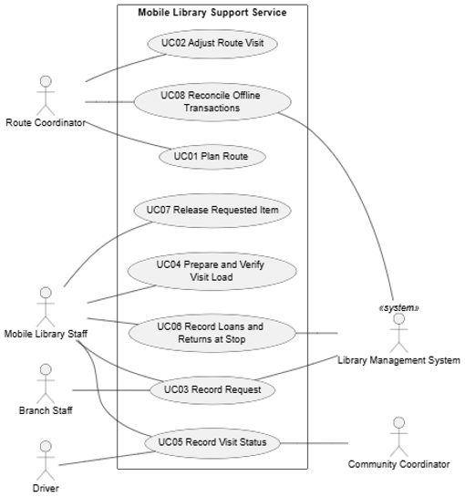
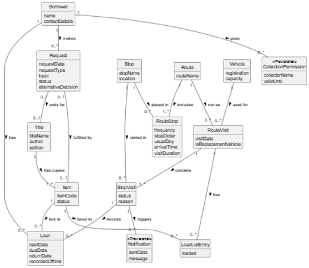

# Scenario 02: Kerry Mobile Library Support Service

**Analysed by:** Daniel Courtney

**Full CA1:** [ Scenario 02 - Kerry Mobile Library Support Service](../scenarios/02_Kerry_Mobile_Library_Support_Service.md)

 

## Summary

Kerry Rural Library is a service for small communities and towns that do not have direct access to a permanent library. It runs on recurring routes enabling remote locations access to library resources. 

Information about the routes, requests, loads and disruptions is spread across spreadsheets, printed route sheets, phone calls and social media. The problem is not the lack of any particular technology but the unreliable and inconsistent information between staff and borrowers. 

 

## 1. Scope

**In Scope and Out of Scope:**

| In Scope | Out of Scope |
| --- | --- |
| Route and stop planning | Replacing the main library system |
| Change or pausing a stop | Borrower account and the book catalogue |
| Book requests linked to a trip | Work in the permanent branch libraries |
| Van load lists and load checks | Automatic route planning |
| Stop status" on time, delayed, moved, or cancelled | Live van tracking on a map |
| Messages to borrowers and community contacts about changes | Posting on social media and noticeboards |
| The borrowers choice on an alternative item |  |
| Loans and returns with no signal and duplicate checks |  |
| Who collected material for a borrower |  |

 

**Constraints:**
- CS1: The wider library management system will not be replaced
- CS2: Mobile connectivity is unreliable in some areas.
- CS3: The initial scope is the two vehicles and their community stops

 

**Stakeholders and actors:**
| Stakeholder | Actor or offstage | Main interest |
| :--- | :--- | :--- |
| Route coordinator | Primary actor | Plan a route, change the stop order for a visit, check offline records |
| Mobile library staff member | Primary actor | Record requests, loading, loans and returns, record visit status |
| Driver | Primary actor | Record that a visit is delayed, moved or cancelled |
| Branch staff member | Primary actor | Record a request for collection from the van |
| Community coordinator | Supporting actor | Be told when a visit is moved or cancelled |
| Library management system | Supporting actor | Provide account and item status, receive loans and returns  |
| Borrower | Offstage stakeholder | Receive requested items, keep the original request |
| School | Offstage stakeholder | Receive class sets |
| Route spreadsheet | Not an actor | Part of the current process, not an external role |

 

## 2. Behaviour

**Business rules**

| Rule | Description |
| --- | --- |
| BR01 | Each stop has a usual day, arrival time and visit duration. |
| BR02 | A paused stop remains part of its normal route. |
| BR03 | Items for a mobile stop must be linked to the correct route and loaded before departure. |
| BR04 | An item reserved for another borrower must not be given out. |
| BR05 | Staff must tell a delayed visit apart from a cancelled visit. |

 

**Use cases**

| Use Case | Primary Actor | Outcome |
| --- | --- | --- |
| UC01 Plan Route | Route coordinator |  A route is recorded with its ordered stops|
| UC02 Adjust Route Visit | Route coordinator | The stop order for one visit is changed, or a stop is paused |
| UC03 Record Request | Branch staff member | A request is recorded and linked to one RouteVisit |
| UC04 Prepare and Verify Visit Load | Mobile-library staff member | Every item on the load list is loaded or reported |
| UC05 Record Visit Status | Driver | A stop is recorded as on time, delayed, moved or cancelled and those affected are told about it  |
| UC06 Record Loans and Returns at Stop | Mobile-library staff member | Loans and returns are recorded, with or without a connection |
| UC07 Release Requested Item | Mobile-library staff member | Requested material is given to the borrower, or the person who collected it is recorded |
| UC08 Reconcile Offline Transactions | Route coordinator | Offline loans and returns are entered without duplicates |

**Use case model:**

 

## 3. OO Potential

**Retained domain concepts (count: 14)**

- Borrower
- Title
- Item
- Request
- Loan
- Route
- Stop
- RouteStop
- RouteVisit
- StopVisit
- Vehicle
- LoadListEntry
- CollectionPermission
- Notification

 

**Main associations**

| Class A | Association | Class B | Multiplicity | Reason |
| :--- | :--- | :--- | :--- | :--- |
| Borrower | makes | Request | 1 to 0..* | A borrower may make no requests or many |
| Borrower | has | Loan | 1 to 0..* | Every loan is for exactly one borrower |
| Borrower | gives | CollectionPermission | 1 to 0..* | Provisional (Q2) |
| Title | has copies | Item | 1 to 1..* | A title held by the library has at least one copy |
| Request | asks for | Title | 0..* to 0..1 | A topic request names no title |
| Request | fulfilled by | Item | 0..1 to 0..1 | Only set once an item is chosen |
| Item | lent in | Loan | 1 to 0..* | One item, many loans over time |
| Route | includes | RouteStop | 1 to 1..* | A route must have at least one stop |
| Stop | placed in | RouteStop | 1 to 0..* | One stop can be on several routes |
| Route | run as | RouteVisit | 1 to 0..* | One visit per running date |
| Vehicle | used for | RouteVisit | 1 to 0..* | One vehicle per visit |
| RouteVisit | contains | StopVisit | 1 to 1..* | One StopVisit for each stop on that day |
| Stop | visited in | StopVisit | 1 to 0..* | One stop is visited on many dates |
| RouteVisit | has | LoadListEntry | 1 to 0..* | The load list for that visit (FR06) |
| Item | listed in | LoadListEntry | 1 to 0..* | One item can be on many load lists over time |
| StopVisit | records | Loan | 1 to 0..* | Where the loan was made (FR11) |
| StopVisit | triggers | Notification | 1 to 0..* | Provisional (FR09) |

 

**Domain model**

 

## 4. Sliceability

**Candidate slices**

| Slice | Event | Rules | State | Depends on |
| --- | --- | --- | --- | --- |
| A |
| B |
| C |
| D |

 

## 5. Testability

 

## 6. Comparability

 

## Strengths and Weaknesses

**Strengths:**

**Weaknesses**