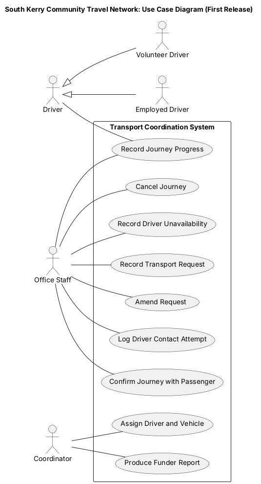
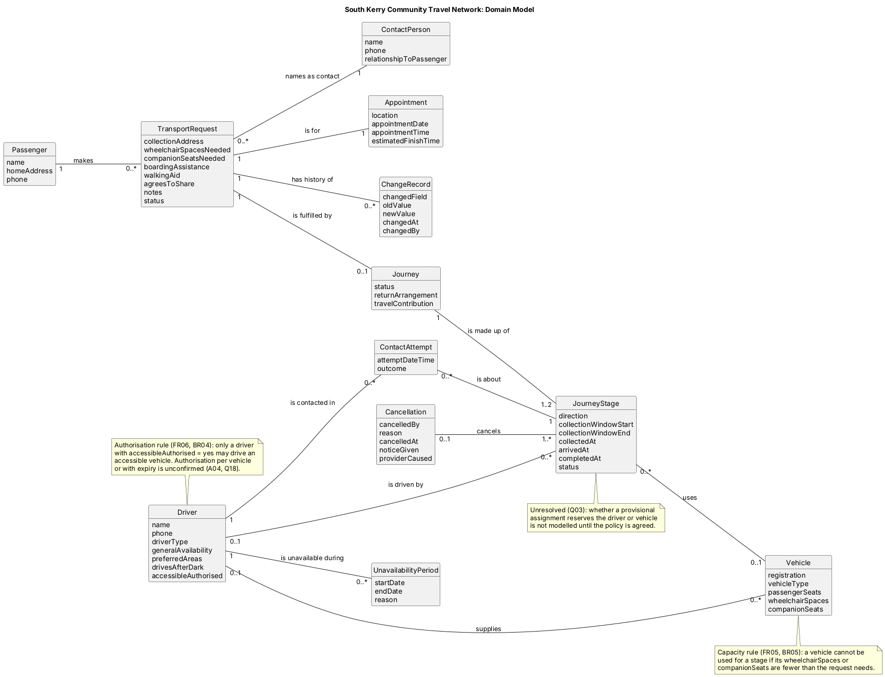

# CA1 Scenario 03: Volunteer Transport Coordination Service

**Analysed by:** Daniel Courtney

**Reviewed by:**

**Full CA1:** [ Scenario  03 - Volunteer Transport Coordination Service](../../scenarios/03_Volunteer_Transport_Coordination_Service.md)

 

## Summary

 

## 1. Scope

**In Scope and Out of Scope:**

*In Scope: Specified for the First Release*

- Recording transport requests with their mandatory details and preventing allocation until those details are complete (FR01, FR02).

- Recording changes to requests (FR03).

- Recording practical travel needs (FR04).

- Checking vehicle capacity and accessible-vehicle authorisation when a journey is assigned (FR05, FR06).

- Recording driver contact attempts, including declined offers (FR07).

- Recording outward and return stages separately (FR08).

- Producing passenger confirmations (FR09).

- Recording journey progress by drivers, including where there is no mobile signal (FR10, NFR03).

- Recording cancellations with their reason and responsibility (FR11).

- Identifying journeys affected when a driver becomes unavailable (FR12).

- Producing anonymised summary reports for funders (FR13).

- Removing clinical information that referrers include unnecessarily (FR14).

- Restricting drivers to the passenger details of journeys they have accepted (NFR01).

*Out of Scope*

- Emergency transport or dispatch.

- Direct access to healthcare or clinical records.

- Clinical decision-making.

- Booking or changing healthcare appointments with providers.

- Processing payments for travel contributions.

- Driver recruitment, training and vehicle maintenance.

- Live vehicle tracking or turn-by-turn navigation.

 

**Constraints:**

| ID | Constraint | Type | Source | Impact |
|------|------------|------|--------|--------|
| C01 | The first release covers planned transport only. Emergency dispatch, direct access to healthcare records and clinical decision-making are excluded. | Scope | *Information and organisational context* | Bounds the requirements. See [BR01](#BR01). |
| C02 | Mobile coverage in the service area is uneven. | Environmental | *Information and organisational context* | Driver features must work offline. See [NFR03](../requirements/02-non-functional-requirements.md#NFR03). |
| C03 | Some volunteers prefer printed journey sheets, so the service cannot rely on every driver using a device. | Organisational | *Information and organisational context* | Paper must remain supported. See [DFR11](../requirements/03-deferred-requirements.md#DFR11), [A08](05-assumptions.md#A08). |
| C04 | The fleet is volunteers' own cars plus two accessible vehicles operated by employed drivers. | Resource | *Organisation and current service* | Accessible-vehicle capacity is very limited. See [FR05](../requirements/01-functional-requirements.md#FR05), [FR06](../requirements/01-functional-requirements.md#FR06). |
| C05 | Volunteer drivers give general availability only and may decline journeys. | Organisational | *Planning and driver allocation* | Allocation cannot assume a volunteer is available. See [FR07](../requirements/01-functional-requirements.md#FR07), [BR08](#BR08). |
| C06 | Passenger data must be handled in line with the GDPR and the Data Protection Act 2018, including data minimisation (Article 5(1)(c)) and special protection for health data (Article 9) ([European Parliament and Council, 2016](../references/01-text-sources.md#gdpr), [Ireland, 2018](../references/01-text-sources.md#dpa2018)). | Legal | Confidentiality concerns throughout the scenario. Applicability assumed ([A17](05-assumptions.md#A17)). | See [NFR01](../requirements/02-non-functional-requirements.md#NFR01), [FR13](../requirements/01-functional-requirements.md#FR13), [FR14](../requirements/01-functional-requirements.md#FR14), [Q20](04-stakeholder-questions.md#Q20). |
| C07 | Clinical diagnoses are not required and must not be held, although referrers sometimes include them. | Legal / data | *Transport requests and eligibility* | See [FR14](../requirements/01-functional-requirements.md#FR14), [BR07](#BR07). |
| C08 | Existing records are held in a shared calendar, a spreadsheet and paper driver sheets. | Transition | *Organisation and current service* | Data must be migrated or re-entered before go-live. See [R06](#R06). |
| C09 | Several policies (eligibility review, provisional reservation, maximum waiting time, notification order) are not yet agreed. | Organisational | *Unresolved matters* | Dependent requirements are deferred. See [Q01](04-stakeholder-questions.md#Q01), [Q03](04-stakeholder-questions.md#Q03), [Q05](04-stakeholder-questions.md#Q05), [Q07](04-stakeholder-questions.md#Q07). |
| C10 | As a not-for-profit organisation, the network is likely to have limited budget and staff time for implementation and training. | Financial | *Organisation and current service*. Limited budget is inferred. | Favours a simple, low-cost solution. See [R10](#R10). |

 

**Stakeholders and actors:**
| Stakeholder | Actor or offstage | Main interest |
| :--- | :--- | :--- |
| **South Kerry Community Travel Network** (network management (A)) | Offstage  | Deliver reliable planned transport to eligible residents, cope with rising demand and meet funder requirements. |
| **Coordinator** | Primary | A reliable overview of requests, journeys, accessible-vehicle demand and driver availability, and efficient allocation. |
| **Office staff** | Primary  | Capture complete requests and secure drivers with fewer repeated calls. |
| **Volunteer driver** | Primary  | Enough information to help passengers safely, journeys that fit their availability and preferences. |
| **Employed (accessible-vehicle) driver** | Primary  | Know wheelchair and companion seating needs before the vehicle is assigned. |
| **Referrer / referring organisation** | Offstage  | Submit requests easily and update them when appointments change. |
| **Passenger** (regular or new) | Offstage  | Reach appointments on time and get home safely. |
| **Family member / companion** | Offstage  | Arrange or share transport on the passenger's behalf. |
| **Healthcare provider / clinic** | Offstage  | Patients attend their appointments (A). |
| **Funders** | Offstage  | Evidence that the service is used effectively. |
| **Data protection officer (A)** | Offstage  | Compliance with data protection law. |

 

## 2. Behaviour

**Business rules**

| Rule | Description |
| --- | --- |
| BR01 | The service provides transport only to planned healthcare appointments. It does not provide emergency transport. |
| BR02 | A passenger is eligible only if they have no reasonable transport alternative and can travel safely in the available vehicles. |
| BR03 | A request is not allocated until its mandatory details are complete. |
| BR04 | An accessible vehicle may only be driven by a driver authorised to drive it. |
| BR05 | A vehicle is not assigned to a passenger unless it meets that passenger's wheelchair and companion seating needs. |
| BR06 | Passengers share a journey only if each has agreed to share. |
| BR07 | A driver receives only the passenger information needed to complete a journey they have accepted. |
| BR08 | Volunteer drivers may decline any individual journey. |
| BR09 | A cancellation caused by the healthcare provider does not count against the passenger. |
| BR10 | If no suitable transport can be provided, both the passenger and the referrer are informed promptly. |
| BR11 | Reports for funders do not identify individual passengers. |

 

**Use cases**

| Use Case | Primary Actor | Outcome |
| --- | --- | --- |
| UC01 Record Transport Request | Office staff | Enter a request's mandatory details and practical travel needs. The request cannot be allocated until all mandatory details are complete. |
| UC02 Amend Request | Office staff | Change a request when an appointment or need changes, with each change recorded. Remove clinical information a referrer included. |
| UC03 Assign Driver and Vehicle | Coordinator | Assign a suitable driver and vehicle to the outward and return stages of a journey. |
| UC04 Log Driver Contact Attempt | Office staff | Record the date, time and outcome of each call to a driver about a journey. |
| UC05 Confirm Journey with Passenger | Office staff | Produce a confirmation stating the collection window, the driver or service contact, whether the driver will wait or return later and any travel contribution. |
| UC06 Record Journey Progress | Driver, office staff | Record collection, arrival and return completion for each stage, including when there is no mobile signal. Office staff record progress for drivers without a smartphone who phone it in. |
| UC07 Cancel Journey | Office staff | Cancel a journey or one stage, recording who cancelled, the reason, the notice given and whether the healthcare provider caused it. |
| UC08 Record Driver Unavailability | Office staff | Record a period when a driver is unavailable and list the journeys affected, for reassignment through UC03. |
| UC09 Produce Funder Report | Coordinator | Produce anonymised totals for a chosen date range. |

**Use case model:**

 

## 3. OO Potential

**Retained domain concepts (count: 12)**

- Passenger 
- ContactPerson
- TransportRequest
- Appointment
- Journey
- JourneyStage
- Driver
- Vehicle
- ContactAttempt
- ChangeRecord
- Cancellation
- UnavailabilityPeriod

 

**Main associations**

| Class A | Association | Class B | Multiplicity | Reason |
| :--- | :--- | :--- | :--- | :--- |
| Passenger | makes | TransportRequest | 1 : 0..* | Each request is made for exactly one passenger. A passenger may have no requests yet, or many over time, since regular passengers travel often ([FR01](../requirements/01-functional-requirements.md#FR01)). |
| TransportRequest | names as contact | ContactPerson | 0..* : 1 | Each request names exactly one contact, who may be a family member. A contact may be named on many requests ([FR01](../requirements/01-functional-requirements.md#FR01), [A01](05-assumptions.md#A01)). |
| TransportRequest | is for | Appointment | 1 : 1 | Each request is for exactly one appointment, and each recorded appointment belongs to exactly one request ([FR01](../requirements/01-functional-requirements.md#FR01)). |
| TransportRequest | is fulfilled by | Journey | 1 : 0..1 | Each journey fulfils exactly one request. A request has no journey until it is allocated, then at most one ([FR02](../requirements/01-functional-requirements.md#FR02), [UC03](07-use-case-model.md#UC03), [BR03](06-rules-and-uncertainty-register.md#BR03)). |
| TransportRequest | has history of | ChangeRecord | 1 : 0..* | Each change belongs to exactly one request. A request may never change, or change many times ([FR03](../requirements/01-functional-requirements.md#FR03)). |
| Journey | is made up of | JourneyStage | 1 : 1..2 | Each stage belongs to exactly one journey. A journey has an outward stage and, unless one isn't needed, a return stage ([FR08](../requirements/01-functional-requirements.md#FR08), [A05](05-assumptions.md#A05)). |
| JourneyStage | is driven by | Driver | 0..* : 0..1 | A driver may drive no stages or many. A stage has no driver while it is outstanding, then at most one ([FR08](../requirements/01-functional-requirements.md#FR08), [UC03](07-use-case-model.md#UC03) alt. 6a). |
| JourneyStage | uses | Vehicle | 0..* : 0..1 | A vehicle may be used on many stages. A stage has no vehicle until one is assigned, then at most one ([FR05](../requirements/01-functional-requirements.md#FR05), [FR06](../requirements/01-functional-requirements.md#FR06), [UC03](07-use-case-model.md#UC03)). |
| Driver | supplies | Vehicle | 0..1 : 0..* | Volunteers use their own cars, so an own car is supplied by one driver. An accessible vehicle is supplied by no driver. A driver may supply none or several (*Organisation and current service*, [C04](06-rules-and-uncertainty-register.md#C04)). |
| Driver | is contacted in | ContactAttempt | 1 : 0..* | Each attempt is a call to exactly one driver. A driver may be contacted many times ([FR07](../requirements/01-functional-requirements.md#FR07)). |
| ContactAttempt | is about | JourneyStage | 0..* : 1 | Each attempt is about exactly one stage. A stage may need no calls or many before a driver accepts ([FR07](../requirements/01-functional-requirements.md#FR07), office staff evidence). |
| Cancellation | cancels | JourneyStage | 0..1 : 1..* | Each stage is cancelled at most once. A cancellation covers one stage or both, because a stage can be cancelled on its own ([FR11](../requirements/01-functional-requirements.md#FR11), [UC07](07-use-case-model.md#UC07), [US05](../requirements/04-user-story-backlog.md#US05)). |
| Driver | is unavailable during | UnavailabilityPeriod | 1 : 0..* | Each period belongs to exactly one driver. A driver may have no periods or many ([FR12](../requirements/01-functional-requirements.md#FR12)). |

 

**Domain model**

 

## 4. Sliceability

**Candidate slices**

| Slice | Event | Rules | State | Depends on |
| --- | --- | --- | --- | --- |
| A – Record Transport Request (UC01) | Office staff enter a request with its mandatory details and practical travel needs | BR03: a request is not allocated until its mandatory details are complete; BR01: planned healthcare appointments only | TransportRequest created and marked complete (ready for allocation) or incomplete (FR01, FR02, FR04) | Passenger, ContactPerson, Appointment |
| B – Assign Driver and Vehicle (UC03) | Coordinator assigns a driver and vehicle to the outward and return stages of a journey | BR04: accessible vehicle only driven by an authorised driver; BR05: vehicle must meet wheelchair and companion seating needs; BR06: shared journeys only with each passenger's agreement; BR08: volunteers may decline | Journey created with its stages; each JourneyStage given a driver and vehicle (FR05, FR06, FR08) | A complete TransportRequest; Driver availability; Vehicle details |
| C – Cancel Journey (UC07) | Office staff cancel a whole journey or one stage | BR09: a cancellation caused by the healthcare provider does not count against the passenger | Cancellation recorded with who cancelled, the reason, the notice given and whether the provider caused it; affected stage(s) cancelled (FR11) | A Journey with assigned stages |
| D – Amend Request (UC02) | Office staff change a request when an appointment or need changes | Each change is recorded (FR03); clinical information a referrer included is removed (FR14, C07) | ChangeRecord added to the request's history; unnecessary clinical information removed | An existing TransportRequest |

 

## 5. Testability

**Gherkin coverage:** [from CA1: X feature files, X scenarios; which cover failure and boundary cases]

**Rules with clear pass/fail outcomes:**
- BR03: a request with a missing mandatory detail cannot be allocated.
- BR04: an unauthorised driver cannot be assigned to an accessible vehicle.
- BR05: a vehicle without enough wheelchair or companion seating cannot be assigned.
- BR06: a passenger who has not agreed to share cannot be placed on a shared journey.
- BR08: a declined offer is recorded and the driver is not assigned.
- BR09: a provider-caused cancellation is not counted against the passenger.
- BR11: a funder report contains no field that identifies a passenger.

**Boundary cases:**
- A request complete except for one mandatory detail.
- A wheelchair user plus a companion where the vehicle has exactly enough seats, and one too few.
- An outward stage assigned but the return stage still outstanding.
- Only the return stage cancelled, leaving the outward stage in place.
- A cancellation made with very short notice.
- Two passengers sharing, where one withdraws their agreement.

**Open questions that block tests:**

| Question | What it blocks |
| :--- | :--- |
| Q01 | Eligibility review policy, so BR02 cannot be tested in slice A |
| Q03 | Provisional reservation policy, which affects how a stage is held during assignment in slice B |
| Q05 | Maximum waiting time, which affects confirmation details |
| Q07 | Notification order, which affects who is told first when a journey is cancelled or cannot be provided (BR10) |
| Q20 | Data protection questions, which affect how far clinical information is removed in slice D |

 

## 6. Comparability

| Slice | Rules | State changes | Failure handling | Relative size |
| :--- | :--- | :--- | :--- | :--- |
| A – Record Transport Request | BR01, BR03 | Request created; complete or incomplete | Missing mandatory detail; not a planned appointment | Medium |
| B – Assign Driver and Vehicle | BR04, BR05, BR06, BR08 | Journey and stages created; driver and vehicle assigned | Unauthorised driver; unsuitable vehicle; no sharing agreement; driver declines | Large |
| C – Cancel Journey | BR09 | Cancellation recorded; stage(s) cancelled | Cancelling an already-cancelled stage; provider-caused vs passenger-caused | Medium |
| D – Amend Request | FR03, FR14 | Change recorded; clinical information removed | Amending a request already allocated; clinical information included | Small–Medium |

All four slices apply rules and change state, so none is read-only. Slice B is clearly the heaviest, with four rules and two stages to assign. Slice D is the lightest, and may need more failure cases, or swapping for UC06, to be comparable.

 

## Strengths and Weaknesses

**Strengths:**

**Weaknesses:**