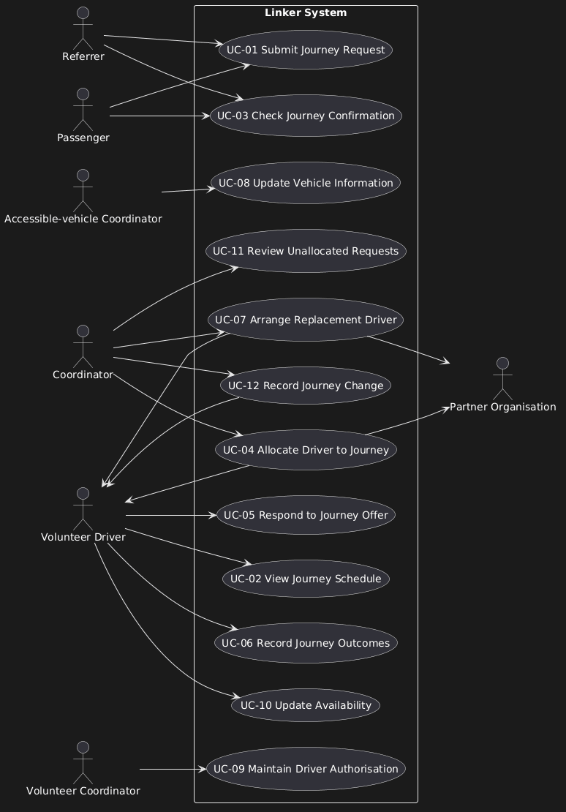
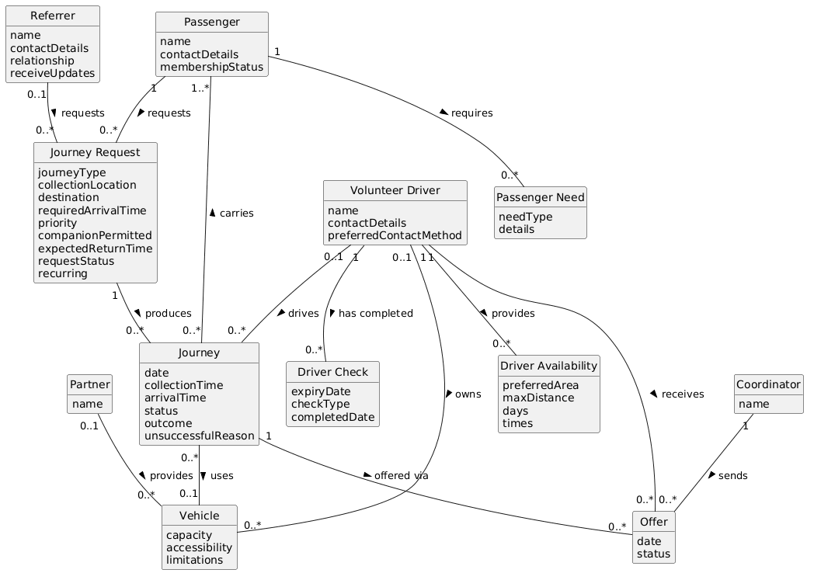

# CA1 Scenario 05 - Rural Health Appointment Transport

**Analysed by:** Daniel Courtney

**Reviewed by:**

**Full CA1:** [ Scenario  05 - Rural Health Appointment Transport](../../scenarios/05_Rural_Health_Appointment_Transport_Service.md)

 

## Summary

Kerry Community Link coordinates non-emergency journeys for residents who have difficulty using ordinary public transport. Journeys include community activities, shopping, education, social appointments and essential local services. Volunteer drivers use their own cars, while partner organisations occasionally provide accessible vehicles.

 

## 1. Scope

**In Scope and Out of Scope:**

*In Scope*

|  ID   | Capability                                                                         |   Problem IDs    | Evidence                                                  |
| :---: | ---------------------------------------------------------------------------------- | :--------------: | :-------------------------------------------------------- |
| SC-01 | Record Journey Requests.                                                           |       P-03       | E-04                                                      |
| SC-02 | Show Driver Availability to coordinators.                                          |    P-04, P-11    | E-08                                                      |
| SC-03 | Provide Suitability Requirements about Passengers to coordinators.                 |    P-08, P-10    | E-06, E-09                                                |
| SC-04 | Flag Journey Changes to coordinators and drivers.                                  |    P-01, P-03    | E-03, E-04                                                |
| SC-05 | Record Journey Records (unsuccessful, collections, etc)                            |   P-02, P-07,    | Changes, Completion and Follow-up section, paragraphs 1–2 |
| SC-06 | Provide drivers' schedule to drivers                                               |       P-01       | E-03                                                      |
| SC-07 | Provide confirmations to passengers.                                               |    P-02, P-03    | E-04                                                      |
| SC-08 | Matching journey details with vehicle suitability for passenger needs.             |    P-08, P-09    | E-01, E-02, E-06, E-09                                    |
| SC-09 | Record driver responses                                                            |    P-04, P-11    | E-08                                                      |
| SC-10 | Handle replacement arrangements when a driver drops out                            |       P-01       | Changes, Completion and Follow-up section, paragraph 1    |
| SC-11 | Show coordinators unallocated requests, workload, unmet demand, incomplete records | P-04, P-07, P-11 | Changes, Completion and Follow-up section, paragraph 3    |

*Out of Scope*

| ID    | Item                                                   | Reason                                                                                                          | Evidence                                                                                                                  |
| ----- | ------------------------------------------------------ | --------------------------------------------------------------------------------------------------------------- | ------------------------------------------------------------------------------------------------------------------------- |
| OS-01 | Emergency Transport                                    | The scenario excludes it.                                                                                       | "The initial scope excludes emergency transport ...". **Changes, completion and follow-up, paragraph 3**                  |
| OS-02 | Real time Vehicle tracking                             | The scenario excludes it.                                                                                       | "The initial scope excludes emergency transport and vehicle tracking." **Changes, completion and follow-up, paragraph 3** |
| OS-04 | Eligibility, Membership, contributions and priorities. | Unconfirmed policy                                                                                              | **Journey requests and passenger needs, paragraph 3**                                                                     |
| OS-05 | Journey Sharing between passengers                     | Unconfirmed policy                                                                                              | **Matching and journey planning, paragraph 1**                                                                            |
| OS-06 | Performing Driver Checks and Verification              | The system records driver authorisation status and uses it for matching but does not perform the checks itself. | **Volunteer drivers and availability, paragraph 2**                                                                       |
| OS-07 | Sensitive health details and financial notes           | Access and sharing rules are not confirmed.                                                                     | **Journey requests and passenger needs, paragraph 1**                                                                     |
| OS-08 | How long the driver waits for a passenger              | A consistent waiting-time policy is not confirmed.   

 

**Constraints:**

| ID   | Constraint                                                                                      | Source                                            |
| ---- | ----------------------------------------------------------------------------------------------- | ------------------------------------------------- |
| C-01 | Volunteers must not have access to financial notes or unrelated passenger history.              | Changes, completion and follow-up, paragraph 3    |
| C-02 | The system must record practical transport information rather than detailed health information. | Journey requests and passenger needs, paragraph 2 |
| C-03 | The system must not rely on all volunteer drivers using email or mobile applications.           | Matching and journey planning, paragraph 3        |

 

**Stakeholders and actors:**

| Stakeholder | Actor or offstage | Main interest |
| :--- | :--- | :--- |
| **Coordinator** (SH-01) | Primary actor (AP-01) | Coordinate suitable, reliable transport by managing journey requests, drivers and vehicles. |
| **Volunteer Drivers** (SH-02) | Primary actor (AP-02) | Receive suitable journey offers and complete assigned journeys. |
| **Passengers** (SH-03) | Primary actor (AP-03) | Receive reliable transport that meets their needs. |
| **Accessible-vehicle Coordinator** (SH-04) | Primary actor (AP-05) | Coordinate accessible vehicles and ensure an authorised driver is available for each journey. |
| **Volunteer Coordinator** (SH-05) | Primary actor (AP-06) | Maintain accurate volunteer availability, authorisation checks, training status and offer history. |
| **Referrer** (SH-06) | Primary actor (AP-04) | Submit journey requests and help ensure passengers receive the final arrangements. |
| **Partner Organisations** (SH-07) | Supporting actor (AS-01) | Occasionally provide accessible vehicles when one is needed for a suitable journey. |
| **Kerry Community Link** (SH-08) | Offstage | Reliable coordination of journeys, accurate records and visibility of unmet demand. |
| **Passenger Companion** (SH-09) | Offstage | Passengers receive reliable arrangements, and any companion's involvement is properly considered. |

 

## 2. Behaviour

**Business rules**

| Rule | Description |
| --- | --- |
| BR-01 | Replacement driver must meet the passenger's and vehicle's requirements. |
| BR-02 | A volunteer may decline a journey without giving a reason. |
| BR-03 | Only drivers who are specifically authorised may drive accessible vehicles. |
| BR-04 | Volunteer drivers should not see financial notes or unrelated passenger history. |
| BR-05 | Practical transport information is recorded rather than detailed health information. |
| BR-06 | Driver is not reserved until the driver accepts the provisional offer. *(Assumed)* |
| BR-07 | A journey is confirmed only when the driver accepts and the coordinator finalises. *(Assumed)* |
| BR-08 | Passengers may only share a journey if they have explicitly agreed to it. *(Assumed)* |

 

**Use cases**

| Use Case | Primary Actor | Outcome |
| --- | --- | --- |
| UC-01 Submit Journey Request | Passenger / Referrer | A journey request (one-way, recurring or return) is submitted with locations, times and assistance needs, so it can be recorded and considered for allocation. |
| UC-02 View Journey Schedule | Volunteer Driver | The driver views their current journey schedule with collection, contact and assistance information. |
| UC-03 Check Journey Confirmation | Passenger / Referrer | The passenger knows the collection details and whether the return journey is confirmed. |
| UC-04 Allocate Driver to Journey | Coordinator | A driver and vehicle that suit the passenger's needs and the journey are assigned. |
| UC-05 Respond to Journey Offer | Volunteer Driver | The offer is accepted or declined, with no reason needed to decline (BR-02). The response is recorded so the coordinator knows whether the journey is confirmed or still needs a driver. |
| UC-06 Record Journey Outcomes | Volunteer Driver | Collection, arrival and return times and the outcome are recorded, with a reason if unsuccessful, giving the coordinator complete and consistent journey records. |
| UC-07 Arrange Replacement Driver | Coordinator | When the allocated driver becomes unavailable, a replacement who meets the passenger and vehicle requirements is allocated. |
| UC-08 Update Vehicle Information | Accessible-vehicle Coordinator | Accessible vehicles, their availability and capabilities are recorded, so allocation only proposes vehicles that suit the passenger. |
| UC-09 Maintain Driver Authorisation | Volunteer Coordinator | Each driver's checks, training, accessible-vehicle authorisation and document expiry are recorded, so allocation only proposes drivers whose checks are current. |
| UC-10 Update Availability | Volunteer Driver | The driver's availability, preferred areas, maximum distance and vehicle limitations are updated, so allocation only proposes drivers who are actually available. |
| UC-11 Review Unallocated Requests | Coordinator | Journey stages, provisional offers, recurring unmet demand and incomplete records are shown, so the coordinator can see what still needs action. |
| UC-12 Record Journey Change | Coordinator | A journey change is recorded and the affected driver is contacted, so their schedule is up to date. |

**Use case model:**

 

## 3. OO Potential

**Retained domain concepts (count: 12)**

- Journey
- JourneyRequest
- VolunteerDriver
- DriverCheck
- DriverAvailability
- Passenger
- PassengerNeed
- Coordinator
- Offer
- Vehicle
- Partner
- Referrer

 

**Main associations**

| Class A | Association | Class B | Multiplicity | Reason |
| :--- | :--- | :--- | :--- | :--- |
| Passenger | requests | Journey Request | 1 to 0..* | A passenger may request a one-way journey, return journey or recurring series |
| Passenger | requires | Passenger Need | 1 to 0..* | Passengers may need wheelchair space, room for a walking aid and similar |
| Volunteer Driver | receives | Offer | 1 to 0..* | A driver may be offered several compatible journeys |
| Volunteer Driver | has completed | Driver Check | 1 to 0..* | Drivers have completed different checks and training |
| Coordinator | sends | Offer | 1 to 0..* | Volunteer coordinator can't tell if a driver was "never contacted" |
| Volunteer Driver | provides | Driver Availability | 1 to 0..* | Volunteer drivers provide usual availability, which may change weekly |
| Referrer | requests | Journey Request | 0..1 to 0..* | Requests are sometimes submitted by relatives or community workers |
| Journey Request | produces | Journey | 1 to 0..* | A request may be a one-way journey, return journey or recurring series |
| Journey | carries | Passenger | 0..* to 1..* | Passengers travelling to nearby destinations may share a journey |
| Volunteer Driver | drives | Journey | 0..1 to 0..* | Volunteer drivers use their own cars |
| Journey | uses | Vehicle | 0..* to 0..1 | Coordinators consider vehicle suitability |
| Journey | offered via | Offer | 1 to 0..* | Repeated unsuccessful offers; provisional offers are recorded inconsistently |
| Volunteer Driver | owns | Vehicle | 0..1 to 0..* | Volunteer drivers use their own cars |
| Partner | provides | Vehicle | 0..1 to 0..* | Partner organisations occasionally provide accessible vehicles |

 

**Domain model**

 

## 4. Sliceability

**Candidate slices**

| Slice | Event | Rules | State | Depends on |
| --- | --- | --- | --- | --- |
| A – Allocate Driver to Journey (UC-04) | Coordinator selects a driver and vehicle for a journey and sends a provisional offer | BR-03: only authorised drivers may drive accessible vehicles; vehicle must suit the passenger's needs (FR-04, FR-05); BR-08: shared journeys only with agreement *(assumed)* | Offer created for the chosen driver; Journey linked to a proposed driver and vehicle | Journey Request, Passenger Need, Driver Check, Driver Availability, Vehicle |
| B – Respond to Journey Offer (UC-05) | Volunteer driver accepts or declines an offer | BR-02: a volunteer may decline without giving a reason; BR-06: driver not reserved until they accept *(assumed)*; BR-07: journey confirmed only when the driver accepts and the coordinator finalises *(assumed)* | Offer marked accepted or declined; Journey confirmed or returned to needing a driver (FR-10, FR-13) | An existing Offer and Journey |
| C – Arrange Replacement Driver (UC-07) | Coordinator replaces a driver who has become unavailable | BR-01: the replacement must meet the passenger's and vehicle's requirements; BR-03 | Original driver removed from the Journey; replacement driver assigned or offered (FR-11) | An allocated Journey; Driver Availability, Driver Check, Vehicle |
| D – Submit Journey Request (UC-01) | Passenger or referrer submits a one-way, return or recurring journey request | BR-05: practical transport information recorded rather than detailed health information (FR-01, FR-03) | Journey Request created with its Passenger Needs; one or more Journeys produced depending on journey type | Passenger, Referrer |

 

## 5. Testability

**Gherkin coverage:** [from CA1: X feature files, X scenarios; which cover failure and boundary cases]

**Rules with clear pass/fail outcomes:**
- BR-01: a replacement driver who does not meet the passenger's or vehicle's requirements cannot be assigned.
- BR-02: a decline with no reason is accepted and recorded.
- BR-03: an unauthorised driver cannot be allocated to an accessible vehicle.
- BR-06 *(assumed)*: a driver is not shown as reserved before accepting.
- BR-07 *(assumed)*: a journey is not confirmed until both the driver accepts and the coordinator finalises.
- BR-08 *(assumed)*: a passenger who has not agreed cannot be placed on a shared journey.

**Boundary cases:**
- A driver check that expires on the journey date.
- A journey just outside a driver's maximum distance or preferred area.
- A return request where the outward journey is confirmed but the return is not.
- A recurring request producing a series of journeys, one of which needs a replacement driver.
- A driver accepting an offer for a journey already confirmed with another driver.

**Open questions that block tests:**

| Question | What it blocks |
| :--- | :--- |
| Q-02 | The scope of a passenger's sharing agreement, so BR-08 cannot be finalised in slice A |
| Q-07 | Whether a provisional offer reserves the driver, which affects BR-06 in slice B |
| Q-08, Q-09 | How drivers without digital access respond to offers, which affects slice B's input route |
| OS-04 | Unconfirmed eligibility and priority policy, so the request's priority cannot be tested in slice D |

 

## 6. Comparability

| Slice | Rules | State changes | Failure handling | Relative size |
| :--- | :--- | :--- | :--- | :--- |
| A – Allocate Driver to Journey | BR-03, BR-08, FR-04, FR-05 | Offer created; driver and vehicle proposed | Unauthorised driver; unsuitable vehicle; no available driver; no sharing agreement | Large |
| B – Respond to Journey Offer | BR-02, BR-06, BR-07 | Offer accepted or declined; Journey confirmed or reopened | Responding to an expired or already-filled offer | Medium |
| C – Arrange Replacement Driver | BR-01, BR-03 | Driver replaced on the Journey | No suitable replacement available | Medium–Large |
| D – Submit Journey Request | BR-05 | Request created; journeys produced by type | Missing details; health information beyond practical needs | Medium |

All four slices apply rules and change state. Slice A is the heaviest because of the suitability matching. Slice C overlaps with it and needs a shared interface to stay independent. Three of the rules behind slices A and B are assumed, so their scope may change once the coordinators confirm them.

 

## Strengths and Weaknesses

**Strengths:**

Exceptional evidence-led analysis, uncertainty management, traceability and domain modelling. The requirements, detailed use case, Gherkin and modelling decisions form a coherent baseline.

**Weaknesses:**

Keep provisional NFR targets clearly conditional, reduce presentation volume.