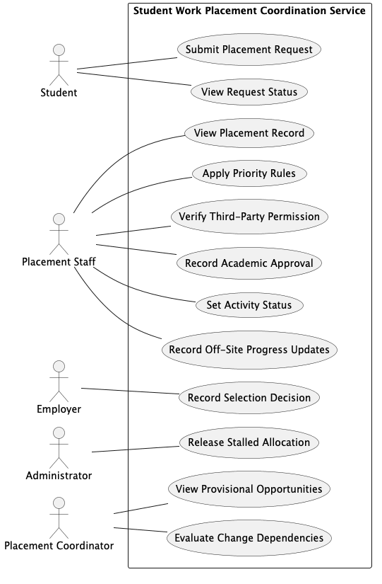
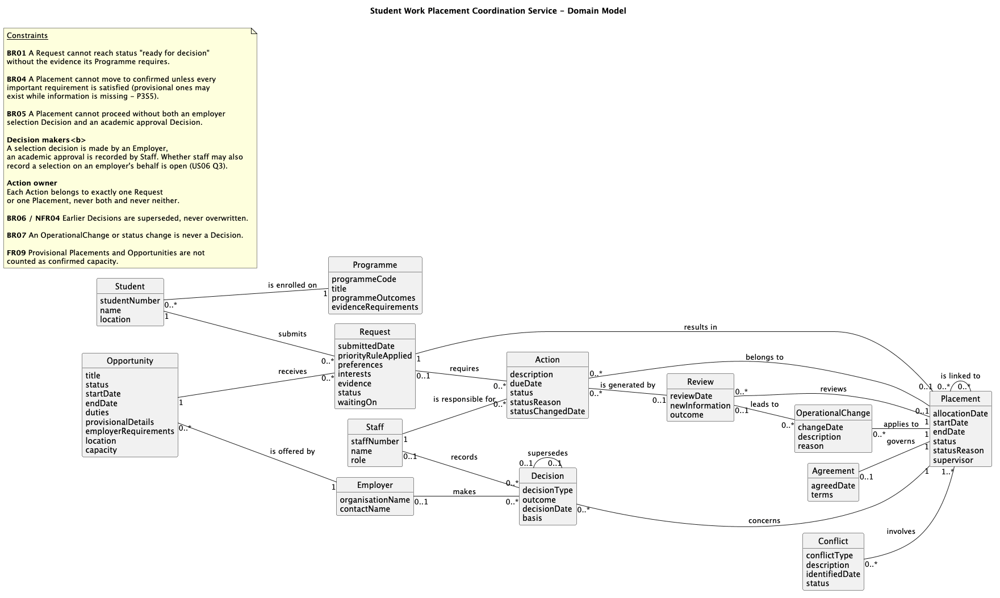

# CA1 Scenario 28 - Student Work Placement Coordination Service

**Analysed by:** Daniel Courtney

**Reviewed by:**

**Full CA1:** [Scenario 28 - Student Work Placement Coordination Service](../../scenarios/28_Student_Work_Placement_Coordination_Service.md)

 

## Summary

The Kerry College Placement Office coordinates student work placements across academic programmes, managing opportunities, applications, employer and academic decisions, agreements, supervisor allocations and progress reviews. Placement records are currently spread across separate files, email threads, notes, messages and spreadsheets, and requests arrive through several channels and are often incomplete. The proposed service provides a single shared placement record, visible request progress, consistent rule application, controlled information sharing and off-site progress recording.

 

## 1. Scope

**In Scope and Out of Scope:**

*In Scope (initial release)*

| ID | Capability | Problem |
| :--- | :--- | :--- |
| IS1 | Placement Record Management | PR1 |
| IS2 | Request Tracking | PR2 |
| IS3 | Priority Management | PR3 |
| IS4 | Authorisation Management | PR4 |
| IS5 | Approval Decision Tracking | PR10 |
| IS6 | Capacity and Provisional Allocation Management | PR5, PR6 |
| IS7 | Linked Arrangements Tracking | PR8 |
| IS8 | Status and Ownership Tracking | PR7 |
| IS9 | Off-Site Progress Recording | PR9 |

*Out of Scope*

| ID | Item | Ref |
| :--- | :--- | :--- |
| OS1 | Specialist Professional Systems | P5S6 |
| OS2 | Financial Accounting | P5S6 |
| OS3 | Public Website Functions | P5S6 |
| OS4 | Negotiating Employer Legal Contracts | A1 |
| OS5 | External Recruitment System Integration | A2 |
| OS6 | Student Academic Record Maintenance | A3 |

 

**Constraints:**

- CS1: The initial release is limited to service coordination and records.
- CS2: The service must accommodate off-site staff operations where connectivity may be unreliable.
- CS3: External partners and funders must access only placement information relevant to their role, excluding unnecessary personal or commercially sensitive details.
- CS4: The service starts from records currently held in separate files.

**Size:** 12 functional requirements, 4 non-functional requirements, 8 business rules, 12 user stories, 12 use cases.

 

**Stakeholders and actors:**

| Stakeholder | Actor or offstage | Main interest |
| :--- | :--- | :--- |
| **Student** (SH1) | Primary actor | Submit placement preferences and programme evidence, and view the current status of their placement request. |
| **Placement Staff** (SH2) | Primary actor | View the shared placement record, apply priority rules, verify third-party permissions, record academic approval decisions, set activity status and record progress updates off-site. |
| **Employer** (SH4) | Primary actor | Record selection decisions for student applications. |
| **Placement Coordinator** (SH5) | Primary actor | View provisional placement opportunities and the dependencies between connected arrangements. |
| **Administrator** (SH9) | Primary actor | Release stalled provisional allocations to free capacity for other students. |
| **Third-Party Representative** (SH3) | Offstage | Legitimate helpers are not refused or delayed when acting for a student. |
| **External Partners** (SH6) | Offstage | Partners receive only the information required for their role. |
| **Management** (SH7) | Offstage | Reliable summary information on placement activity is available. |
| **Funders** (SH8) | Offstage | Summary reporting does not expose unnecessary personal or commercially sensitive information. |
| **Reviewer** (SH10) | Offstage | The basis of earlier decisions is preserved when new information is added. |
| **Data-Protection Officer** (SH11, *A8*) | Offstage | Placement information is shared only with authorised parties, and only as much as their role requires. |
| **Supervisor** (SH12, *A9*) | Offstage | Supervisor allocations are recorded accurately and changes affecting them are visible. |

 

## 2. Behaviour

**Business rules**

| Rule | Description |
| --- | --- |
| BR01 | A request must include the evidence required by the student's programme before it is ready for a decision. *(Q1)* |
| BR02 | Priority and exception handling for applications must follow agreed, documented guidelines rather than inconsistent practice. *(Q2)* |
| BR03 | Staff must verify and record third-party permissions prior to the disclosure of any detailed student placement information or decisions. *(Q3)* |
| BR04 | A vacancy must not be treated as a match unless programme outcomes, student interests, employer requirements, location, capacity and potential conflicts have all been satisfied. |
| BR05 | A placement cannot proceed unless both employer selection and academic approval are recorded. |
| BR06 | Staff must preserve the current confirmed position, while retaining evidence of earlier decision making. |
| BR07 | A formal decision must be distinguished from an operational change, with silence not taken as approval. |
| BR08 | Provisional allocations that remain stalled past the agreed threshold must be reviewed and released. *(Q4)* |

 

**Use cases**

| Use Case | Primary Actor | Outcome |
| --- | --- | --- |
| UC01 Submit Placement Request | Student | A placement request with preferences and programme evidence is recorded. |
| UC02 View Request Status | Student | The student sees the current status of their request, including whether it is waiting on information, a decision or an outside organisation. |
| UC03 View Placement Record | Placement Staff | A single placement record is displayed showing all associated details without searching across separate records. |
| UC04 Apply Priority Rules | Placement Staff | Student applications are prioritised consistently, using agreed guidelines, with the applied rule recorded. |
| UC05 Verify Third-Party Permission | Placement Staff | Placement information is disclosed to a third party only where the required permission is recorded. |
| UC06 Record Selection Decision | Employer | The employer selection decision for a student application is recorded. |
| UC07 Record Academic Approval | Placement Staff | The college academic approval decision is recorded for a placement. |
| UC08 Release Stalled Allocation | Administrator | A stalled provisional allocation is cleared, freeing up capacity for other students. |
| UC09 View Provisional Opportunities | Placement Coordinator | Provisional opportunities are identified and not counted as confirmed capacity. |
| UC10 Set Activity Status | Placement Staff | The status of a placement activity is updated using an agreed, standardised term. |
| UC11 Evaluate Change Dependencies | Placement Coordinator | Connected arrangements are viewed to assess knock-on impacts before making changes. |
| UC12 Record Off-Site Progress Updates | Placement Staff | Progress updates recorded without a reliable connection reach the shared record once the connection returns. |

**Use case model:**

 

## 3. OO Potential

**Retained domain concepts (count: 13 classes, plus 1 deferred)**

- Student
- Programme
- Opportunity
- Employer
- Agreement
- Request
- Staff
- Decision
- Conflict
- OperationalChange
- Placement
- Action
- Review
- *Match (deferred: stored record or derived state is unresolved, Q10)*

**Transaction or history concepts:** Request, Placement, Decision (with a *supersedes* chain keeping earlier versions, BR06, NFR04), OperationalChange, Action and Review.

 

**Main associations**

| Class A | Association | Class B | Multiplicity | Reason |
| :--- | :--- | :--- | :--- | :--- |
| Student | is enrolled on | Programme | 0..* to 1 | Evidence is required by the student's programme; only the current programme is held *(P2S1, A5, A3)* |
| Student | submits | Request | 1 to 0..* | A student can hold several requests over time *(FR01, US01 AC4, US02 AC2)* |
| Opportunity | is offered by | Employer | 0..* to 1 | Each opportunity is offered by one employer *(US06 AC1)* |
| Opportunity | receives | Request | 1 to 0..* | Each request is for one opportunity *(US01 AC1)* |
| Employer | makes | Decision | 0..1 to 0..* | Only selection decisions have an employer; academic approvals have none *(FR06)* |
| Agreement | governs | Placement | 0..1 to 1 | No agreement while provisional; agreements record confirmed terms *(A1)* |
| Request | results in | Placement | 1 to 0..1 | No placement while a request is an expression of interest or awaiting evidence *(P2S4, BR06)* |
| Request | requires | Action | 0..1 to 0..* | Request-stage follow-ups before any placement exists *(P5S1, P2S4)* |
| Staff | records | Decision | 0..1 to 0..* | Academic approvals are recorded by staff *(FR07)* |
| Staff | is responsible for | Action | 1 to 0..* | Exactly one owner, so ownership is never unclear *(US10 AC2, PR7)* |
| Decision | concerns | Placement | 0..* to 1 | Selection and approval both needed before proceeding; silence is not approval *(BR05, BR06, BR07)* |
| Decision | supersedes | Decision | 0..1 to 0..1 | Keeps a chain of versions instead of overwriting *(BR06, NFR04)* |
| Conflict | involves | Placement | 0..* to 1..* | A conflict may be between placements, or one placement and a resource or timing limit *(P3S1, P3S3, P5S1)* |
| OperationalChange | applies to | Placement | 0..* to 1 | Changes are recorded separately from decisions *(P3S6, P4S3, BR07)* |
| Action | belongs to | Placement | 0..* to 0..1 | A request-stage action has no placement yet *(P4S1, US03 AC4)* |
| Action | is generated by | Review | 0..* to 0..1 | Actions can also be planned without a review *(P4S3, P4S5)* |
| Review | reviews | Placement | 0..* to 1 | Progress reviews are recorded per placement *(P1S2, P4S5)* |
| Review | leads to | OperationalChange | 0..1 to 0..* | Revised arrangements from reviews; changes can also happen outside a review *(P4S5, P3S6)* |
| Placement | is linked to | Placement | 0..* to 0..* | Linked arrangements; what links them is open *(P3S6, FR11, US11 AC1)* |

 

**Domain model**

 

## 4. Sliceability

**Candidate slices**

| Slice | Event | Rules | State | Depends on |
| --- | --- | --- | --- | --- |
| A – Submit Placement Request (UC01) | Student submits preferences and programme evidence for an open opportunity | BR01: a request is not ready for a decision until the programme's required evidence is supplied | Request created against the student with status "ready for decision" or "awaiting evidence"; nothing recorded if cancelled (FR01) | Student, Programme (evidence requirements), Opportunity |
| B – Record Academic Approval (UC07) | Placement staff record the college's approval decision for a placement | BR05: a placement cannot proceed without both employer selection and academic approval; BR06: earlier decisions are kept, not overwritten; BR07: silence is not approval | New Decision recorded (and any earlier one superseded); placement shown as able to proceed only when both decisions exist (FR07) | Placement, employer selection Decision (UC06), Staff |
| C – Release Stalled Allocation (UC08) | Administrator releases a provisional allocation that has stalled | BR08: stalled provisional allocations past the agreed threshold are reviewed and released *(Q4)*; BR06 | Placement status set to released (history kept); capacity returned to the opportunity (FR08) | Placement, Request, Opportunity capacity, the date |
| D – Verify Third-Party Permission (UC05) | Placement staff check whether a third party may receive a student's placement information | BR03: permission must be verified and recorded before disclosure *(Q3)*; NFR02: every disclosure without recorded permission is refused | Permission check recorded; information disclosed or refused (FR05) | Student, Placement, the third party's recorded permission |

 

## 5. Testability

**Gherkin coverage:** 1 feature file (`submit-placement-request.feature`) for UC01, with 5 scenarios (SC01–SC05): the main success path, the recoverable alternative (missing evidence supplied, 4a), the failure path (held as awaiting evidence), a boundary Scenario Outline (all evidence vs one item missing) and cancellation before confirming. Each FR in the requirements catalogue also has a stated verification method.

**Rules with clear pass/fail outcomes:**
- BR01: a request missing a required evidence item is held as "awaiting evidence", not "ready for decision" (already covered by SC03 and SC04).
- BR03 / NFR02: a disclosure attempt without recorded permission is refused.
- BR05: a placement with only one of the two decisions cannot proceed.
- BR06 / NFR04: a revised decision keeps the earlier decision and its basis.
- BR07: no recorded approval means the placement is not approved.
- BR08: once the threshold is agreed, an allocation past it is released and its capacity returned.

**Boundary cases:**
- A request with every required evidence item vs one item missing.
- A placement with employer selection recorded but academic approval still outstanding.
- An academic approval revised from refused to approved, with the earlier decision retained.
- A provisional allocation exactly at the stalled threshold, one day before and one day after.
- A third party whose permission is recorded for a different student or placement.

**Rules that are harder to test:** BR02 depends on priority rules that are not agreed *(Q2)*. BR04 combines six matching conditions and depends on whether a match is stored or derived *(Q10)*. BR08's threshold is not yet defined *(Q4)*.

**Open questions that block tests:**

| Question | What it blocks |
| :--- | :--- |
| Q1 | Exactly what evidence makes a request ready for a decision; slice A uses a working assumption of a fixed evidence list per programme |
| Q2 | How eligibility, priority and exceptions apply, so UC04 cannot be tested yet |
| Q3 | What authority is required when another person acts for the student, which defines the permission check in slice D |
| Q4 | When provisional allocations expire or become confirmed, which sets the threshold in slice C |
| Q5 | Who may approve changes, substitutions or withdrawal, which affects revised decisions in slice B |
| Q9 | Whether opportunity approval and academic approval are the same, which affects what slice B records |
| Q10 | Whether a match is its own record, which affects BR04 testing |

 

## 6. Comparability

| Slice | Rules | State changes | Failure handling | Relative size |
| :--- | :--- | :--- | :--- | :--- |
| A – Submit Placement Request | BR01 | Request created as ready or awaiting evidence | Missing evidence; cancelled before confirming; opportunity not open | Medium |
| B – Record Academic Approval | BR05, BR06, BR07 | Decision recorded; earlier decision superseded; placement able or unable to proceed | Selection missing; revised decision; no decision recorded | Medium–Large |
| C – Release Stalled Allocation | BR08, BR06 | Placement released; capacity returned | Allocation not yet stalled; already released or confirmed | Medium |
| D – Verify Third-Party Permission | BR03, NFR02 | Permission check recorded; disclosure allowed or refused | No permission; permission for the wrong student | Medium |

All four slices apply rules and change state, and three are roughly the same size. Slice B is slightly heavier because of the version history (BR06). Slices C and D each depend on an open question (Q4 and Q3), so both need a working assumption recorded as a spike or decision. The read-only use cases (UC02, UC03, UC09, UC11) would be noticeably thinner than these four.

 

## Strengths and Weaknesses

**Strengths:** 

Great evidence, traceability and domain reasoning with a strong requirements and behavioural baseline. 

**Weaknesses:** 

The submission is substantially longer than necessary and contains some inconsistencies around, Authority and Supervisor concepts. Resolve those modelling decisions and reduce repetition.