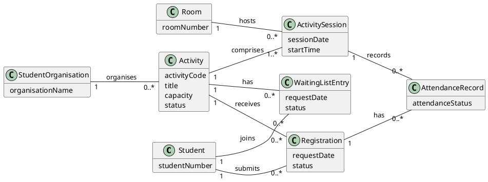

# DOMAIN MODELLING

 
 

# Task 1: Select Essential Attributes

| Concept | Candidate Attributes | Keep / Remove | Reason |
| :--- | :--- | :--- | :--- |

 
 

# Task 2: Identify and Name Associations

| Class A | Association Name or Sentence | Class B | Evidence | Keep? | 
| :--- | :--- | :--- | :--- | :--- |

 
 

# Task 3: Assign and Justify Multiplicities

| Association | Multiplicity at Class A | Multiplicity at Class B | Reading from Both Ends | Evidence / Rule | 
| :--- | :--- | :--- | :--- | :--- |

 
 

# Task 4: Validate Transactions and Historical Records

| Information to Retain | Best Owning Concept | Why |
| :--- | :--- | :--- |

 
 

# Task 5: Draw the First Complete Domain Model

## PlantUML Starting Template
