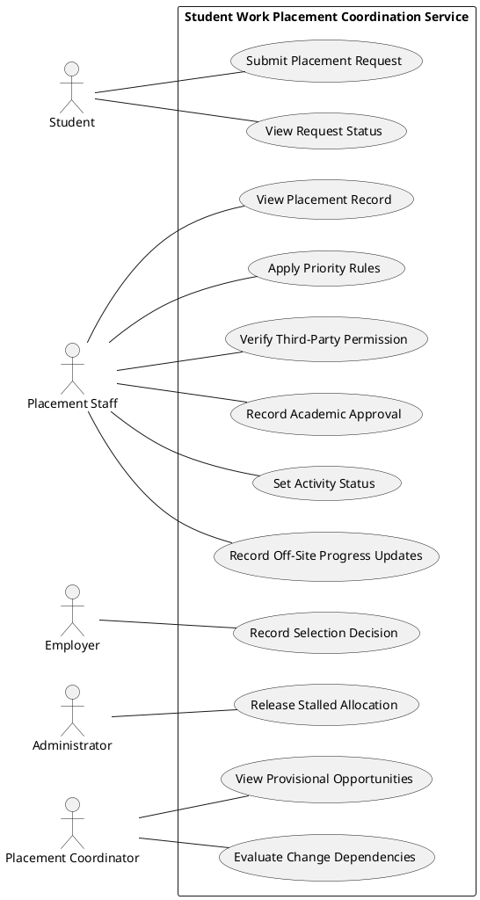

# REQUIREMENTS TO USER STORIES AND USE CASES

<br>
<br>

# Task 1: Develop User Stories

| Story ID | Requirement | Role-Goal-Benefit User Story |
| :--- | :--- | :--- |
| **US01** | FR01 | As a student, I want to submit my placement preferences and programme evidence so that my request can be assessed for a placement decision. |
| **US02** | FR02 | As a student, I want to view the current status of my placement request so that I know whether my request is waiting on information, a decision, or an outside organisation. |
| **US03** | FR03 | As a placement staff member, I want to view a single shared record for each placement so that I do not have to search across separate records. |
| **US04** | FR04 | As a placement staff member, I want to apply priority rules for student placement applications so that I treat each student application consistently. |
| **US05** | FR05 | As a placement staff member, I want to verify third-party authorisation permissions so that I do not accidentally disclose any sensitive placement information. |
| **US06** | FR06 | As an employer, I want to record selection decisions for student applications so that the placement application can proceed once academic approval is also recorded. |
| **US07** | FR07 | As a placement staff member, I want to record academic approval decisions for a placement so that a placement application can proceed once the employer's selection is also recorded. |
| **US08** | FR08 | As an administrator, I want to release stalled provisional allocations so that a placement is free for other students.  |
| **US09** | FR09 | As a placement coordinator, I want to view provisional placement opportunities so that I don't count provisional places as confirmed capacity, overstating what is available.  |
| **US10** | FR10 | As a placement staff member, I want to set an agreed activity status so that everyone can see what's awaiting action and who is responsible. |
| **US11** | FR11 | As a placement coordinator, I want to view the dependencies between connected placement arrangements so that I can see the knock-on effects prior to making changes. |
| **US12** | FR12 | As a placement staff member, I want to record progress updates off-site so that updates aren't lost or re-entered at a later stage. | 

<br>
<br>

# Task 2: Acceptance Criteria

## Selected Story: US01
> **US01:** As a student, I want to submit my placement preferences and programme evidence so that my request can be assessed for a placement decision.

### Acceptance Criteria

| ID | Observable Acceptance Condition |
| :--- | :--- |
| **AC1** | The requested placement opportunity is open for requests. |
| **AC2** | The student supplies placement preferences to make the request. |
| **AC3** | The student supplies the programme evidence required to make the request. |
| **AC4** | The request is recorded against the student in the placement record. |
| **AC5** | A request without the required programme evidence is not shown as ready for a decision. |
| **AC6** | The student is shown that the request has been received. |
| **AC7** | The student can view the current status of the request. |


### Given-When-Then

```gherkin
Given the placement opportunity is open for requests
And the student has placement preferences and the programme evidence required for the request
When the student submits the request
Then the request is recorded against the student in the placement record
And the student is shown that the request has been received
And the student can view the current status of the request
```

### Questions Revealed

1. What makes a placement opportunity open for requests, and who decides when it opens?
2. What placement preference information is a student required to submit?
3. What programme evidence is a student required to submit?
4. Is a request submitted without the required programme evidence recorded and held, or rejected outright?

<br>

## Selected Story: US02
> **US02:** As a student, I want to view the current status of my placement request so that I know whether my application is waiting on information, a decision, or an outside organisation.

### Acceptance Criteria

| ID | Observable Acceptance Condition |
| :--- | :--- |
| **AC1** | The student has submitted a placement request. |
| **AC2** | The student can only view their own placement requests. |
| **AC3** | The request status is shown using one of the agreed standardised status values. |
| **AC4** | The status shows whether the request is waiting on information, a decision, or an outside organisation. |
| **AC5** | When the request status changes, the student sees the updated status. |
| **AC6** | A request with no recorded decision is not shown as approved. |

### Given-When-Then

```gherkin
Given the student has submitted a placement request
And the request is awaiting the programme evidence required for a decision
When the student views the status of their request
Then the request status is shown as awaiting evidence
And the student can see that the request is waiting on information
And the request is not shown as ready for a decision
```

### Questions Revealed

1. What status values will students see, and are they the same as the ones for internal staff?
2. How much detail should a student see when their request is waiting on an outside organisation?
3. Should a student be told when their status changes, or only when they check it themselves?
4. Can a third-party rep acting on behalf of the student view the same status?

<br>

## Selected Story: US03
> **US03:** As a placement staff member, I want to view a single shared record for each placement so that I do not have to search across separate records.

### Acceptance Criteria

| ID | Observable Acceptance Condition |
| :--- | :--- |
| **AC1** | The placement staff member is authorised to view placement records. | 
| **AC2** | Each placement has one record, with no duplicates or split records for the same placement. | 
| **AC3** | The record shows the placement's opportunity, application, decisions, agreement, supervisor allocation, and progress reviews. | 
| **AC4** | The record shows the placement's current status and who is responsible for the next action. | 
| **AC5** | An update made by a staff member is visible to other staff members viewing the same record. | 
| **AC6** | Historical decisions remain visible in the record when new information is added. | 

### Given-When-Then

```gherkin
Given a placement has an employer selection decision
And an academic approval decision is recorded
And the placement has a supervisor allocated
When a placement staff member views the record for that placement 
Then both decisions are shown in the same record
And the supervisor allocation is shown in the same record
And the placement's current status and owner are displayed
```

### Questions Revealed

1. What minimum information must every placement record contain?
2. Does a record exist from the minute a student submits a request, or only once a placement is allocated?
3. Which staff roles can update the record, and who can only view it?
4. How will existing records held in separate files and spreadsheets be brought into the single record, and who verifies this?

<br>

## Selected Story: US04
> **US04:** As a placement staff member, I want to apply priority rules for student placement applications so that I treat each student application consistently.

### Acceptance Criteria

| ID | Observable Acceptance Condition |
| :--- | :--- |
| **AC1** | An agreed set of priority rules is available to placement staff. |
| **AC2** | Applications with the same circumstances receive the same priority when the rules are applied. |
| **AC3** | The priority rule applied to an application is recorded against the application. |
| **AC4** | An exception to a priority rule is recorded with its reason and the staff member who granted the exception. |
| **AC5** | Recording an exception for one application does not change the priority of other applications. |

### Given-When-Then

```gherkin
Given an agreed set of priority rules is in place
And two applications have the same relevant circumstances
When placement staff apply the priority rules to both applications
Then both applications receive the same priority
And the rule applied is recorded against the application
```

### Questions Revealed

1. What circumstances should give an application priority?
2. Who is allowed to grant an exception to a priority rule?
3. Can an application's priority change after it has been set?
4. Should students be told what priority their application has been given?

<br>

## Selected Story: US05
> **US05:** As a placement staff member, I want to verify third-party authorisation permissions so that I do not accidentally disclose any sensitive placement information.

### Acceptance Criteria

| ID | Observable Acceptance Condition |
| :--- | :--- |
| **AC1** | A third party is acting on behalf of a student for a placement request. |
| **AC2** | Placement staff can see whether permission is recorded for a third party. |
| **AC3** | Detailed placement information or decisions are not disclosed to a third party without recorded permission. |
| **AC4** | Each disclosure to a third party is recorded against the students' request. |

### Given-When-Then

```gherkin
Given a third party is acting on behalf of a student
And no permission is recorded for that third party
When the third party asks placement staff for a decision on the student's' request
Then placement staff can see that no permission is recorded
And the decision is not disclosed to the third party
```

### Questions Revealed

1. What evidence counts as valid permission for a third party to act for a student?
2. Can a student withdraw permission, or does this permission expire?
3. Can permission cover only some information e.g. progress updates and not decisions?
4. What information can be shared with the third-party before permission is required?

<br>

## Selected Story: US06
> **US06:** As an employer, I want to record selection decisions for student applications so that the placement application can proceed once academic approval is also recorded.

### Acceptance Criteria

| ID | Observable Acceptance Condition |
| :--- | :--- |
| **AC1** | The employer is offering the placement opportunity. |
| **AC2** | The employer can view only the applicant information required for decision making. |
| **AC3** | The selection decision is recorded against the application. |
| **AC4** | A placement with an employer selection but no academic approval is shown as not able to proceed. |
| **AC5** | Once the employer selection and academic approval are recorded, the placement is shown as able to proceed. |
| **AC6** | An application with no recorded employer decision is not treated as selected. |

### Given-When-Then

```gherkin
Given the employer is offering a placement opportunity
And a student has applied for that placement
And no academic approval has been recorded for the placement
When the employer records a decision selecting the student
Then the selection decision is recorded against the application
And the placement is not shown as able to proceed
And the placement is shown as awaiting academic approval
```

### Questions Revealed

1. Can an employer change or withdraw a selection decision after it has been recorded?
2. Should academic approval happen before employer approval, after it, or can it happen in either order?
3. Do employers record decisions themselves, or do placement staff record them on the employer's behalf?
4. How long can an application wait for an employer decision before it is followed up?

<br>

## Selected Story: US07
> **US07:** As a placement staff member, I want to record academic approval decisions for placement so that a placement application can proceed once the employer's selection is also recorded.

### Acceptance Criteria

| ID | Observable Acceptance Condition |
| :--- | :--- |
| **AC1** | The academic approval decision is recorded against the placement. |
| **AC2** | A placement with academic approval but no employer selection is not shown as able to proceed. |
| **AC3** | A placement whose academic approval is refused is not shown as able to proceed. |
| **AC4** | A placement with no recorded academic decision is not treated as approved. |

### Questions Revealed

1. Who has the authority to give academic approval for placement?

<br>

## Selected Story: US08
> **US08:** As an administrator, I want to release stalled provisional allocations so that a placement is free for other students.

### Acceptance Criteria

| ID | Observable Acceptance Condition |
| :--- | :--- |
| **AC1** | The administrator can see which provisional allocations have stalled. |
| **AC2** | Once a stalled provisional allocation is released, the placement is shown as available for other students. |

### Questions Revealed

1. Should the student be warned before their provisional allocation is released, and given a chance to supply missing information?

<br>

## Selected Story: US09
> **US09:** As a placement coordinator, I want to view provisional placement opportunities so that I don't count provisional places as confirmed capacity, overstating what is available.

### Acceptance Criteria

| ID | Observable Acceptance Condition |
| :--- | :--- |
| **AC1** | Each placement opportunity is shown as provisional or confirmed. |
| **AC2** | A provisional opportunity shows which details are provisional. |
| **AC3** | Provisional opportunities are not counted as confirmed capacity. |
| **AC4** | When an opportunity is confirmed, it is shown as confirmed and counted as available capacity. |

### Questions Revealed

1. Can students be matched to a provisional opportunity, or only express interest until it is confirmed?

<br>

## Selected Story: US10
> **US10:** As a placement staff member, I want to set an agreed activity status so that everyone can see what's awaiting action and who is responsible.

### Acceptance Criteria

| ID | Observable Acceptance Condition |
| :--- | :--- |
| **AC1** | An activity status can only be set from the agreed set of status values. |
| **AC2** | Each activity shows the current status and the person responsible for the next action. |
| **AC3** | A status change records the date and the staff member who made it. |
| **AC4** | A status change on its own is not recorded as a formal decision. |

### Questions Revealed

1. Should a reason be recorded when an activity is set to a status, and should those reasons come from an agreed list?

<br>

## Selected Story: US11
> **US11:** As a placement coordinator, I want to view the dependencies between connected placement arrangements so that I can see the knock-on effects prior to making changes.

### Acceptance Criteria

| ID | Observable Acceptance Condition |
| :--- | :--- |
| **AC1** | Each placement arrangement shows the other arrangements linked to it. |
| **AC2** | Before a change is recorded, the coordinator can see which linked arrangements it would affect. |
| **AC3** | After a change is recorded, the affected linked arrangements are marked for review. |
| **AC4** | An arrangement with no linked arrangements is shown as having none. |

### Questions Revealed

1. What links arrangements, a shared supervisor, location, resource, or time for example?

<br>

## Selected Story: US12
> **US12:** As a placement staff member, I want to record progress updates off-site so that updates aren't lost or re-entered at a later stage.

### Acceptance Criteria

| ID | Observable Acceptance Condition |
| :--- | :--- |
| **AC1** | A placement staff member can record progress updates while off-site without a reliable connection |
| **AC2** | Once a connection returns, every update recorded off-site appears in the shared placement record. |
| **AC3** | The staff member can see which of their updates have not yet reached the shared record. |
| **AC4** | An off-site update does not overwrite a change made to the same record by another staff member. |

### Questions Revealed

1. If two staff members update the same placement while one is off-site, how should the conflict be resolved, and who decides this?

<br>
<br>

# Task 3: Identify Actors and Use Cases

## Stakeholder Analysis

| ID  | Stakeholder | Goals |
| :--- | :--- | :--- |
| **SH1** | **Student** | Know what their request is waiting on and track application progress. |
| **SH2** | **Placement Staff** | Process requests smoothly, verify student evidence without searching separate files, and maintain evidence of current and earlier decisions and versions. |
| **SH3** | **Third-Party Representative** | Help students with applications and get updates on their progress. |
| **SH4** | **Employer** | Select suitable students for placement openings and confirm placement duties. |
| **SH5** | **Placement Coordinator** | Keep track of unallocated requests, provisional arrangements, capacity conflicts, overdue actions, and incomplete records. |
| **SH6** | **External Partners** | Receive information needed for their role without receiving unnecessary details. |
| **SH7** | **Management** | Access summary information about overall placement activity. |
| **SH8** | **Funders** | Receive high-level summary reports about placement activity without sensitive data. |
| **SH9** | **Administrator** | Identify and release stalled provisional arrangements to free up capacity. |
| **SH10** | **Reviewer** | Add new information and decisions without erasing the basis of earlier decisions. |
| **SH11** | **Data-Protection Officer** | Ensure placement information is shared only with authorised parties and only as much as each role requires. | Detailed student information or decisions being disclosed without the required authority, or summary reporting exposing unnecessary personal or commercially sensitive information. |
| **SH12** | **Supervisor** | Know which placements they are allocated to and be informed when an allocation changes. |

## Actor or Stakeholder Catalogue

| Actor or Stakeholder | Type | Goal or Interest | Direct Interaction |
| :--- | :--- | :--- | :--- |
| Student | Primary Actor | Submit placement preferences and programme evidence, and view the current status of their placement request. | Yes |
| Placement Staff | Primary Actor | View the shared placement record, apply priority rules, verify third-party permissions, record academic approval decisions, set activity status, and record progress updates off-site. | Yes |
| Employer | Primary Actor | Record selection decisions for student applications. | Yes |
| Placement Coordinator | Primary Actor | View provisional placement opportunities and the dependencies between connected arrangements. | Yes |
| Administrator | Primary Actor | Release stalled provisional allocations to free capacity for other students. | Yes |
| Third-Party Representative | Offstage Stakeholder | Ensure legitimate helpers are not refused or delayed when acting for a student. | No |
| External Partners | Offstage Stakeholder | Ensure partners receive only the information required for their role. | No |
| Management | Offstage Stakeholder | Ensure reliable summary information on placement activity is available. | No |
| Funders | Offstage Stakeholder | Ensure summary reporting does not expose unnecessary personal or commercially sensitive information. | No |
| Reviewer | Offstage Stakeholder | Ensure the basis of earlier decisions is preserved when new information is added. | No |
| Data-Protection Officer *(A8)* | Offstage Stakeholder | Ensure placement information is shared only with authorised parties and only as much as their role requires | No |
| Supervisor *(A9)* | Offstage Stakeholder | Ensure supervisor allocations are recorded accurately and that changes affecting them are visible | No |


## Actor Decisions

### Student and Service User
An assumption was made that the service user is a student *(A6)*. A quote from the service user (*"I need to know whether I am waiting for information, a decision, or an outside organisation"*) *(P6S2)* suggests an individual whose own placement request is in progress, which describes the student. Therefore, a single Student actor will cover both terms. 

### Placement Staff, Coordinator, Administrator
Placement staff, coordinators, and administrators all work within the placement office, but have different goals. The staff process records *(P4S1)*, the coordinator oversees provisional opportunities and dependencies *(P5S1, P3S6)*, and the administrator releases stalled allocations *(P6S3)*. They are therefore kept as separate actors, each with its own goals and use cases matching the user stories.

### Third-Party Representative
Placement staff verify permissions and the third party contacts staff not the service *(US05, FR05)*. Therefore, third-party representatives are designated as offstage stakeholders. Their interest in not being wrongly refused or delayed, and in student information not being disclosed without authority is still protected *(BR03, NFR02)*.

### Management and Funders
Summary reporting for management and funders is a recognised need *(P5S3)*, with Manager stating: "We need consistent reasons for delay, withdrawal and incomplete outcomes." *(P6S6)*. Reporting was not prioritised within the functional requirements for the initial release, so no user story has either party using the service directly.

Therefore, both the management and funders are designated as offstage stakeholders. Their interest in reliable reporting is still protected through *(NFR01)* and *(CS3)*.

### External Partners
External partners should receive only the information required for their role *(P5S2)*, with the partner representative stating: "I need the information required for my role, not the complete case history." *(P6S4)*. 

The partner representative is assumed to be an external partner *(A7)*. As no user story in the initial release has external partners using the service directly, they are designated offstage stakeholders. Their interest in receiving role-relevant information is still protected through *(NFR01)* and *(CS3)*

### Reviewer
The reviewer's concern is that: "New information should be added without erasing the basis of earlier decision." *(P6S5)*. However, no user story in the initial release has the reviewer using the service directly. Therefore, the reviewer is designated as an offstage stakeholder.

Their interest in preserving earlier decisions is still protected through *(BR06)* and *(NFR04)*, which apply to every update made by placement staff.

### Data-Protection Officer
The scenario does not name a data-protection role, but raises several concerns about who may receive information and how much *(P2S7, P5S2, P5S3)*, which no listed stakeholder is responsible for.

A data-protection officer is therefore assumed to exist *(A8)*, who will set or approve the rules on information sharing rather than using the service themselves. Therefore, they will be designated as an offstage stakeholder.

Their interest is protected through *(NFR01, NFR02, BR03, CS3)*, with the question of what information can be shared and to who *(Q7)* directed to them.

### Supervisor
The scenario mentions supervisor allocation as part of each placement *(P1S2)*, and capacity depends on the people involved *(P3S3)*. Supervisors are assumed to be allocated to placements by placement staff *(A9)*.

No user story in the initial release has them using the service directly. Therefore, they are designated as offstage stakeholders. Whether or not a supervisor is a college staff member or an employer contact is unresolved *(Q8)*, and will impact the domain model.

## Use-Case Catalogue

| ID | Use Case | Primary Actor | Meaningful Outcome | Source Requirement |
| :--- | :--- | :--- | :--- | :--- |
| UC01 | **Submit Placement Request** | Student | A placement request with preferences and programme evidence is recorded. | FR01 |
| UC02 | **View Request Status** | Student | The student sees the current status of their request, including whether it is waiting on information, a decision, or an outside organisation. | FR02 |
| UC03 | **View Placement Record** | Placement Staff | A single placement record is displayed showing all associated details without searching across separate records. | FR03 |
| UC04 | **Apply Priority Rules** | Placement Staff | Student applications are prioritised consistently, using agreed guidelines, and with the applied rule recorded. | FR04 |
| UC05 | **Verify Third-Party Permission** | Placement Staff | Placement information is disclosed to a third-party only where the required permission is recorded. | FR05 |
| UC06 | **Record Selection Decision** | Employer | The employer selection decision for a student application is recorded. | FR06 |
| UC07 | **Record Academic Approval** | Placement Staff | The college academic approval decision is recorded for a placement. | FR07 |
| UC08 | **Release Stalled Allocation** | Administrator | A stalled provisional allocation is cleared, freeing up capacity for other students. | FR08 |
| UC09 | **View Provisional Opportunities** | Placement Coordinator | Provisional opportunities are identified and not counted as confirmed capacity. | FR09 |
| UC10 | **Set Activity Status** | Placement Staff | The status of a placement activity is updated using an agreed, standardised term. | FR10 |
| UC11 | **Evaluate Change Dependencies** | Placement Coordinator | Connected arrangements are viewed to assess knock-on impacts before making changes. | FR11 |
| UC12 | **Record Off-Site Progress Updates** | Placement Staff | Progress updates recorded without a reliable connection reach the shared record once the connection returns. | FR12 |

<br>
<br>

# Task 4: Use-Case Diagram
<details>
    <summary>PlantUML Source Code</summary>


</details>


# Task 5: Traceability

| Business Problem or Stakeholder Goal | Requirement | User Story | Acceptance Evidence | Use Case |
| :--- | :--- | :--- | :--- | :--- |
| Students need to record preferences and evidence. | FR01 | US01 | Placement request is recorded against student record. | Submit Placement Request |
| Students are uncertain about request progress and what their request is waiting on. | FR02 | US02 | Current request status displayed, showing whether it is waiting on information, a decison, or an outside organisation. | View Request Status |
| Placement information is fragmented across separate files, spreadsheets, and email threads. | FR03 | US03 | Single record displays linked opportunities, applications, decisions, agreements, supervisor allocations, and progress reviews. | View Placement Record |
| Priorities and exceptions are applied inconsistently without agreed guidelines. | FR04 | US04 | Applications with the same circumstances receive the same priority. | Apply Priority Rules |
| Staff are uncertain about authority required before disclosing details to third parties. | FR05 | US05 | Placement information is disclosed to a third party only where required authorisation permissions are recorded. | Verify Third-Party Permission |
| Placement decisions require separate employer selection and acdemic approval. | FR06 | US06 | Placement shown as not able to proceed without college academic approval, even when an employer selection is recorded. | Record Selection Decision |
| Academic approval must be recorded independently alongside employer selection. | FR07 | US07 | With academic approval but no employer selection, the placement is not shown as able to proceed. | Record Academic Approval |
| Stalled provisional allocations blick capacity needed by other students. | FR08 | US08 | Stalled provisional allocation released, showing placement available for other students. | Release Stalled Allocation |
| Advertised opportunities remain provisional and visible vacancies do not confirm placement feasibility. | FR09 | US09 | Provisional opportunities identified and distinguished from confirmed capacity. | View Provisional Opportunities |
| Unstandardised status terms cause confusion over task ownership and pending actions. | FR10 | US10 | Each activity shows the current status and the person responsible. | Set Activity Status |
| Unrecorded dependencies across linked arrangements cause knock-on effects when changes occur. | FR11 | US11 | Coordinator sees which linked arrangements a change would affect. | Evaluate Change Dependencies |
| Unreliable connectivity during off-site work causes delayed or lost progress updates | FR12 | US12 | Progress updates recorded without a reliable connection reach the shared record once connection returns. | Record Off-Site Progress Updates |