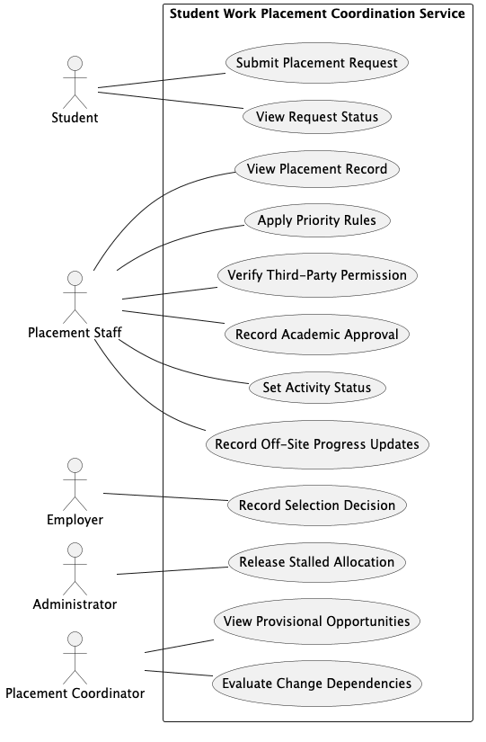

<!-- TOC -->
# USE CASE MODEL

FOR THE FULL WORKINGS OF THIS SECTION, PLEASE SEE [`04_From_Requirements_to_User Stories_and_Use_Cases/`](decisions/Worked-Business-Problem/02_Requirements_To_User_Stories_And_Use_Cases.md) |

<!-- TOC start (generated with https://github.com/derlin/bitdowntoc) -->

- [USE CASE MODEL](#use-case-model)
- [Named System Boundary](#named-system-boundary)
- [Actors](#actors)
- [Use Case Catalogue](#use-case-catalogue)
- [Detailed Use Case (Preconditions, Trigger, Success Flow, Alternatives, Exceptions, Postconditions)](#detailed-use-case-preconditions-trigger-success-flow-alternatives-exceptions-postconditions)
  - [Task 1: Detailed Use Case](#task-1-detailed-use-case)
  - [Task 2: Main Success Scenario](#task-2-main-success-scenario)
  - [Task 3: Extensions (Alternatives)](#task-3-extensions-alternatives)
  - [Task 4: Extensions (Exceptions)](#task-4-extensions-exceptions)
  - [Task 5: Postconditions](#task-5-postconditions)
  - [Task 6: From Paths and Rules to Focused Examples](#task-6-from-paths-and-rules-to-focused-examples)
  - [Task 7: Gherkin Scenario](#task-7-gherkin-scenario)

<!-- TOC end -->

 

<!-- TOC -->
# Named System Boundary

Source: [`diagrams/use-case-diagram.puml`](../diagrams/use-case-diagram.puml)

The `Student Work Placement Coordination Service` is the system boundary. Academic records *(OS6)*, recruitment systems *(OS5)*, and legal contract negotiation *(OS4)* sit outside of it. The five primary actors are the only roles that cross this boundary.
 
 

<!-- TOC -->
# Actors
| Actor | Use Case(s) |
| :--- | :--- |
| Student | UC01, UC02 |
| Placement Staff | UC03, UC04, UC05, UC07, UC10, UC12 |
| Employer | UC06 |
| Placement Coordinator | UC09, UC11 |
| Administrator | UC08 |

Offstage stakeholders (SH3, SH6–SH8, SH10–SH12) do not cross the system boundary and so do not appear on the diagram, see Actor Decisions.

 
 

<!-- TOC -->
# Use Case Catalogue

| ID | Use Case | Primary Actor | Meaningful Outcome | Source Requirement |
| :--- | :--- | :--- | :--- | :--- |
| UC01 | **Submit Placement Request** | Student | A placement request with preferences and programme evidence is recorded. | FR01 |
| UC02 | **View Request Status** | Student | The student sees the current status of their request, including whether it is waiting on information, a decision, or an outside organisation. | FR02 |
| UC03 | **View Placement Record** | Placement Staff | A single placement record is displayed showing all associated details without searching across separate records. | FR03 |
| UC04 | **Apply Priority Rules** | Placement Staff | Student applications are prioritised consistently, using agreed guidelines, and with the applied rule recorded. | FR04 |
| UC05 | **Verify Third-Party Permission** | Placement Staff | Placement information is disclosed to a third-party only where the required permission is recorded. | FR05 |
| UC06 | **Record Selection Decision** | Employer | The employer selection decision for a student application is recorded. | FR06 |
| UC07 | **Record Academic Approval** | Placement Staff | The college academic approval decision is recorded for a placement. | FR07 |
| UC08 | **Release Stalled Allocation** | Administrator | A stalled provisional allocation is cleared, freeing up capacity for other students. | FR08 |
| UC09 | **View Provisional Opportunities** | Placement Coordinator | Provisional opportunities are identified and not counted as confirmed capacity. | FR09 |
| UC10 | **Set Activity Status** | Placement Staff | The status of a placement activity is updated using an agreed, standardised term. | FR10 |
| UC11 | **Evaluate Change Dependencies** | Placement Coordinator | Connected arrangements are viewed to assess knock-on impacts before making changes. | FR11 |
| UC12 | **Record Off-Site Progress Updates** | Placement Staff | Progress updates recorded without a reliable connection reach the shared record once the connection returns. | FR12 |

 
 

<!-- TOC -->
# Detailed Use Case (Preconditions, Trigger, Success Flow, Alternatives, Exceptions, Postconditions)

Use Case `UC01: Submit Placement Request` was selected for detailed analysis because it forms the entry point for every placement journey and directly addresses the multi-channel, incomplete intake problem (PR2, FR01, Must).

Business rule *BR01* gives the use case a recoverable alternative path *(4a when missing evidence is supplied)* and a failure path *(4b when evidence remains missing)*, providing clear boundaries for the Gherkin scenarios.

It also exercises key domain classes: `Student`, `Request`, `Programme`, and `Opportunity`, and uses the `ready for decision` and `awaiting evidence` status values from the domain model.

<!-- TOC -->
## Task 1: Detailed Use Case

| Field | Worked Content |
| :--- | :--- |
| **ID and Name** | UC01: Submit Placement Request |
| **Scope** | Student Work Placement Coordination Service |
| **Level** | User Goal |
| **Primary Actor** | Student |
| **Preconditions** | The student is identified by the service, and the target placement opportunity is open for requests. |
| **Trigger** | The student decides to request a particular open placement opportunity. |
| **Postcondition(Minimal Guarantee)** | No placement request is shown as ready for a decision without the required programme evidence. If the student abandons the submission halfway through, no partial request is recorded. If the submission is incomplete, the student is told what evidence is missing. |
| **Postcondition(Success Guarantee)** | The placement request containing preferences and programme evidence is recorded against the student in the single shared placement record, confirmation of receipt is shown, and the current request status can be viewed by the student. |
| **Open Issue(s)** | 1. What makes a placement opportunity open for requests and who decides when it opens?    2. What placement preference information and programme evidence are required before a request is ready for a decision?    3. Is a request submitted without the required programme evidence recorded and held as awaiting evidence, or is it rejected? *(Working assumption: the request is held with status 'awaiting evidence' until the evidence is supplied. To be confirmed with stakeholders.)*    4. What authority or verification is required if a third-party representative acts on behalf of the student? |

 
 

<!-- TOC -->
## Task 2: Main Success Scenario

| Step | Actor Intention or System Responsibility |
| :--- | :--- |
| **1** | The student starts a placement request for an open opportunity. |
| **2** | The student supplies their placement preferences. |
| **3** | The student supplies the programme evidence required for the request. |
| **4** | The system validates that the submission meets the evidence requirements of the students programme. |
| **5** | The student confirms the request details. |
| **6** | The system records the placement request against the student in the single shared placement record, with status ready for decison. |
| **7** | The system confirms to the student that the request has been received and shows the current status. |

 
 

<!-- TOC -->
## Task 3: Extensions (Alternatives)

| Ref | Condition | Response and Destination |
| :--- | :--- | :--- |
| 4a | Insufficient Evidence Supplied | 1. The system informs the student what evidence is missing.   2. The student supplies the missing evidence.   3. Resume at step 4. |

 
 

<!-- TOC -->
## Task 4: Extensions (Exceptions)

| Ref | Condition | Response and Destination |
| :--- | :--- | :--- |
| 4b | Student Cannot Supply Missing Evidence | 1. The student confirms the request.   2. The system records the request with status awaiting evidence *(Assumption)*.   3. Use case ends with an incomplete request. |
| 5a | Student Cancels Submission | 1. No request is recorded.   2. Use case ends. |

 
 

<!-- TOC -->
## Task 5: Postconditions

The success and minimal guarantees are defined in the use-case header. Each path ends as follows:

- **Main Success Scenario:** the request is recorded against the student the current status is shown. *(Success guarantee)*
- **4a (recoverable):** after the missing evidence is supplied, the flow resumes at step 4 and ends as the Main Success Scenario. *(Success guarantee)*
- **4b (failure):** the request is recorded with status *awaiting evidence* (working assumption, open issue 3), and the student has been told what evidence is missing. *(Minimal guarantee only)*
- **5a (cancellation):** no request is recorded. *(Minimal guarantee only)*

On every path, no request is shown as *ready for decision* without the required programme evidence (BR01).

 
 

<!-- TOC -->
## Task 6: From Paths and Rules to Focused Examples

> [!NOTE]
> The following key was used for this table:
> 
> S - Student
> 
> OP - Opportunity
> 
> P - Programme
> 
> E - Evidence

| Scenario ID | Source | Concrete Example | Reason |
| :--- | :--- | :--- | :--- |
| SC1 | Main Success Scenario | S1, open opportunity OP7, preferences and evidence E1 + E2 supplied | Representative success |
| SC2 | Extension 4a | E2 missing, then supplied before confirming | Recoverable missing evidence |
| SC3 | Extension 4b | E2 missing and cannot be supplied | Request held as awaiting evidence |
| SC4 | BR01 | E1 + E2 supplied, E1 only supplied | Exact evidence boundary |
| SC5 | Extension 5a | Student cancels before confirming | Cancellation, nothing recorded |

<!-- TOC -->
## Task 7: Gherkin Scenario

Source: [`features/submit-placement-request.feature`](../features/submit-placement-request.feature)