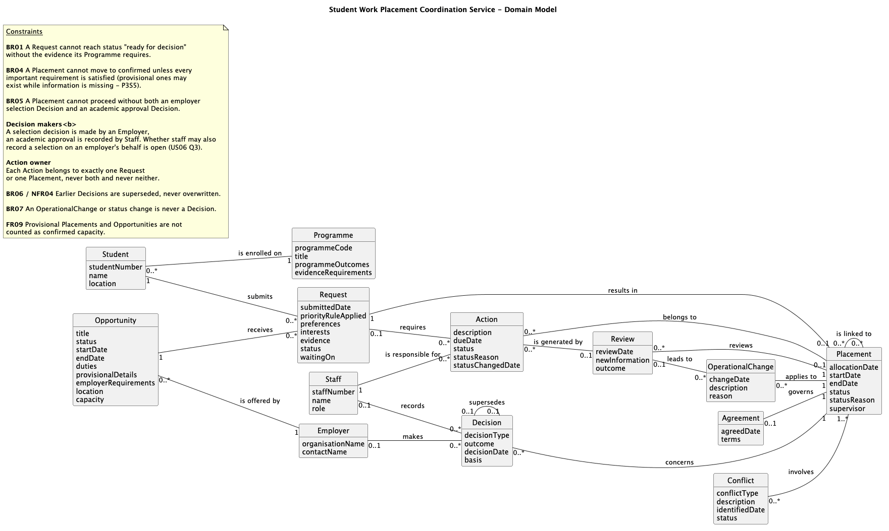

<!-- TOC -->
# DOMAIN MODEL

FOR THE FULL WORKINGS OF THIS SECTION, PLEASE SEE [`06_Domain_Modelling/`](decisions/Worked-Business-Problem/04_Domain_Modelling.md)

<!-- TOC start (generated with https://github.com/derlin/bitdowntoc) -->

- [DOMAIN MODEL](#domain-model)
- [Conceptual Classes](#conceptual-classes)
- [Selected Attributes](#selected-attributes)
- [Named Associations](#named-associations)
- [Multiplicity](#multiplicity)
- [Domain Model Diagram](#domain-model-diagram)

<!-- TOC end -->

 

<!-- TOC -->
# Conceptual Classes

**Student:** Preferences, Student Interests, Location, Detailed Information, Personal or Commercially Sensitive Information

**Programme:** Programme Outcomes

**Opportunity:** Advertised, Dates, Timing, Duties, Provisional, Employer Requirements, Location, Places, Capacity

**Employer:** *(none)*

**Agreement:** *(none)*

**Request:** Preferences, Student Interests, Evidence, Incomplete, Initial Expression of Interest, Request Awaiting Evidence, Request Ready for a Decision, Essential Information, Status Terms, Awaiting Action, Unallocated Requests, Incomplete Records, Waiting, Stalled, Information Required, Ready for Decision

**Staff:** Teams, Role

**Decision:** Basis

**Conflict:** *(none)*

**Operational Change:** *(none)*

**Placement:** Supervisor Allocation, Dates, Timing, Provisional, Location, Places, Resources, Progress, Incomplete, Essential Information, Incomplete Records, Detailed Information, Personal or Commercially Sensitive Information, Status Terms, Responsible, Changed, Partially Completed, Paused, Withdrawn, Waiting, Stalled, Consistent Reasons, Delay, Withdrawal, Incomplete Outcomes

**Action:** Status Terms, Awaiting Action, Responsible, Changed, Partially Completed, Paused, Withdrawn, New Information, Consistent Reasons, Delay, Withdrawal, Incomplete Outcomes

**Review:** New Information

**Match:** Important Requirements, Satisfied

**Relationship between Placements:** Linked Arrangements *(association, Session 6)*

 
 

<!-- TOC -->
# Selected Attributes

> [!NOTE]
> I based this off Part A in the lab sheet and added in the attributes above along with any possible attributes I believe will be required within the domain model.
>
> For readability, the following key is used for decisions in the tables:
> - 🟢 $\color{green}{\textsf{Keep}}$
> - 🔴 $\color{red}{\textsf{Remove}}$
> - 🔵 $\color{blue}{\textsf{Keep Provisionally}}$

| Concept | Candidate Attributes | Keep / Remove | Reason |
| :--- | :--- | :--- | :--- |
| **Student** | studentNumber *(added)* | 🟢 $\color{green}{\textsf{Keep}}$ | Identifies the student so a request can be recorded against them *(US01)* and they see only their own requests *(US02)*. |
|  | name *(added)* | 🟢 $\color{green}{\textsf{Keep}}$ | Simple identifying value used across the shared record *(FR03)*. |
|  | Location | 🟢 $\color{green}{\textsf{Keep}}$ | The student's location is one of the matching considerations *(P3S1, BR04)*. |
|  | Preferences | 🔴 $\color{red}{\textsf{Remove}}$ | Moved to `Request`. Preferences are submitted with each request *(FR01, US01)* and may differ between requests. |
|  | Student Interests | 🔴 $\color{red}{\textsf{Remove}}$ | Moved to `Request` for the same reason as Preferences *(P3S1)*. |
|  | Detailed Information | 🔴 $\color{red}{\textsf{Remove}}$ | A classification of data for access control, not a single value. Handled as a constraint *(NFR01, NFR02, CS3)*. |
|  | Personal or Commercially Sensitive Information | 🔴 $\color{red}{\textsf{Remove}}$ | A data-sensitivity category, not an attribute. Handled by *(NFR01, CS3, A4)*. |
| **Programme** | programmeCode, title *(added)* | 🟢 $\color{green}{\textsf{Keep}}$ | Identify which programme a student is enrolled on, so the right evidence requirements are applied to their request *(P2S1, A5)*. |
|  | Programme Outcomes | 🟢 $\color{green}{\textsf{Keep}}$ | Used as a matching consideration *(P3S1, BR04)*. |
|  | evidenceRequirements *(added)* | 🟢 $\color{green}{\textsf{Keep}}$ | Each programme sets its own evidence requirements *(A5)*. Needed to decide when a request is ready for a decision *(BR01)*. |
| **Opportunity** | title *(added)* | 🟢 $\color{green}{\textsf{Keep}}$ | Lets a student identify the opportunity they are requesting *(US01)* and the coordinator identify each provisional or confirmed opportunity *(US09)*. |
|  | status *(added)* | 🟢 $\color{green}{\textsf{Keep}}$ | One value from an agreed set (advertised, provisional, confirmed, closed). An opportunity may be advertised while details are still provisional *(P2S2)*, and only confirmed opportunities count as available capacity *(US09, FR09)*. |
|  | Dates | 🟢 $\color{green}{\textsf{Keep}}$ | Kept as `startDate` and `endDate`. Dates may still be provisional *(P2S2)*. |
|  | Duties | 🟢 $\color{green}{\textsf{Keep}}$ | Describes the opening and may be provisional *(P2S2)*. Employer confirms duties *(SH4)*. |
|  | Provisional | 🟢 $\color{green}{\textsf{Keep}}$ | Kept as a `status` value **and** as `provisionalDetails`, because the coordinator must see *which* details (dates, duties, approval) are still provisional *(P2S2, US09)*. |
|  | Employer Requirements | 🟢 $\color{green}{\textsf{Keep}}$ | Matching consideration set by the employer *(P3S1, BR04)*. |
|  | Location | 🟢 $\color{green}{\textsf{Keep}}$ | Matching consideration *(P3S1, BR04)*. |
|  | Capacity | 🟢 $\color{green}{\textsf{Keep}}$ | Number of places offered. Only confirmed capacity counts as available *(US09, FR09)*. Capacity depends on people, places, resources and timing *(P3S3)*, but how it is calculated is not agreed, so only the resulting number is held here (see Open Questions). |
|  | Advertised | 🔴 $\color{red}{\textsf{Remove}}$ | Becomes a value of `status` (advertised, provisional, confirmed, closed) rather than a separate yes/no attribute *(P2S2)*. |
|  | Timing | 🔴 $\color{red}{\textsf{Remove}}$ | Duplicates Dates, as already noted in Finding the Objects. |
|  | Places | 🔴 $\color{red}{\textsf{Remove}}$ | Duplicates Location (where) and Capacity (how many). |
| **Employer** | organisationName *(added)* | 🟢 $\color{green}{\textsf{Keep}}$ | Identifies who offers the opportunity and makes selection decisions. |
|  | contactName *(added)* | 🟢 $\color{green}{\textsf{Keep}}$ | The employer is described as an organisation or contact in the glossary. |
| **Agreement** | agreedDate *(added)* | 🟢 $\color{green}{\textsf{Keep}}$ | Records when placement terms were confirmed *(A1)*. |
|  | terms *(added)* | 🟢 $\color{green}{\textsf{Keep}}$ | The confirmed placement terms. Legal contract negotiation stays outside the system *(A1, OS4)*. |
|  | status | 🔴 $\color{red}{\textsf{Remove}}$ | No evidence of agreement states. An Agreement by definition records confirmed terms *(A1)*. If terms are revised, the change is recorded as an `OperationalChange` *(BR07)*. |
| **Request** | submittedDate *(added)* | 🟢 $\color{green}{\textsf{Keep}}$ | Needed to see when a request arrived and whether it has stalled *(P6S3, BR08)*. |
|  | priorityRuleApplied *(added)* | 🔵 $\color{blue}{\textsf{Keep Provisionally}}$ | The priority rule applied must be recorded *(US04)*, but the rules are not agreed *(Q2)*. |
|  | Preferences | 🟢 $\color{green}{\textsf{Keep}}$ | Submitted by the student *(FR01, US01)*. |
|  | Student Interests | 🟢 $\color{green}{\textsf{Keep}}$ | Kept as `interests`, a matching consideration *(P3S1)*. |
|  | Evidence | 🟢 $\color{green}{\textsf{Keep}}$ | Programme evidence supplied with the request *(FR01, US01, BR01)*. |
|  | Status Terms | 🟢 $\color{green}{\textsf{Keep}}$ | Kept as one `status` attribute drawn from the agreed set *(FR02, US02)*. |
|  | Waiting | 🟢 $\color{green}{\textsf{Keep}}$ | Kept as `waitingOn` (information, decision, or outside organisation). This is separate from `status` because the student needs to know *what* they are waiting on *(FR02, US02, P6S2)*. |
|  | Initial Expression of Interest | 🔴 $\color{red}{\textsf{Remove}}$ | A value of `status` *(P2S4)*. |
|  | Request Awaiting Evidence | 🔴 $\color{red}{\textsf{Remove}}$ | A value of `status` *(P2S4)*. |
|  | Request Ready for a Decision | 🔴 $\color{red}{\textsf{Remove}}$ | A value of `status` *(P2S4, BR01)*. |
|  | Ready for Decision | 🔴 $\color{red}{\textsf{Remove}}$ | Duplicate of the above, a value of `status`. |
|  | Incomplete | 🔴 $\color{red}{\textsf{Remove}}$ | Same meaning as *awaiting evidence*, a value of `status` |
|  | Incomplete Records | 🔴 $\color{red}{\textsf{Remove}}$ | Same as Incomplete. |
|  | Unallocated Requests | 🔴 $\color{red}{\textsf{Remove}}$ | A value of `status` *(P5S1)*. |
|  | Stalled | 🔴 $\color{red}{\textsf{Remove}}$ | A value of `status` *(P6S3)*. |
|  | Awaiting Action | 🔴 $\color{red}{\textsf{Remove}}$ | Belongs to `Action`, which has a responsible staff member and due date *(US10, P5S1)*. |
|  | Essential Information | 🔴 $\color{red}{\textsf{Remove}}$ | A broad category, covered by `evidence` and `status`. |
|  | Information Required | 🔴 $\color{red}{\textsf{Remove}}$ | Derived from the student's `Programme evidenceRequirements` *(BR01, Q1)*. |
| **Staff** | staffNumber, name *(added)* | 🟢 $\color{green}{\textsf{Keep}}$ | Identify the person responsible for an action *(US10)* and who recorded a decision *(FR07)*. |
|  | Role | 🟢 $\color{green}{\textsf{Keep}}$ | Distinguishes placement staff, coordinator and administrator, which were merged into `Staff` *(SH2, SH5, SH9)*. Also drives what information a person may see *(NFR01)*. |
|  | Teams | 🔴 $\color{red}{\textsf{Remove}}$ | *P4S2* describes the problem (teams use status terms differently). The fix is one agreed status set *(FR10, PR7)*, not recording each person's team. No requirement needs a team value. |
| **Decision** | decisionType *(added)* | 🟢 $\color{green}{\textsf{Keep}}$ | Distinguishes employer selection from academic approval, as decided when merging them into `Decision` *(BR05)*. |
|  | outcome *(added)* | 🟢 $\color{green}{\textsf{Keep}}$ | e.g. selected / not selected, approved / refused *(US07)*. |
|  | decisionDate *(added)* | 🟢 $\color{green}{\textsf{Keep}}$ | Needed to keep the order of earlier and current decisions *(BR06)*. |
|  | Basis | 🟢 $\color{green}{\textsf{Keep}}$ | The reasons behind a decision must not be erased *(P6S5, BR06, NFR04)*. |
| **Conflict** | conflictType *(added)* | 🟢 $\color{green}{\textsf{Keep}}$ | Capacity, timing, location or resource conflict *(P3S1, P3S3, P5S1)*. |
|  | description, identifiedDate *(added)* | 🟢 $\color{green}{\textsf{Keep}}$ | Lets the coordinator see what the conflict is and how long it has been open *(P5S1)*. |
|  | status *(added)* | 🟢 $\color{green}{\textsf{Keep}}$ | Open or resolved, so the coordinator can see which conflicts still need attention *(P5S1)* and resolve them *(SH5)*. |
| **Operational Change** | changeDate *(added)* | 🟢 $\color{green}{\textsf{Keep}}$ | When the arrangement changed *(P3S6)*. |
|  | description *(added)* | 🟢 $\color{green}{\textsf{Keep}}$ | What changed. Kept separate from a formal decision *(BR07)*. |
|  | reason *(added)* | 🟢 $\color{green}{\textsf{Keep}}$ | Why the change was made, so earlier arrangements keep their context *(BR06)*. |
| **Placement** | allocationDate *(added)* | 🟢 $\color{green}{\textsf{Keep}}$ | Needed to tell when a provisional allocation has stalled *(BR08, Q4)*. |
|  | Dates | 🟢 $\color{green}{\textsf{Keep}}$ | Kept as `startDate` and `endDate`. A placement's dates may differ from the advertised dates. |
|  | Status Terms | 🟢 $\color{green}{\textsf{Keep}}$ | Kept as one `status` attribute from the agreed set *(FR10)*. |
|  | Consistent Reasons | 🟢 $\color{green}{\textsf{Keep}}$ | Kept as `statusReason`, chosen from an agreed list *(P6S6)*. |
|  | Supervisor Allocation | 🔵 $\color{blue}{\textsf{Keep Provisionally}}$ | Kept as `supervisor` while Q8 is open. A supervisor has identity, so it should become a `Supervisor` class with an association once Q8 is answered *(A9, Q8)*. |
|  | Timing | 🔴 $\color{red}{\textsf{Remove}}$ | Duplicates Dates. |
|  | Provisional | 🔴 $\color{red}{\textsf{Remove}}$ | A value of `status` *(P3S5, BR08)*. |
|  | Location | 🔴 $\color{red}{\textsf{Remove}}$ | Duplicates the opportunity's location, reached through the request. |
|  | Places | 🔴 $\color{red}{\textsf{Remove}}$ | Duplicates Location and Opportunity capacity. |
|  | Resources | 🔴 $\color{red}{\textsf{Remove}}$ | Resources affect capacity *(P3S3)*, and capacity belongs to `Opportunity`, not `Placement`. How people, places, resources and timing combine into capacity is not agreed, so it is not modelled yet (see Open Questions). |
|  | Progress | 🔴 $\color{red}{\textsf{Remove}}$ | Progress has history and is recorded through `Review` *(P1S2, P4S5)*. A single attribute would overwrite earlier progress *(BR06)*. |
|  | Incomplete | 🔴 $\color{red}{\textsf{Remove}}$ | A value of `status`. |
|  | Essential Information | 🔴 $\color{red}{\textsf{Remove}}$ | A broad category, covered by `status` being incomplete. |
|  | Incomplete Records | 🔴 $\color{red}{\textsf{Remove}}$ | Same as Incomplete. |
|  | Detailed Information | 🔴 $\color{red}{\textsf{Remove}}$ | Access-control category *(NFR01, CS3)*. |
|  | Personal or Commercially Sensitive Information | 🔴 $\color{red}{\textsf{Remove}}$ | Access-control category *(NFR01, CS3, A4)*. |
|  | Responsible | 🔴 $\color{red}{\textsf{Remove}}$ | Responsibility belongs to a person. It is shown through `Action` → `Staff` *(US03, US10)*. |
|  | Changed | 🔴 $\color{red}{\textsf{Remove}}$ | *P4S3* says a *planned activity* may be changed, so as a status it belongs to `Action`. A change to the placement's **arrangements** is recorded as an `OperationalChange`, which keeps what changed and why *(P3S6, BR07)*.|
|  | Partially Completed | 🔴 $\color{red}{\textsf{Remove}}$ | Describes a planned activity, so it belongs to `Action` *(P4S3)*. |
|  | Paused | 🔴 $\color{red}{\textsf{Remove}}$ | Describes a planned activity, so it belongs to `Action` *(P4S3)*. |
|  | Withdrawn | 🔴 $\color{red}{\textsf{Remove}}$ | A value of `status` *(P4S3, Q5)*. |
|  | Waiting | 🔴 $\color{red}{\textsf{Remove}}$ | A value of `status`. |
|  | Stalled | 🔴 $\color{red}{\textsf{Remove}}$ | A value of `status` *(P6S3, BR08)*. |
|  | Delay | 🔴 $\color{red}{\textsf{Remove}}$ | A value of `statusReason` *(P6S6)*. |
|  | Withdrawal | 🔴 $\color{red}{\textsf{Remove}}$ | A value of `statusReason` *(P6S6)*. |
|  | Incomplete Outcomes | 🔴 $\color{red}{\textsf{Remove}}$ | A value of `statusReason` *(P6S6)*. |
| **Action** | description, dueDate *(added)* | 🟢 $\color{green}{\textsf{Keep}}$ | The coordinator needs to see overdue actions, which needs a due date *(P5S1)*. |
|  | Status Terms | 🟢 $\color{green}{\textsf{Keep}}$ | Kept as `status` from the agreed set *(FR10, US10)*. |
|  | Consistent Reasons | 🟢 $\color{green}{\textsf{Keep}}$ | Kept as `statusReason` from an agreed list *(P6S6)*. |
|  | statusChangedDate *(added)* | 🟢 $\color{green}{\textsf{Keep}}$ | A status change records the date *(US10)*. |
|  | Awaiting Action | 🔴 $\color{red}{\textsf{Remove}}$ | A value of `status` *(P4S2)*. |
|  | Responsible | 🔴 $\color{red}{\textsf{Remove}}$ | Replaced by the association `Staff` *is responsible for* `Action` *(US10 AC2)*. |
|  | Changed | 🔴 $\color{red}{\textsf{Remove}}$ | A value of `status`. *P4S3* lists changed alongside partially completed, paused and withdrawn as states of a planned activity, so it is treated the same way as those. |
|  | Partially Completed | 🔴 $\color{red}{\textsf{Remove}}$ | A value of `status` *(P4S3)*. |
|  | Paused | 🔴 $\color{red}{\textsf{Remove}}$ | A value of `status` *(P4S3)*. |
|  | Withdrawn | 🔴 $\color{red}{\textsf{Remove}}$ | A value of `status` *(P4S3)*. |
|  | New Information | 🔴 $\color{red}{\textsf{Remove}}$ | Belongs to `Review` *(P6S5)*. |
|  | Delay | 🔴 $\color{red}{\textsf{Remove}}$ | A value of `statusReason`. |
|  | Withdrawal | 🔴 $\color{red}{\textsf{Remove}}$ | A value of `statusReason`. |
|  | Incomplete Outcomes | 🔴 $\color{red}{\textsf{Remove}}$ | A value of `statusReason`. |
| **Review** | reviewDate *(added)* | 🟢 $\color{green}{\textsf{Keep}}$ | Keeps the order of reviews so earlier information is not lost *(BR06)*. |
|  | New Information | 🟢 $\color{green}{\textsf{Keep}}$ | Information added at a review without erasing earlier information *(P6S5)*. |
|  | outcome *(added)* | 🟢 $\color{green}{\textsf{Keep}}$ | No further action, new actions, revised arrangements, or escalation *(P4S5)*. |
| **Match** | Important Requirements | 🔴 $\color{red}{\textsf{Remove}}$ | Match is not modelled as a class until Q10 is answered. The requirements are already attributes of `Programme`, `Opportunity` and `Request`, and BR04 becomes a constraint. |
|  | Satisfied | 🔴 $\color{red}{\textsf{Remove}}$ | A derived condition (true when every important requirement is met), not a stored value. |

 
 

<!-- TOC -->
# Named Associations

> [!NOTE]
> Each candidate was checked against the tests:
> - Must the relationship be remembered beyond one temporary calculation?
> - Do stakeholders discuss, query, or report on the relationship?
> - Does it support a business rule or use case?
> - Can the assocation name be read as a simple domain sentence?
> - Does the assocation duplicate another path without adding value?
>
> **Classes**:
> Student ·
> Programme ·
> Opportunity ·
> Employer ·
> Agreement ·
> Request ·
> Staff ·
> Decision ·
> Conflict ·
> Operational Change ·
> Placement · 
> Action ·
> Review · 
> Match
>
> Candidates were drawn from the following sources: the related concepts column from the glossary in finding the objects, scenario sentences linking concepts, and task 1 attributes removed due to pointing to another concept.
>
> | Concept | Related Concepts |
> | :--- | :--- |
> | **Student**| Programme, Request, Agreement, Placement, Match |
> | **Programme** |Student, Opportunity, Request |
> | **Opportunity** |Employer, Programme, Request, Placement, Conflict, Match |
> | **Employer**| Opportunity, Decision, Placement, Agreement |
> | **Agreement** | Placement, Employer, Student |
> | **Request** | Student, Opportunity, Programme, Decision, Match |
> | **Staff** | Decision, Action, Review |
> | **Decision** | Request, Placement, Employer, Staff, Operational Change |
> | **Conflict**| Placement, Opportunity |
> | **Operational Change** | Placement, Action, Decision |
> | **Action** | Staff, Placement, Review |
> | **Review**| Placement, Staff, Action |
> | **Placement** | Student, Opportunity, Employer, Agreement, Decision, Conflict, Operational Change, Action, Review |
> | **Match** | Student, Request, Opportunity |

 

| Class A | Association Name or Sentence | Class B | Evidence | Keep? |
| :--- | :--- | :--- | :--- | :--- |
| **Student** | is enrolled on | Programme | Students provide evidence *required by their programme* *(P2S1, A5, BR01)* | Yes |
|  | submits | Request | *(FR01, US01 AC4)* the request is recorded against the student. *(US02 AC2)* students see only their own requests | Yes |
|  | is party to | Agreement | Glossary: Student related to Agreement | No. Agreements are recorded per placement *(A1)*, so the student is reached through Agreement → Placement → Request → Student |
|  | is allocated to | Placement | Glossary: Student related to Placement | No. Duplicates Student → Request → Placement and loses the link to the request that started it |
|  | is matched in | Match | Glossary: Student related to Match | Deferred. Depends on whether a match is its own record *(Q10)*. Even then, the student would be reached through the request |
| **Programme** | is suitable for | Opportunity | Glossary: Programme related to Opportunity | No. No rule says an opportunity is restricted to a programme. Programme outcomes are compared during matching instead *(BR04)* |
|  | sets evidence requirements for | Request | *(BR01, A5)* a request needs the evidence its programme requires | No. Duplicates Request → Student → Programme. The requirement comes from the student's own programme *(P2S1)*, and BR01 is kept as a constraint |
| **Opportunity** | is offered by | Employer | *(US06 AC1)* the employer is offering the opportunity. Glossary: opening offered by an employer | Yes |
|  | receives | Request | *(US01 AC1)* the requested opportunity is open for requests. *(US06)* a student has applied for that placement | Yes |
|  | is filled by | Placement | Capacity is counted per opportunity *(FR09)* | No. Duplicates Placement → Request → Opportunity. Every placement has exactly one request, so the path is always available |
|  | is involved in | Conflict | Capacity conflicts *(P5S1)* | No. Conflicts are recorded against the placements that compete *(Conflict involves Placement)*, and the opportunity is reached through them. Revisit if a conflict can exist before any placement |
|  | is matched in | Match | *(BR04, P6S1)* | Deferred. Depends on whether a match is its own record *(Q10)* |
| **Employer** | makes | Decision | *(FR06, US06)* employers record selection decisions | Yes |
|  | hosts | Placement | Glossary: Employer related to Placement | No. Duplicates Placement → Request → Opportunity → Employer |
|  | signs | Agreement | Glossary: Employer related to Agreement | No. Reached through Agreement → Placement → Request → Opportunity → Employer, and legal contracts are out of scope *(OS4)* |
| **Agreement** | governs | Placement | Agreements are recorded per placement *(P1S2, A1, US03 AC3)* | Yes |
| **Request** | receives | Decision | *(US06 AC3)* selection recorded against the application | No. Kept on Placement instead, because BR05 and US06's Given-When-Then talk about whether the *placement* can proceed. The request is reachable from the placement |
|  | is matched in | Match | *(BR04, P6S1)* | Deferred. Depends on whether a match is its own record *(Q10)* |
|  | results in | Placement *(added)* | A placement is the allocation of a student to an opportunity *(glossary)*, starting as a provisional allocation from a request *(P3S5, P6S3 "the original request")* | Yes |
|  | requires | Action *(added)* | The coordinator needs overdue actions and unallocated requests *(P5S1)*. A request awaiting evidence or a decision needs follow-ups (chase evidence, decide) before any placement exists *(P2S4, US02 AC4)* | Yes |
| **Staff** | records | Decision | *(FR07, US07)* staff record academic approval | Yes |
|  | is responsible for | Action | *(US10 AC2)* each activity shows the person responsible for the next action *(P4S2, PR7)* | Yes |
|  | conducts | Review | Reviews are carried out by someone | No. No requirement asks who conducted a review. The reviewer is an offstage stakeholder *(SH10)* |
|  | supervises | Placement *(added)* | *(A9)* supervisor allocation | Deferred. Depends on whether a supervisor is college staff, an employer contact, or either *(Q8)* |
| **Decision** | concerns | Placement | Employer selection and academic approval are both needed before a placement proceeds *(BR05, US06 AC4, US07 AC1)* | Yes |
|  | is distinguished from | Operational Change | *(BR07)* a formal decision must be distinguished from an operational change | No. BR07 keeps the two apart. It does not say one causes or records the other. Revisit if changes need an approving decision *(Q5)* |
|  | supersedes | Decision *(added)* | Earlier decisions and versions are kept, not overwritten *(P3S7, BR06, NFR04)* | Yes |
| **Conflict** | involves | Placement | Matching considers potential conflicts. The coordinator needs to see capacity conflicts *(P3S1, P5S1)* | Yes |
| **Operational Change** | applies to | Placement | Changes to arrangements must be recorded separately from decisions *(P3S6, P4S4, BR07, FR11)* | Yes |
|  | leads to | Action | After a change, affected linked arrangements are marked for review *(US11 AC3)* | No. Follow-up actions are recorded against the affected placement, and no requirement asks which change caused an action. How changes and actions relate is open *(Q6)* |
| **Action** | belongs to | Placement | Outstanding actions and planned activities belong to a placement *(P4S1, P4S3, US03 AC4)* | Yes |
|  | is generated by | Review | Reviews may generate new actions *(P4S5)* | Yes |
| **Review** | reviews | Placement | Progress reviews are recorded per placement *(P1S2, US03 AC3)* | Yes |
|  | leads to | Operational Change *(added)* | Reviews may generate revised arrangements *(P4S5)*. Session 5 merged Revised Arrangements into Operational Change | Yes |
| **Placement** | is linked to | Placement *(added)* | Linked arrangements *(P3S6, FR11, US11 AC1)*. Planned as an association in Session 5 | Yes |

 
 

<!-- TOC -->
# Multiplicity

`ClassA` `"x"` -- `"y"` `ClassB`: the value x beside Class A is read from the point of view of one Class B instance. The value y beside Class B is read from the point of view of one Class A instance.

| Association | Multiplicity at Class A | Multiplicity at Class B | Reading from Both Ends | Evidence / Rule | 
| :--- | :--- | :--- | :--- | :--- |
| Student *is enrolled on* Programme | 0..* | 1 | Each Student is enrolled on exactly one Programme. A Programme has zero or many Students. | Evidence is *required by their programme* *(P2S1, A5)*. Academic records are kept elsewhere *(A3)*, so only the current programme is held. |
| Student *submits* Request | 1 | 0..* | Each Request is submitted by exactly one Student. A Student submits zero or many Requests. | *(FR01, US01 AC4, US02 AC2)*. A student can hold several requests over time. |
| Opportunity *is offered by* Employer | 0..* | 1 | Each Opportunity is offered by exactly one Employer. An Employer offers zero or many Opportunities. | *(US06 AC1)* |
| Opportunity *receives* Request | 1 | 0..* | Each Request is for exactly one Opportunity. An Opportunity receives zero or many Requests. | *(US01 AC1)* "the requested placement opportunity". |
| Employer *makes* Decision | 0..1 | 0..* | Each Decision is made by zero or one Employer. An Employer makes zero or many Decisions. | Only selection decisions have an employer *(FR06)*. Academic approvals have none. |
| Agreement *governs* Placement | 0..1 | 1 | Each Agreement governs exactly one Placement. A Placement is governed by zero or one Agreement. | Zero while provisional. Agreements record confirmed terms *(A1)*. |
| Request *results in* Placement | 1 | 0..1 | Each Placement comes from exactly one Request. A Request results in zero or one Placement. | Zero while a request is still an expression of interest or awaiting evidence *(P2S4)*. A released or withdrawn placement keeps its status, so it is not replaced *(BR06)*. |
| Request *requires* Action | 0..1 | 0..* | Each Action belongs to zero or one Request. A Request requires zero or many Actions. | *(P5S1, P2S4)*. Zero because placement-stage actions belong to the placement. Each Action belongs to exactly one Request **or** one Placement. |
| Staff *records* Decision | 0..1 | 0..* | Each Decision is recorded by zero or one Staff member. A Staff member records zero or many Decisions. | Academic approvals are recorded by staff *(FR07)*. Whether staff also record selections on an employer's behalf is open *(US06 Q3)*. |
| Staff *is responsible for* Action | 1 | 0..* | Each Action has exactly one responsible Staff member. A Staff member is responsible for zero or many Actions. | *(US10 AC2)* "the person responsible". Exactly one, so ownership is never unclear *(PR7)*. |
| Decision *concerns* Placement | 0..* | 1 | Each Decision concerns exactly one Placement. A Placement is the subject of zero or many Decisions. | Zero before any decision. At least one selection and one approval before proceeding *(BR05)*, plus earlier versions *(BR06)*. "Silence is not approval" *(BR07)*, so zero must be allowed. |
| Decision *supersedes* Decision | 0..1 | 0..1 | A Decision is superseded by zero or one later Decision. A Decision supersedes zero or one earlier Decision. | Keeps a chain of versions instead of overwriting *(BR06, NFR04)*. |
| Conflict *involves* Placement | 0..* | 1..* | Each Conflict involves one or more Placements. A Placement is involved in zero or many Conflicts. | *(P3S1, P5S1)*. "1..*" rather than "2..*", because a conflict may be between one placement and a resource or timing limit *(P3S3)*. |
| OperationalChange *applies to* Placement | 0..* | 1 | Each OperationalChange applies to exactly one Placement. A Placement has zero or many OperationalChanges. | *(P3S6, P4S3, BR07)* |
| Action *belongs to* Placement | 0..* | 0..1 | Each Action belongs to zero or one Placement. A Placement has zero or many Actions. | *(P4S1, US03 AC4)*. Zero because a request-stage action has no placement yet. |
| Action *is generated by* Review | 0..* | 0..1 | Each Action is generated by zero or one Review. A Review generates zero or many Actions. | Zero because actions can also be planned without a review *(P4S3)*. |
| Review *reviews* Placement | 0..* | 1 | Each Review is of exactly one Placement. A Placement is reviewed in zero or many Reviews. | *(P1S2, P4S5)* |
| Review *leads to* OperationalChange | 0..1 | 0..* | Each OperationalChange comes from zero or one Review. A Review leads to zero or many OperationalChanges. | Revised arrangements from reviews *(P4S5)*. Changes can also happen outside a review *(P3S6)*. |
| Placement *is linked to* Placement | 0..* | 0..* | A Placement may be linked to zero or many other Placements, in both directions. | *(US11 AC1, AC4)* an arrangement may have none. What links them is open *(US11 Q1)*. |

 
 

<!-- TOC -->
# Domain Model Diagram

Source: [`diagrams/domain-model.puml`](../diagrams/domain-model.puml)

